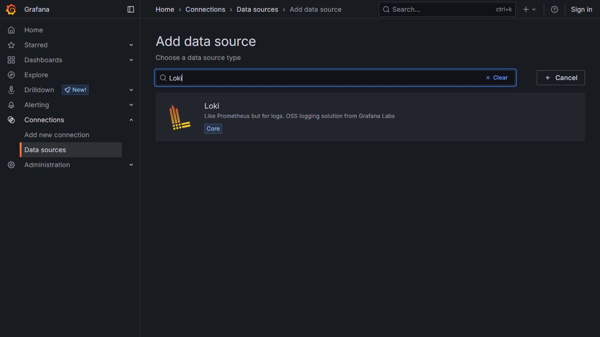
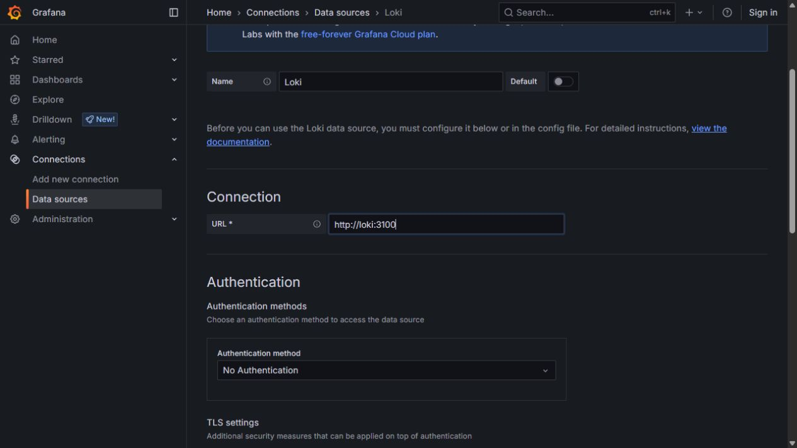
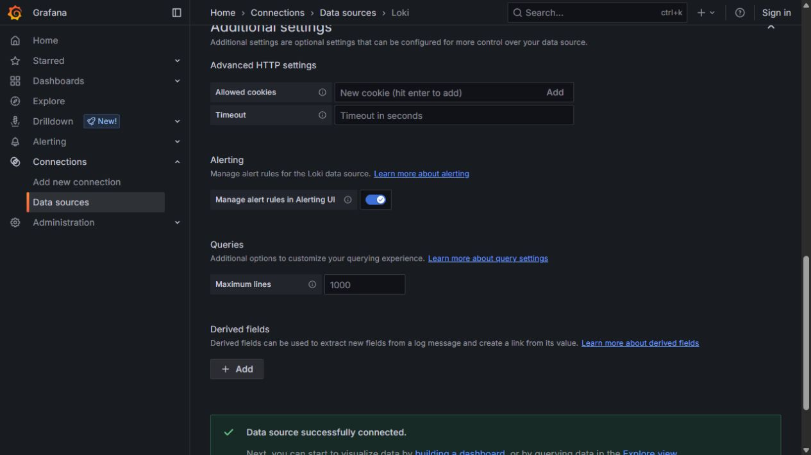
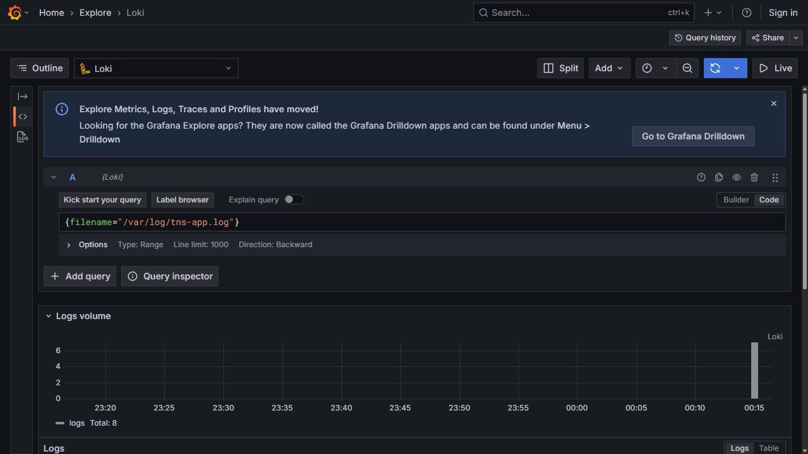
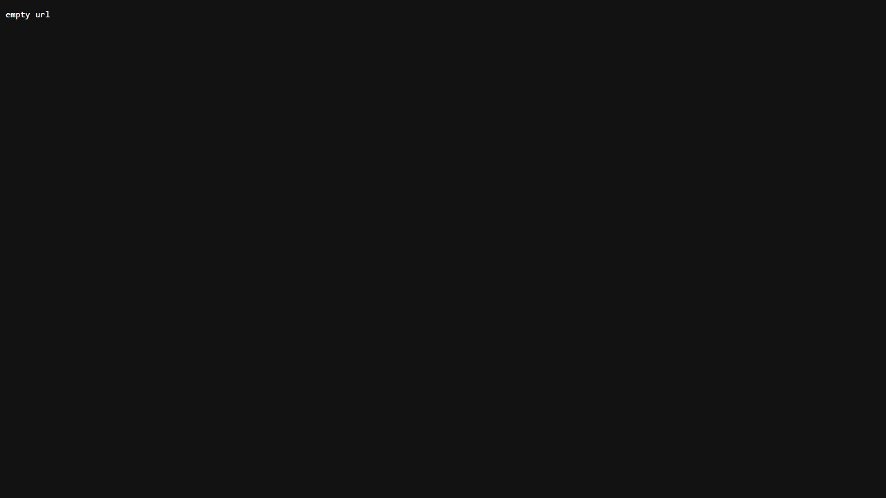
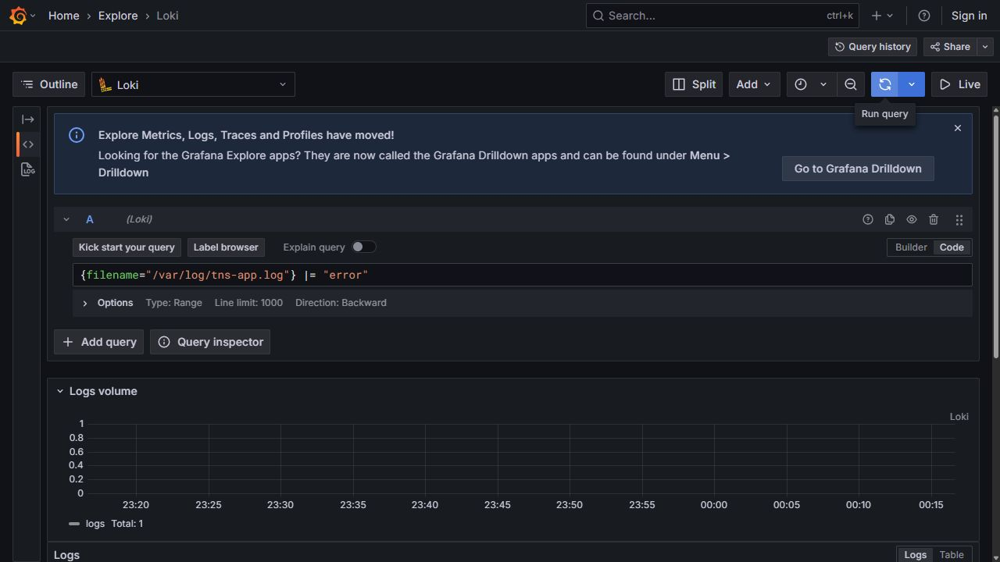
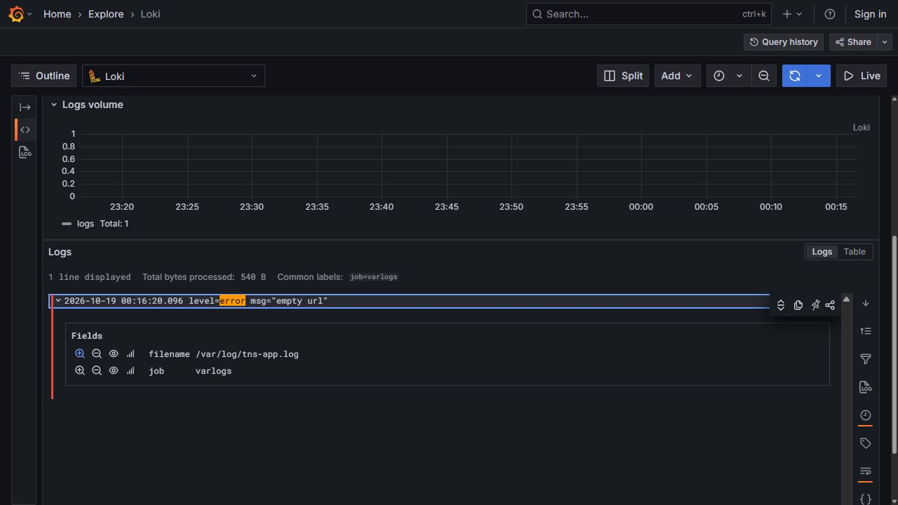

# Noite 3 — Logs e LogQL

Guia visual V8 • Prática 21h00–22h15 • Fábio Silva

Execute na ordem. As telas são do ambiente do aluno, Grafana 12.0.1.

## Exercício 3.1 — Etapa 1: Adicionar Loki sem criar duplicatas

1. Abra Connections > Data sources. Se Loki já existir, clique nela e siga para a configuração da próxima página.

2. Se ainda não existir, clique em Add new data source, no canto superior da lista.

3. Na caixa de busca, digite Loki. Na opção de mesmo nome, clique em Add new data source Loki.

4. Aguarde a página de configuração carregar. Não escolha Tempo ou Prometheus.

5. Não crie fontes loki-1, loki-2 a cada aula: reutilize a conexão correta.

**Resultado esperado:** A página de configuração de uma única fonte Loki está aberta.

**Se não funcionar:** Se a busca não apresentar Loki, limpe o termo e confira que está em Data sources, não na busca global do Grafana.



## Exercício 3.1 — Etapa 2: Configurar a URL interna do Loki

1. No campo Name, defina Loki, com esse nome simples para reconhecer a fonte nos próximos exercícios.

2. Na seção Connection, preencha URL = http://loki:3100.

3. Mantenha No Authentication no laboratório local. Não preencha certificados, tokens nem campos de senha.

4. Role até o final da página e clique em Save & test.

5. Aguarde a confirmação Data source successfully connected. Não prossiga enquanto aparecer erro de conexão.

**Resultado esperado:** A conexão foi salva apontando para o serviço Loki da rede Docker.

**Se não funcionar:** Não use http://localhost:33100 nessa caixa: esse é o endereço do navegador, enquanto a fonte é acessada pelo container Grafana.



## Exercício 3.1 — Etapa 3: Confirmar a conexão e entrar no Explore

1. Leia a mensagem Data source successfully connected.

2. Clique em Explore data na configuração da fonte, ou abra Explore pelo menu principal.

3. No seletor de fonte do Explore, confirme Loki. Selecione Code no editor A.

4. Use Last 15 minutes para começar. Se não aparecer seu primeiro evento, amplie para Last 1 hour.

5. Prepare a consulta do arquivo apresentada na próxima página.

**Resultado esperado:** Explore está usando Loki e não há erro de comunicação com a fonte.

**Se não funcionar:** A confirmação de conexão não cria logs. Se o container app ou promtail estiver parado, ainda poderá haver No data.



## Exercício 3.1 — Etapa 4: Consultar o arquivo inteiro

1. Cole a consulta abaixo no editor A e clique em Run query ou pressione Shift+Enter.

2. Aguarde o resultado. Você deve ver o volume de logs e uma lista de linhas da aplicação.

3. Se a lista estiver abaixo da área visível, role a página; você pode recolher Logs volume pelo título da seção.

4. Leia um horário e uma mensagem. filename identifica o arquivo; job identifica o fluxo de coleta.

5. Anote a quantidade de linhas exibida, sabendo que ela depende do período e do limite de resultados.

```

{filename="/var/log/tns-app.log"}

```

**Resultado esperado:** As linhas vêm de /var/log/tns-app.log e incluem eventos da aplicação.

**Se não funcionar:** Em No data: abra a aplicação, atualize-a, aguarde 10 a 20 segundos e execute novamente. Confira aspas, filename e período. Não use o seletor service do ambiente de e-commerce do professor neste laboratório.



## Exercício 3.2 — Etapa 5: Produzir o erro controlado

1. Na aba da aplicação, preencha Title com Teste sem URL - seguido do seu nome.

2. Deixe o campo URL completamente vazio. Esta falha é intencional e limitada à aplicação de exemplo.

3. Anote o horário e clique em Submit uma única vez.

4. A aplicação deve mostrar empty url. Faça uma captura da mensagem.

5. Use Voltar do navegador para retornar ao formulário. Não continue reenviando o POST ao recarregar a página de erro.

**Resultado esperado:** A aplicação respondeu empty url e você registrou o horário.

**Se não funcionar:** Se o link foi publicado, havia uma URL no campo. Volte ao formulário, limpe-a e repita uma vez. Esse erro de validação não exige reinstalar o lab.



## Exercício 3.2 — Etapa 6: Localizar somente as linhas de erro

1. Volte ao Explore com Loki. Substitua a consulta anterior pelo filtro abaixo.

2. Selecione Last 15 minutes e clique em Run query. Espere a coleta se a ação acabou de ocorrer.

3. Na lista Logs, procure a linha level=error msg="empty url".

4. Compare o horário do log com o horário da ação no navegador. O fuso de exibição pode ser o do navegador.

5. O operador |= procura texto e diferencia maiúsculas de minúsculas. Neste aplicativo o texto é error, em minúsculas.

```

{filename="/var/log/tns-app.log"} |= "error"

```

**Resultado esperado:** Você relaciona o erro provocado à linha de log correspondente.

**Se não funcionar:** Se não houver resultado, remova temporariamente |= "error". Se os logs voltarem, revise o texto do filtro e o período. Se Live estiver ativo, pare-o antes de abrir os detalhes.



## Exercício 3.2 / 3.3 — Etapa 7: Abrir o evento e descrever a investigação

1. Na linha do erro, clique na pequena seta ou no botão See log details, à esquerda da linha.

2. Leia a mensagem e os campos filename e job. Esses campos confirmam a origem do fluxo.

3. Compare a consulta sem filtro com a consulta contendo |= "error". A segunda deve mostrar um subconjunto da primeira no mesmo período.

4. Mude Last 15 minutes para Last 1 hour e observe se a quantidade de linhas aumenta. Depois volte ao período curto.

5. Entregue uma sequência reproduzível: ação feita, horário, fonte Loki, seletor, filtro e mensagem encontrada.

6. Escreva a conclusão: a aplicação rejeitou uma URL vazia e registrou o erro. Uma coincidência temporal isolada entre eventos diferentes não prova causa.

**Resultado esperado:** Sua evidência inclui o erro no navegador e a linha expandida nos logs.

**Se não funcionar:** As linhas logfmt deste exemplo não são JSON. Não acrescente | json automaticamente. A investigação de TraceID e Tempo pertence à demonstração complementar do professor.


