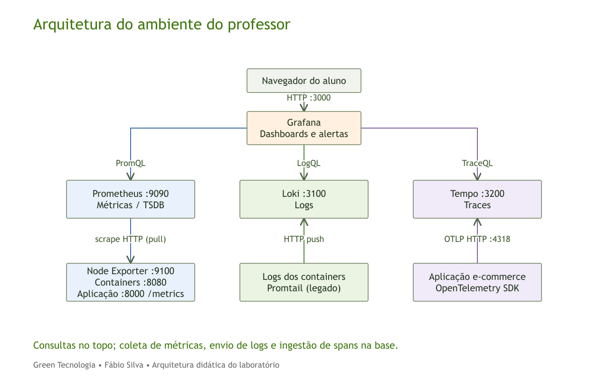
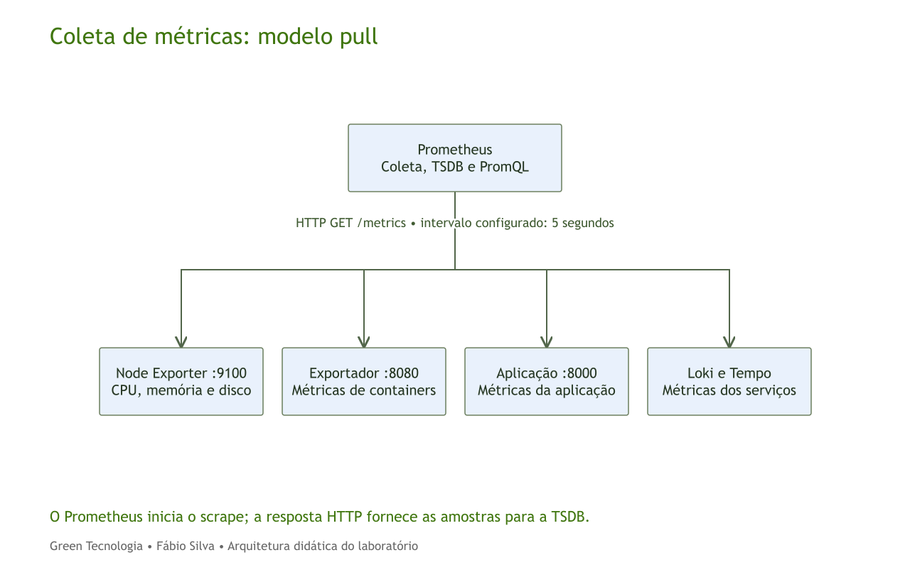
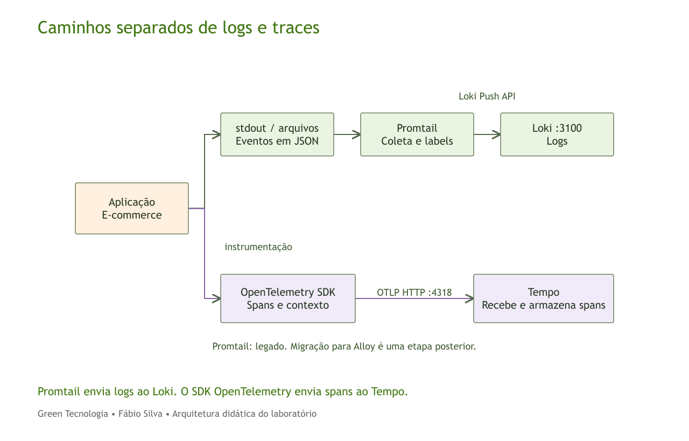
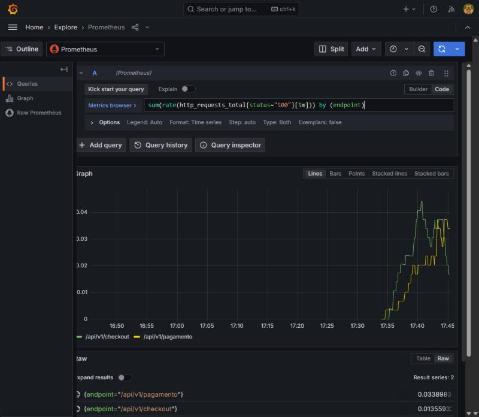
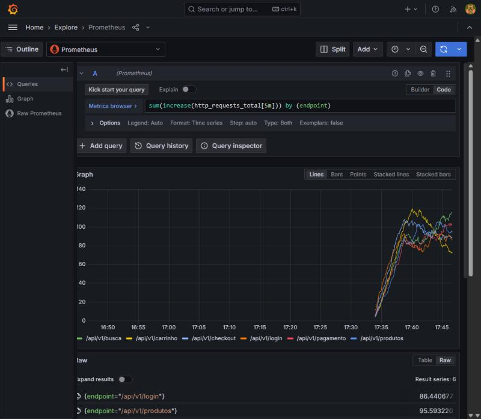
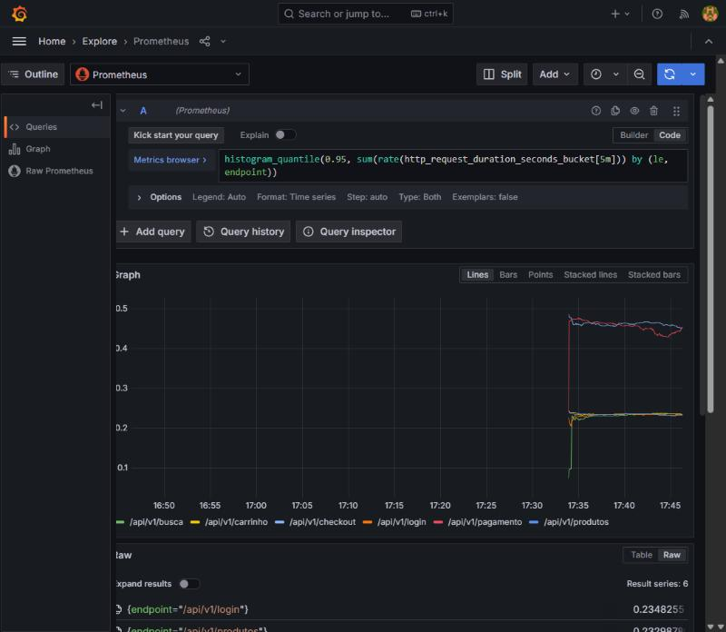
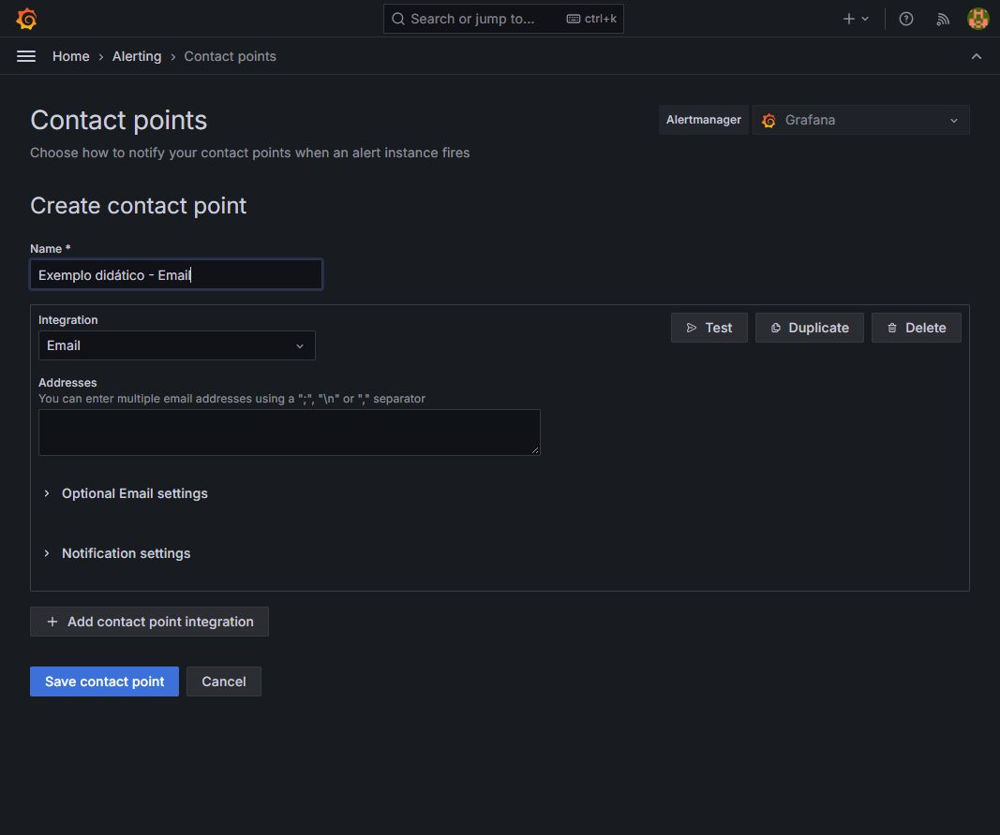

# Grafana Visualizando Dados

Green Tecnologia — Fábio Silva, Arquiteto de Soluções.

## Como usar esta apostila

Revisão V11: teoria de métricas ampliada e três desafios opcionais na Noite 2 (2.4 a 2.6). O guia ilustrado aparece depois da parte conceitual e também está em alunos/Guia_Visual_Exercicios_V11.html.

O curso tem cinco noites, das 18h30 às 22h30, com intervalo de 20h20 a 20h45. São 20 horas de programação, incluindo 2h05 de intervalos; tempo de atividades: 17h55.

### Noites 1, 3, 4 e 5

| Bloco | Horário | Duração |
|---|---|---|
| Teoria | 18h30–19h55 | 85 min |
| Demonstração | 19h55–20h20 | 25 min |
| Intervalo | 20h20–20h45 | 25 min |
| Exercícios comentados | 20h45–21h00 | 15 min |
| Prática do aluno | 21h00–22h15 | 75 min |
| Correção | 22h15–22h30 | 15 min |

### Noite 2 — Métricas e PromQL

| Bloco | Horário | Duração |
|---|---|---|
| Teoria de métricas | 18h30–20h20 | 110 min |
| Intervalo | 20h20–20h45 | 25 min |
| Exercício guiado: professor e alunos no Grafana | 20h45–21h20 | 35 min |
| Consolidação autônoma dos mesmos exercícios | 21h20–22h15 | 55 min |
| Correção | 22h15–22h30 | 15 min |

Na Noite 2, acompanhe a teoria e os exemplos de interpretação antes do intervalo. O ambiente Grafana será aberto para a execução conjunta às 20h45. Os 55 minutos seguintes servem para retomar os mesmos passos, comparar resultados e concluir as evidências. Não há demonstração separada de métricas antes do intervalo. Três desafios opcionais (2.4 a 2.6) ficam no fim da noite para quem concluir 2.1 a 2.3 antes do tempo.

As capturas deste material foram obtidas no laboratório local Grafana 12.0.1 em 19/10/2026. Elas ajudam a localizar os campos; não representam acesso atual à VM do professor. As quatro outras folhas de exercícios mantêm seu conteúdo anterior. Os modelos para importar são referências opcionais em pasta separada; a atividade continua sendo manual.

## Material e ambiente local

O professor poderá distribuir a versão da turma pelo GitHub ou pelo Google Drive. Os links finais serão informados antes da aula. Nesta entrega não foi criado repositório nem publicado arquivo no Drive.

No GitHub, clone o repositório informado pelo professor ou baixe seu ZIP. No Google Drive, baixe o ZIP completo e extraia antes de executar. Use uma única revisão do pacote para manter slides, folhas e laboratório consistentes.

O caminho Docker é o laboratório executável. O roteiro Ubuntu apresenta a segunda instalação, cujos scripts serão preparados e testados depois pelo professor em VM Azure.

### Iniciar Docker

Entre na pasta lab/tutorial-environment e execute:

```bash
docker ps
docker compose -p green-fundamentals up -d --build
docker compose -p green-fundamentals ps
```

No Windows, pode usar iniciar-lab.ps1; no Linux, bash iniciar-lab.sh. Docker e Compose precisam estar instalados e ativos. O primeiro download pode levar alguns minutos.

| Serviço | Navegador no ambiente local | Endereço entre containers |
|---|---|---|
| Grafana | http://localhost:3300 | http://grafana:3000 |
| Aplicação | http://localhost:38081 | http://app:80 |
| Prometheus | http://localhost:39090 | http://prometheus:9090 |
| Loki | http://localhost:33100 | http://loki:3100 |
| Receptor de notificações | http://localhost:38090 | http://webhook:8080/ |

O pacote usa portas diferentes do repositório original para evitar conflitos conhecidos no ambiente de preparação. Se clonar diretamente https://github.com/grafana/tutorial-environment, confira os endereços: Grafana 3000 e aplicação 8081 no snapshot usado pelo curso.

O Grafana Docker do exemplo usa acesso anônimo administrativo para a demonstração. Os serviços publicados no pacote ficam vinculados a 127.0.0.1. Não transfira essa configuração automaticamente para produção.

## Noite 1 — Fundamentos e arquitetura

Objetivo: compreender os sinais, o papel das ferramentas e os caminhos dos dados antes da prática.

### O que é observabilidade?

É a capacidade de investigar o estado interno de um sistema a partir dos sinais que ele produz.

A investigação começa com uma pergunta e usa evidências para testar explicações.

Uma investigação pode começar pela lentidão do checkout e avançar até a etapa responsável pelo atraso. A capacidade de fazer perguntas úteis depende de coleta, contexto e correlação, além da ferramenta de visualização.

### Monitoramento e investigação

Monitoramento acompanha condições conhecidas e avisa quando uma regra é atendida.

Observabilidade ajuda a investigar perguntas novas sobre o comportamento do sistema.

Um alerta de taxa de erros acompanha uma condição conhecida. Para descobrir em qual rota, versão ou serviço o problema se concentra, precisamos investigar os dados. Os dois usos se complementam.

### Métricas: medidas ao longo do tempo

Métricas são valores numéricos associados a instantes e dimensões.

Permitem acompanhar tendências e comparar grupos com consultas agregadas.

Toda leitura precisa de unidade, período e identificação do que foi medido. Uma taxa de 12 req/s e um total de 12 requisições descrevem quantidades diferentes. As labels separam as séries por dimensões como rota e instância.

### Logs: registros de eventos

Logs registram acontecimentos com horário e contexto.

Uma linha pode conter nível, serviço, mensagem, rota e identificador de trace.

Uma mensagem de erro é evidência registrada pela aplicação, mas pode não conter toda a causa do problema. Logs estruturados facilitam a extração de campos e a busca; volume e retenção também precisam ser planejados.

### Traces: caminho de uma requisição

Um trace reúne o trabalho associado a uma requisição.

Cada span representa uma etapa, com início, duração e atributos.

Spans podem se sobrepor quando o trabalho acontece em paralelo. Por isso, somar as durações de todos eles nem sempre produz a duração total do trace. Instrumentação e propagação do contexto precisam existir na aplicação.

### Métricas, logs e traces juntos

A métrica mostra a mudança.
O log acrescenta contexto.
O trace mostra as etapas.

A conclusão depende da combinação das evidências.

Um aumento de latência, um evento de timeout e um span demorado no pagamento sustentam uma hipótese de investigação. A proximidade de dois eventos no tempo, isoladamente, não prova uma relação de causa.

### O que é o Grafana?

É uma plataforma para consultar, explorar e visualizar dados de diferentes fontes.

Permite criar dashboards e regras de alerta sobre os dados conectados.

Neste laboratório, a telemetria fica nos backends Prometheus, Loki e Tempo. O Grafana guarda configurações e dashboards e consulta as fontes conectadas. Uma fonte de dados define como conectar; a consulta define o que selecionar; o painel define como apresentar.

### Grafana: vantagens e limites

Vantagens
Reúne fontes, visualizações e alertas em uma interface.

Limites
Depende da coleta, das fontes disponíveis e da qualidade das consultas.

A vantagem é reunir diferentes fontes em uma experiência de consulta e acompanhamento. A limitação é que um dashboard depende de coleta e consultas corretas. Recursos de autenticação e governança também variam entre edições e configurações.

### O que é o Prometheus?

É um sistema de monitoramento e alertas que coleta e armazena métricas em séries temporais.

Neste laboratório, consulta endpoints HTTP de métricas periodicamente.

No modelo pull do laboratório, o Prometheus inicia um pedido HTTP a cada endpoint de métricas. A resposta contém amostras que são armazenadas por nome de métrica e combinação de labels. O Grafana consulta essas séries por meio da API do Prometheus.

### Prometheus: vantagens e limites

Vantagens
Modelo por labels, PromQL e ecossistema de exporters.

Limites
Alta cardinalidade e retenção exigem planejamento. Não guarda logs nem traces.

Cada nova combinação de valores de labels cria uma série diferente. IDs de requisições ou usuários podem multiplicar esse número. A coleta periódica é apropriada para acompanhamento operacional, mas não substitui registros exatos de faturamento ou auditoria transacional.

### Counter, gauge e distribuições

Counter acumula ocorrências e pode reiniciar.
Gauge sobe e desce.

Histogram e summary descrevem distribuições de observações.

Um counter pode voltar a zero quando o processo reinicia. A função rate interpreta a evolução do contador e trata seus resets. Histogramas agrupam observações em buckets; summaries podem calcular quantis no cliente. Counter e gauge são o foco dos primeiros exercícios.

### O que é o Loki?

É um backend para armazenar e consultar logs.

Organiza fluxos por labels e usa LogQL para selecionar eventos e obter medidas derivadas.

O modelo de indexação do Loki se apoia em labels e metadados, enquanto o corpo dos logs é compactado em chunks. Uma aplicação ou um agente precisa enviar os eventos; instalar somente o Loki não cria a coleta dos arquivos.

### Loki: vantagens e limites

Vantagens
Integração com o Grafana e correlação por contexto.

Limites
Labels mal escolhidos e buscas amplas podem aumentar o custo das consultas.

Selecionar poucos fluxos e um período adequado reduz a quantidade de dados examinada. Labels de cardinalidade elevada podem fragmentar excessivamente os fluxos. Não existe uma economia percentual de armazenamento garantida para qualquer instalação.

### O que é o Tempo?

É um backend para armazenar e consultar traces distribuídos.

Recebe spans de aplicações instrumentadas e permite investigar a duração das etapas.

A porta 4318 recebe OTLP HTTP no ambiente do professor. A porta 3200 atende a API de consulta do Tempo. Receber spans e consultar traces são funções distintas. A aplicação de demonstração usa o SDK OpenTelemetry para enviar spans diretamente.

### Tempo: vantagens e limites

Vantagens
Expõe etapas e durações da requisição; permite navegar a partir do trace_id.

Limites
Depende de instrumentação, propagação de contexto e retenção.

A árvore de spans ajuda a localizar etapas demoradas. Sua completude depende da instrumentação, da propagação de contexto, da amostragem e da retenção. Um backend de traces instalado não produz automaticamente spans de todas as aplicações.

### PromQL: consulta de métricas

PromQL seleciona, filtra e combina séries temporais.

rate calcula uma taxa a partir de um contador; sum pode agregar as séries.

A janela [5m] fornece as amostras para rate. Já Last 1 hour controla o período exibido na tela. Agregar por route soma as séries de cada rota. Esses passos serão praticados com as métricas tns_ do Grafana News na Noite 2.

```promql
sum(rate(tns_request_duration_seconds_count[5m])) by (route)
```

### LogQL: consulta de logs

O seletor escolhe os fluxos.
Os filtros escolhem linhas.
Parsers extraem campos.

Também é possível calcular contagens e taxas a partir dos eventos.

No laboratório do professor, service identifica a aplicação. No Grafana News, os exercícios usam filename. O filtro |= seleciona texto nas linhas; o parser | json extrai campos de conteúdo JSON. Um envelope Docker pode exigir primeiro expor seu campo log.

```logql
{service="ecommerce-shop"} |= "ERROR"
```

### TraceQL: consulta de traces

TraceQL seleciona traces a partir de condições sobre spans, recursos e duração.

Um TraceID conhecido também permite abrir uma requisição específica.

Uma expressão como { resource.service.name = "ecommerce-shop" } seleciona traces com spans do serviço. Já um TraceID conhecido abre uma requisição específica. Nem todo intervalo terá traces que correspondam à condição escolhida.

```traceql
{ resource.service.name = "ecommerce-shop" }
```

### Promtail: papel no laboratório

Promtail acompanha arquivos e logs de containers, acrescenta labels e envia os eventos ao Loki por HTTP.

Ele aparece aqui por fazer parte do ambiente legado do curso.

Promtail lê logs continuamente, acrescenta labels e envia os eventos para a API HTTP do Loki. Ele não é o responsável pelo envio de spans ao Tempo neste ambiente. Uma linha de log com trace_id e um span são registros diferentes ligados pelo contexto.

### Promtail e a migração para Alloy

Promtail encerrou o suporte em 2 de março de 2026.

Para novas implantações, estude Grafana Alloy ou outro coletor mantido. O laboratório preserva o fluxo legado para comparação.

O suporte ao Promtail terminou em 02/03/2026. O curso mantém o fluxo legado para compreender o laboratório existente e apresenta a migração para Alloy como evolução. A migração exige conversão e validação da configuração; ela não foi executada na VM nesta entrega.

### Arquitetura do ambiente do professor



Grafana consulta Prometheus com PromQL, Loki com LogQL e Tempo com TraceQL. Prometheus inicia o scrape dos exporters. O coletor de logs envia ao Loki e a aplicação instrumentada envia spans ao Tempo.

### Coleta de métricas: modelo pull



As setas representam o pedido HTTP de coleta. As amostras retornam na resposta e ficam na TSDB. O intervalo de 5 segundos é a configuração do arquivo local do professor; ele deve ser escolhido conforme o ambiente.

### Caminhos separados de logs e traces



A aplicação gera eventos em stdout ou arquivos e também spans pelo SDK OpenTelemetry. Promtail coleta os eventos e envia ao Loki. Os spans seguem por OTLP HTTP até o Tempo, sem passar pelo Promtail.

### Tutorial do aluno e demonstração

O aluno usa Grafana News no ambiente local.

O professor também mostra host, containers e e-commerce na VM Azure. Os conceitos são os mesmos; as métricas e labels mudam.

Os coletores de host e containers e a aplicação de e-commerce não fazem parte do pacote básico Grafana News. Antes de executar uma consulta, confirme se está usando a fonte e o ambiente correspondentes.

### Preparação para a demonstração

Vamos observar a instalação Docker, a aplicação, as fontes e a navegação.

O roteiro Ubuntu explica a segunda instalação. Os scripts nativos serão validados antes da distribuição.

Docker e Compose precisam estar ativos. O professor demonstra antes do intervalo; os alunos recebem e executam as folhas a partir das 21h00. A instalação nativa de Grafana no Ubuntu é uma rota separada; ela não instala automaticamente toda a pilha de observabilidade.

### Referência em vídeo

https://www.youtube.com/watch?v=TQur9GJHIIQ

### Exercício 1.1 — Obter e iniciar o laboratório Docker

Tipo: Execução local. Tempo previsto: 25 minutos.

1. Baixe o pacote oficial da turma pelo GitHub ou Google Drive quando o professor disponibilizar o link.
2. Extraia ou clone a pasta completa e abra lab/tutorial-environment.
3. Confirme Docker ativo e inicie com o script de entrada ou Compose.
4. Abra a aplicação e o Grafana nos endereços locais do pacote.

**Entrega:** Ambiente local iniciado e dois endereços acessíveis.

**Seu registro:**

- Consulta, comando ou caminho usado: ____________________
- Resultado observado: ____________________
- Interpretação e dúvida: ____________________

### Exercício 1.2 — Gerar atividade conhecida

Tipo: Navegação no navegador. Tempo previsto: 25 minutos.

1. Na aplicação Grafana News, publique um link com título e URL válidos.
2. Vote no link e atualize a página.
3. Registre o horário e descreva as ações feitas.

**Entrega:** Link publicado, voto registrado e anotação do horário.

**Seu registro:**

- Consulta, comando ou caminho usado: ____________________
- Resultado observado: ____________________
- Interpretação e dúvida: ____________________

### Exercício 1.3 — Reconhecer os recursos do Grafana

Tipo: Navegação no Grafana. Tempo previsto: 25 minutos.

1. Localize Explore, Dashboards e Connections.
2. Abra a fonte Prometheus já existente.
3. Identifique a URL interna e teste a conexão quando disponível.
4. Escreva uma frase sobre o papel de cada recurso.

**Entrega:** Fonte identificada e explicação dos recursos de navegação.

**Seu registro:**

- Consulta, comando ou caminho usado: ____________________
- Resultado observado: ____________________
- Interpretação e dúvida: ____________________

## Noite 2 — Métricas: fundamentos e interpretação

Objetivo: escolher e interpretar medidas com unidade, população, dimensões e tempo; depois aplicar esses conceitos a contadores, taxas e agrupamentos no Grafana.

Na Noite 2, a teoria ocupa 18h30–20h20 (110 minutos), seguida do intervalo de 20h20–20h45. Às 20h45–21h20, professor e alunos executam juntos os três exercícios de métricas no Grafana. Às 21h20–22h15, retome os mesmos procedimentos no seu ambiente e conclua os registros sem acompanhar cada clique do professor. Correção: 22h15–22h30. A Noite 2 não possui um bloco separado de demonstração antes do intervalo.

### Noite 2 — Entender métricas

Métricas ajudam a responder perguntas sobre o comportamento de sistemas. Para interpretar um valor, identifique o que foi medido, a unidade, a população e o instante ou intervalo. A forma do gráfico só ganha significado depois dessas verificações. Ao longo desta noite, estudaremos estados atuais, contagens acumuladas, taxas e distribuições, sempre distinguindo uma observação de uma conclusão sobre sua causa.

A primeira parte da noite é dedicada a conceitos e casos didáticos, sem operação do Grafana. Depois do intervalo, todos executam juntos as consultas de Grafana News. Na sequência, cada aluno consolida os exercícios 2.1, 2.2 e 2.3. Os exemplos com números usados na teoria são inventados para ensino; não representam medições do ambiente da turma.

Referência: [Documentação oficial](https://opentelemetry.io/docs/concepts/signals/metrics/)

### Métrica: número com contexto

Uma medição interpretável combina grandeza, valor, unidade e contexto. Memória usada, duração de chamada e quantidade de requisições não podem ser comparadas como se fossem o mesmo objeto. O instante ou intervalo e as dimensões identificam a situação à qual o valor se refere.

Exemplo didático: um servidor utiliza 6 GiB. Em uma máquina de 8 GiB, isso corresponde a 75% da capacidade; em uma máquina de 64 GiB, a aproximadamente 9,4%. O mesmo absoluto leva a leituras diferentes. Também precisamos conferir se a definição inclui cache. Antes de comparar painéis, normalize unidades e confirme que ambos descrevem a mesma grandeza. Uma proporção de 0,05 pode representar 5%, mas 0,05 req/s representa frequência de eventos.

Referência: [Documentação oficial](https://opentelemetry.io/docs/specs/otel/metrics/data-model/) • [Documentação oficial](https://prometheus.io/docs/practices/naming/)

### Infraestrutura, aplicação e negócio

Métricas de infraestrutura descrevem recursos como memória, processador, disco e filas. Métricas de aplicação descrevem a atividade do serviço, por exemplo volume, duração e respostas com falha. Métricas de negócio acompanham resultados como compras concluídas e pagamentos aprovados. Nenhuma camada substitui automaticamente as demais.

Exemplo didático: uma loja recebe mil tentativas de compra e duzentas falham enquanto a CPU permanece em 30%. Isso mostra que baixa utilização não comprova bom atendimento. Uma dependência externa é uma hipótese, mas os números não comprovam a causa. Para investigar, precisamos correlacionar sinais e entender a definição de cada medição. Total de chamadas HTTP também não equivale a total de pessoas: uma mesma pessoa ou automação pode fazer muitas chamadas.

Referência: [Documentação oficial](https://prometheus.io/docs/practices/instrumentation/)

### Uma série temporal acompanha um contexto

Uma série temporal reúne observações de um mesmo contexto ao longo do tempo. Cada amostra tem um valor e um timestamp, que a posiciona na linha do tempo. No Prometheus, o nome da métrica e seu conjunto de labels identificam uma série. Se uma dimensão muda, podemos estar observando outra série.

Exemplo didático: o servidor A apresenta 6, 7 e 5 GiB em três instantes; o servidor B apresenta 3, 3 e 4 GiB nos mesmos instantes. Misturar todos os pontos em uma única linha, sem preservar a origem, produz uma história que nenhum servidor viveu. Leia a legenda e a seleção de ambiente antes de interpretar tendência, mudança ou comparação. Um ponto isolado descreve uma observação, não uma tendência.

Referência: [Documentação oficial](https://prometheus.io/docs/concepts/data_model/)

### Eventos não são amostras

Evento e amostra são conceitos distintos. Uma aplicação pode atualizar um contador em cada requisição, enquanto o coletor registra periodicamente o acumulado. A coleta não precisa produzir um ponto separado para cada evento. A agregação permite observar volume, mas não preserva automaticamente todos os detalhes individuais.

Exemplo didático sem reset: o contador vale 100 em uma coleta e 140 na seguinte. O aumento observado é 40, mas os dois pontos não revelam se as requisições chegaram em rajada ou distribuídas, nem quem as fez. Logs e traces podem ajudar a investigar eventos individuais. Coleta periódica de métricas também não é a mesma decisão técnica que amostragem de traces; os mecanismos operam sobre sinais e objetivos diferentes.

Referência: [Documentação oficial](https://opentelemetry.io/docs/specs/otel/metrics/data-model/)

### Coleta: frequência, tempo e lacunas

A frequência de coleta determina quando novas observações podem ser registradas. A atualização da interface determina quando a tela solicita resultados novamente. Atualizar o navegador mais rápido não cria medições que o backend ainda não coletou. Maior frequência pode revelar detalhes adicionais, mas também gera mais trabalho e armazenamento.

Exemplo didático: com coletas nos segundos 0, 5 e 10, uma fila pode subir para 50 itens no segundo 2 e retornar a 2 itens no segundo 4. As duas leituras nas bordas podem não mostrar o pico. Um contador de ocorrências durante esse intervalo preservaria outra informação, sem reconstruir automaticamente a curva da fila. Escolha a medição e a frequência em função da pergunta, da duração do fenômeno e do custo.

Referência: [Documentação oficial](https://prometheus.io/docs/prometheus/latest/configuration/configuration/) • [Documentação oficial](https://grafana.com/docs/grafana/latest/visualizations/dashboards/use-dashboards/)

### Do sistema observado até o painel

O caminho de uma métrica inclui produção, transporte, armazenamento, consulta e interpretação. A aplicação pode produzir medições por instrumentação. Um exporter pode expor dados de componentes que não apresentam diretamente o formato esperado pelo coletor. Em pull, o coletor busca informações; em push, um produtor envia informações a um receptor.

No laboratório, Prometheus coleta e armazena as séries e Grafana consulta essa fonte para apresentar resultados. Outros pipelines podem utilizar OpenTelemetry e envio por OTLP. A existência de um painel não cria instrumentação automaticamente. Pushgateway tem finalidades específicas, como determinados trabalhos curtos em lote, e não é uma substituição universal do scraping. Se um alvo não responde, investigue também rede e configuração antes de concluir que o componente caiu.

Referência: [Documentação oficial](https://prometheus.io/docs/introduction/overview/) • [Documentação oficial](https://prometheus.io/docs/instrumenting/exporters/) • [Documentação oficial](https://prometheus.io/docs/practices/pushing/)

### Gauge: um estado que pode subir e descer

No vocabulário Prometheus, gauge representa um valor que pode subir ou descer. Temperatura, memória atual, conexões simultâneas e tamanho de fila são exemplos de estados. O valor precisa ser interpretado com sua unidade, capacidade e momento de leitura. Uma queda pode ser normal ou exigir investigação, conforme o contexto.

Exemplo didático: uma fila apresenta 12, depois 30 e depois 8 itens. A redução de 22 itens no saldo não comprova que exatamente 22 foram processados: novos itens podem ter entrado enquanto outros saíam. Para conhecer entradas e saídas separadamente, precisamos de medições próprias. Não aplique automaticamente rate de contador a memória ou temperatura. Essa função considera uma semântica de acumulado monotônico e pode interpretar quedas como resets.

Referência: [Documentação oficial](https://prometheus.io/docs/concepts/metric_types/)

### Counter: acumulado de eventos

Um counter Prometheus representa uma contagem cumulativa que cresce entre resets. Um reinício pode fazer o valor recomeçar. É apropriado para total de requisições atendidas, tarefas concluídas ou erros ocorridos. O acumulado não informa, sozinho, a atividade atual: um processo antigo pode ter total grande e pouco tráfego agora.

Exemplo didático: as leituras são 100, 120 e 150. Sem reset, os aumentos observados são 20 e 30. Para obter taxa, falta conhecer o tempo. Somar 100 + 120 + 150 contaria várias vezes eventos já incluídos nos acumulados. O sufixo total costuma comunicar contagem, e count pode aparecer em componentes de distribuições; consulte sempre a definição. O count de uma duração representa quantidade de observações, não segundos.

Referência: [Documentação oficial](https://prometheus.io/docs/concepts/metric_types/) • [Documentação oficial](https://prometheus.io/docs/practices/naming/)

### O conceito é geral; os modelos variam

Os conceitos de medição existem em diversas plataformas, mas os modelos têm regras próprias. Gauge e Counter, nesta prática, seguem o vocabulário Prometheus. OpenTelemetry distingue instrumentos, incluindo Counter, UpDownCounter, Gauge e Histogram, e permite agregações com temporalidade delta ou cumulativa. Esses nomes não devem ser interpretados apenas por semelhança.

Exemplo didático: um produtor informa 10 no primeiro intervalo e 20 no segundo. Se são deltas, os intervalos somam 30 eventos. Se são acumulados do mesmo contador sem reset, o aumento entre as leituras é 10. A escolha da operação depende da semântica. No laboratório desta noite, trabalharemos com contagens cumulativas no padrão Prometheus; não será necessário configurar um pipeline OpenTelemetry.

Referência: [Documentação oficial](https://opentelemetry.io/docs/concepts/signals/metrics/) • [Documentação oficial](https://opentelemetry.io/docs/specs/otel/metrics/data-model/)

### Histograma: a distribuição importa

Uma distribuição mostra como muitas observações se espalham. Um histograma organiza frequências por faixas e permite examinar a cauda de valores maiores. No formato clássico Prometheus, os buckets são cumulativos: somá-los como se fossem faixas independentes duplicaria observações. Histograms nativos têm outra representação, preservando o objetivo de descrever a distribuição.

Exemplo didático: 90 chamadas duram 0,1 s e 10 duram 2 s. As durações somam 29 s e a média é 0,29 s. Nenhuma chamada desse exemplo durou exatamente a média, e dez chamadas tiveram experiência bem mais lenta. A média responde uma pergunta útil, mas não descreve sozinha o espalhamento. Os limites das faixas e a forma de cálculo influenciam a precisão das estimativas.

Referência: [Documentação oficial](https://prometheus.io/docs/practices/histograms/) • [Documentação oficial](https://prometheus.io/docs/concepts/metric_types/)

### p95 não é média nem máximo

Média, percentil e máximo descrevem aspectos diferentes. A média divide a soma das observações por sua quantidade. O p95 é o valor até o qual ficam aproximadamente 95% das observações, conforme o método de cálculo. O máximo corresponde à maior observação. Em conjuntos pequenos e estimativas, convenções e aproximações importam.

Exemplo didático: p95 próximo de 0,8 s não significa que a média seja 0,8 s, que todas as chamadas demoraram esse tempo ou que nenhuma foi mais lenta. No Prometheus, histogramas permitem estimar quantis a partir das distribuições, enquanto summaries podem expor quantis calculados na origem. Não calcule o p95 global fazendo a média dos p95 de servidores: esses resumos não preservam a distribuição necessária. Compare populações e janelas compatíveis.

Referência: [Documentação oficial](https://prometheus.io/docs/practices/histograms/)

### Labels: recortar a pergunta

Dimensões permitem recortar a pergunta. No Prometheus, labels podem distinguir serviço, ambiente, rota ou status HTTP. Filtrar seleciona as séries que participam; agrupar reorganiza o resultado, preservando determinadas dimensões. Alterar o agrupamento não altera automaticamente a unidade.

Exemplo didático: eventos estão separados em voto com status 200, voto com status 400, página inicial com 200 e página inicial com 302. Podemos somar por operação ou por código usando a mesma população. Uma taxa agrupada por rota continua em requisições por segundo se for agrupada por status. O código HTTP descreve a resposta; não é uma severidade de log. Prefira rotas lógicas, como uma operação de consulta, a URLs completas com identificadores que crescem sem controle.

Referência: [Documentação oficial](https://prometheus.io/docs/concepts/data_model/) • [Documentação oficial](https://prometheus.io/docs/prometheus/latest/querying/operators/)

### Cardinalidade: quantas séries surgem?

Cardinalidade se relaciona à quantidade de combinações distintas de dimensões. Uma label útil permite perguntas operacionais, mas seus valores precisam de controle. Mais séries podem aumentar o custo de coleta, armazenamento e consulta. Não existe um único limite universal adequado a qualquer ambiente.

Exemplo didático: 3 serviços, 4 rotas e 5 status permitem até 60 combinações básicas. Nem todas precisam existir. Instâncias, ambientes e componentes de histograma podem multiplicar a quantidade. Acrescentar identificadores individuais, como e-mail, request_id ou URL completa com código de usuário, pode provocar crescimento contínuo. Para investigar uma chamada específica, logs e traces podem ser mais apropriados, com seus próprios cuidados. Escolha dimensões pela pergunta que respondem e pelo custo de mantê-las.

Referência: [Documentação oficial](https://prometheus.io/docs/practices/naming/) • [Documentação oficial](https://prometheus.io/docs/practices/instrumentation/)

### Taxa: quanto acontece por unidade de tempo

Taxa relaciona ocorrência e tempo. Para contadores Prometheus, rate calcula uma taxa média por segundo a partir das amostras de uma janela. A implementação também considera resets e extrapolação nas bordas. Uma divisão simples ajuda a aprender a unidade, mas não substitui todos os detalhes do cálculo real.

Exemplo didático simplificado: 120 requisições em 60 segundos correspondem a 2 req/s em média. Elas podem ter chegado de forma regular ou em rajadas. Outro exemplo, 3 requisições em um minuto, equivale a 0,05 req/s. Isso não representa uma fração de requisição executada, e sim frequência média de eventos discretos. A janela [5m] não muda a unidade para requisições por cinco minutos: o resultado de rate continua por segundo.

Referência: [Documentação oficial](https://prometheus.io/docs/prometheus/latest/querying/functions/)

### increase e o cuidado com resets

increase estima o aumento de um counter durante a janela; rate apresenta a taxa média por segundo. Para a mesma série e janela, essas leituras se relacionam pela duração do intervalo. Os ajustes do backend podem produzir estimativas fracionárias. Métricas de monitoramento não substituem necessariamente o registro transacional exigido para faturamento ou contabilidade exata.

Exemplo didático: 0,4 req/s por 300 s corresponde aproximadamente a 120 requisições. Em outro desenho, um contador aparece em 90, 100, 5 e 15; uma queda pode indicar reset. Subtrair apenas a primeira da última leitura produziria interpretação errada. Ao combinar instâncias, calcule a taxa por série antes de agregar, para que resets individuais possam ser identificados. Uma queda de counter não significa eventos negativos.

Referência: [Documentação oficial](https://prometheus.io/docs/prometheus/latest/querying/functions/)

### Agregar no espaço e no tempo

Agregar entre séries e agregar ao longo do tempo respondem perguntas diferentes. Em PromQL, sum combina séries no ponto de avaliação; funções de janela podem resumir observações de uma série no tempo. Ao agregar por rota, o resultado conserva esse recorte e combina outras dimensões conforme a expressão.

Exemplo didático: duas APIs com populações distintas recebem 2 req/s e 3 req/s no mesmo instante. O total é 5 req/s. Uma fila com leituras 2, 10 e 3 itens tem média amostral de 5 itens nesse conjunto; isso não significa 5 itens por segundo nem 15 itens processados. Antes de somar, confirme compatibilidade de definição e ausência de duplicação. Duas fontes que representam os mesmos eventos podem produzir total duplicado.

Referência: [Documentação oficial](https://prometheus.io/docs/prometheus/latest/querying/operators/) • [Documentação oficial](https://prometheus.io/docs/prometheus/latest/querying/functions/)

### A média das porcentagens pode enganar

Uma razão global deve respeitar o peso das populações. Somar numeradores e denominadores compatíveis costuma responder à população total. A média simples de porcentagens só é adequada em situações específicas; não representa automaticamente o resultado geral de grupos com volumes distintos. Um total saudável também pode esconder um grupo com problema.

Exemplo didático: no mesmo intervalo, A tem 1 erro em 10 chamadas, ou 10%; B tem 0 em 990, ou 0%. O total é 1 erro em 1.000 chamadas, ou 0,1%, e não a média simples de 5%. A continua com 10% no próprio recorte. Não misture períodos ou definições diferentes. Se não houve chamadas, a razão requer tratamento explícito; ausência de denominador não comprova zero por cento de erro.

Referência: [Documentação oficial](https://prometheus.io/docs/prometheus/latest/querying/operators/) • [Documentação oficial](https://prometheus.io/docs/practices/instrumentation/)

### Quatro perguntas sobre saúde

Um conjunto inicial de perguntas ajuda a organizar o monitoramento. Tráfego descreve demanda; latência descreve tempo de atendimento; erros descrevem falhas; saturação indica trabalho esperando ou pressão sobre a capacidade. RED organiza taxa, erros e duração de serviços. USE organiza utilização, saturação e erros de recursos. Eles são guias de investigação, não uma lista universal de painéis obrigatórios.

Exemplo didático: 50 req/s, 2% de erros, p95 de 0,5 s e 20 tarefas em espera criam uma visão inicial. Se a fila cresce para 200 tarefas, surge uma pista, ainda sem causa comprovada. CPU elevada não comprova sozinha impacto no usuário, e CPU baixa não garante bom atendimento. Defina o que falha e o que espera em cada componente.

Referência: [Documentação oficial](https://prometheus.io/docs/practices/instrumentation/) • [Documentação oficial](https://grafana.com/blog/the-red-method-how-to-instrument-your-services/) • [Documentação oficial](https://grafana.com/docs/grafana/latest/visualizations/dashboards/build-dashboards/best-practices/)

### Zero, ausência e dado antigo

Zero e ausência são evidências diferentes. Uma série com resultado zero pode indicar que não houve novos eventos na janela. No data informa que a consulta não retornou séries para aquela seleção. Uma observação antiga também pode não representar o momento atual. A forma como o backend trata atualidade precisa ser considerada.

Exemplo didático: um laboratório iniciado às 21h não possui necessariamente dados das 20h. Uma rota nunca utilizada pode ainda não ter criado determinada combinação de labels. Em outro caso, a coleta pode ter falhado. Antes de concluir que o serviço está saudável, confira fonte, expressão, filtro, período, aplicação e coleta. Preencher toda ausência com zero pode esconder perda de observação; isso exige uma regra de significado explícita.

Referência: [Documentação oficial](https://prometheus.io/docs/prometheus/latest/querying/basics/) • [Documentação oficial](https://prometheus.io/docs/prometheus/latest/querying/functions/)

### Período exibido não é janela de cálculo

Período visível, janela de cálculo e atualização têm papéis diferentes. Last 15 minutes escolhe o trecho de história mostrado. A expressão rate com [5m] utiliza uma janela de cinco minutos em cada ponto avaliado. A atualização controla quando a interface solicita resultados novamente. Nenhuma dessas opções deve ser confundida com a frequência original de coleta.

Imagine uma régua de quinze minutos e uma janela móvel de cinco minutos deslizando sobre ela. Cada ponto da taxa usa sua janela correspondente. Se o seletor passar a Last 5 minutes, a expressão com janela fixa [5m] permanece igual, a menos que seja editada. Por isso dois gráficos de períodos diferentes podem compartilhar a mesma janela de taxa e manter a mesma unidade por segundo.

Referência: [Documentação oficial](https://prometheus.io/docs/prometheus/latest/querying/basics/) • [Documentação oficial](https://grafana.com/docs/grafana/latest/visualizations/dashboards/use-dashboards/)

### Resolução: o gráfico também faz escolhas

A resolução depende do espaçamento dos resultados consultados ou apresentados e das opções do painel e da fonte. Um período longo pode ser mostrado com menos detalhe visual. Isso não permite concluir que a atividade foi constante. Também não permite recuperar observações que nunca foram coletadas. Frequência de coleta, janela e passo de consulta são escolhas distintas.

Exemplo didático: um pico de dez segundos fica mais fácil de perceber numa visão de cinco minutos do que num dia inteiro comprimido. Uma janela menor que o intervalo entre coletas pode não ter amostras suficientes para calcular taxa. Grafana oferece variáveis como $__rate_interval para ajudar em consultas usuais; nesta noite, [5m] fica explícito para facilitar o aprendizado. Diminuir janelas indefinidamente não garante maior precisão.

Referência: [Documentação oficial](https://grafana.com/docs/grafana/latest/datasources/prometheus/query-editor/) • [Documentação oficial](https://grafana.com/docs/grafana/latest/visualizations/panels-visualizations/query-transform-data/)

### Baseline e limites precisam de contexto

Baseline é uma referência de comportamento observado. Compare horários, populações e condições semelhantes, mas lembre que o histórico pode incluir problemas. Um comportamento repetido não é automaticamente desejável. Capacidade, demanda e experiência do usuário ajudam a interpretar o que mudou. Correlação entre curvas é uma pista, não prova de causalidade.

Exemplo didático: 100 req/s podem ser usuais durante o expediente e incomuns às 3h. Uma campanha, um robô ou uma falha são hipóteses que exigem outras evidências. Limites precisam de definição e contexto; o valor usado para facilitar um exercício não deve ser copiado como política de produção. Os alertas serão aprofundados na Noite 5; aqui importa distinguir observação, referência e decisão.

Referência: [Documentação oficial](https://prometheus.io/docs/practices/instrumentation/) • [Documentação oficial](https://grafana.com/docs/grafana/latest/visualizations/panels-visualizations/query-transform-data/)

### Seis verificações antes de concluir

Antes de interpretar uma curva, formule a pergunta, confirme definição e unidade, identifique séries e dimensões, confira período e janela, classifique o resultado e avalie o limite da evidência. Uma resposta válida pode ser que falta outra medição. Essa disciplina também ajuda a comunicar resultados por capturas.

Exemplo didático: 0,05 na taxa da rota de votação significa 0,05 requisição por segundo em média na janela escolhida. Isso equivale aproximadamente a uma a cada vinte segundos, sem afirmar regularidade. Não informa usuários únicos. Se o mesmo número representar uma proporção de erro, pode significar 5%, conforme a definição. Ao enviar um print, inclua contexto de fonte, consulta, unidade e período para que outra pessoa consiga compreender a conclusão.

Referência: [Documentação oficial](https://prometheus.io/docs/practices/naming/) • [Documentação oficial](https://grafana.com/docs/grafana/latest/visualizations/panels-visualizations/query-transform-data/)

### Caso em sala: interprete antes do clique

Resolva o caso sem usar uma ferramenta. No mesmo intervalo, A tem 1 erro em 10 chamadas e B tem 0 em 990. Um counter passa de 100 para 160 em 60 segundos sem reset. Uma terceira consulta não retorna séries. Calcule a razão de erros global e a taxa média simplificada; depois explique o que a ausência permite concluir.

Gabarito: a razão global é 1/1.000 = 0,1%, mantendo A com 10% no próprio recorte. O aumento de 60 em 60 segundos corresponde a 1 req/s na conta simplificada. No data não comprova zero erros. A implementação real de rate considera mais detalhes do que essa conta de dois pontos. Em todas as respostas, registre unidade, população e limite da conclusão.

Referência: [Documentação oficial](https://prometheus.io/docs/prometheus/latest/querying/operators/) • [Documentação oficial](https://prometheus.io/docs/prometheus/latest/querying/functions/)

### Síntese antes do intervalo

O bloco teórico termina às 20h20. Após o intervalo de 25 minutos, o exercício guiado começa às 20h45. As quatro perguntas de retomada são: o que o número mede, em qual unidade, para quais séries e em qual intervalo? Elas valem para infraestrutura, aplicações e negócio, independentemente da ferramenta escolhida.

Na execução guiada, a turma abrirá Explore, lerá o contador de Grafana News, calculará taxa e agrupará por rota e por status. Cada pessoa executa os passos no ambiente orientado. No pacote local, os endereços são localhost:3300 para Grafana e localhost:38081 para a aplicação; o professor pode orientar outros endereços. Depois da condução conjunta, os exercícios continuam com criação manual. Arquivos importáveis são apoio opcional.

Referência: [Documentação oficial](https://grafana.com/tutorials/grafana-fundamentals/)

### Execução dos mesmos três exercícios

20h45–20h55: exercício 2.1, seleção da fonte e interpretação do contador; 20h55–21h08: exercício 2.2, período e taxa por rota; 21h08–21h14: exercício 2.3, agrupamento por status HTTP; 21h14–21h20: conferência conjunta dos mesmos resultados e passagem à consolidação.

21h20–21h35: retome 2.1 e finalize a interpretação do contador e dos labels; 21h35–21h55: retome 2.2, gere tráfego e registre rota, unidade e valor; 21h55–22h15: retome 2.3, compare as duas consultas e finalize as capturas e a explicação da janela. São os mesmos três exercícios, sem atividade obrigatória adicional.

### Exercício 2.1 — Explorar a métrica da aplicação

Tipo: Consulta no navegador, durante o bloco guiado e a consolidação autônoma.

1. Abra Explore e selecione Prometheus.
2. Execute a métrica bruta.
3. Identifique dois labels disponíveis e registre o significado do valor.

Consulta a utilizar:

```
tns_request_duration_seconds_count
```

**Entrega:** Consulta executada e interpretação da contagem.

**Seu registro:**

- Consulta, comando ou caminho usado: ____________________
- Resultado observado: ____________________
- Interpretação e dúvida: ____________________

### Exercício 2.2 — Consultar a taxa por rota

Tipo: Consulta no navegador, durante o bloco guiado e a consolidação autônoma.

1. Execute a consulta de taxa por rota.
2. Gere atividade na aplicação e aguarde a coleta.
3. Escolha Last 5 minutes e compare as séries.
4. Registre a unidade e a rota identificada.

Consulta a utilizar:

```
sum(rate(tns_request_duration_seconds_count[5m])) by (route)
```

**Entrega:** Taxa interpretada com unidade e agrupamento.

**Seu registro:**

- Consulta, comando ou caminho usado: ____________________
- Resultado observado: ____________________
- Interpretação e dúvida: ____________________

### Exercício 2.3 — Comparar agrupamentos

Tipo: Consulta e navegação, durante o bloco guiado e a consolidação autônoma.

1. Troque o agrupamento por status_code.
2. Compare o resultado com o agrupamento por rota.
3. Mude o período mostrado e descreva o efeito.
4. Entregue uma frase explicando cada consulta.

Consulta a utilizar:

```
sum(rate(tns_request_duration_seconds_count[5m])) by (status_code)
```

**Entrega:** Duas consultas comparadas e uma conclusão sustentada.

**Seu registro:**

- Consulta, comando ou caminho usado: ____________________
- Resultado observado: ____________________
- Interpretação e dúvida: ____________________

### Desafios opcionais 2.4 a 2.6

Os três desafios abaixo aprofundam filtro por label, rate contra increase e latência por percentil. As capturas vêm do ambiente do professor (loja virtual); no seu laboratório use as consultas tns_. A entrega não substitui os registros de 2.1 a 2.3.

### Desafio 2.4 — Filtrar por label: tirar o scrape

Tipo: Consulta no navegador. Opcional, depois de concluir 2.1 a 2.3.

1. Execute a taxa por rota sem a rota metrics.
2. Compare com o exercício 2.2 e identifique a série que desapareceu.
3. Troque o filtro por {status_code="200"} e observe as rotas restantes.
4. Registre a pergunta de cada consulta e a unidade.

Consulta a utilizar:

```
sum(rate(tns_request_duration_seconds_count{route!="metrics"}[5m])) by (route)
```



**Entrega:** Duas consultas comparadas com a explicação do filtro.

**Seu registro:**

- Consulta, comando ou caminho usado: ____________________
- Resultado observado: ____________________
- Interpretação e dúvida: ____________________

### Desafio 2.5 — Taxa ou total: rate e increase

Tipo: Consulta no navegador. Opcional, depois de concluir 2.1 a 2.3.

1. Execute increase e leia o total de requisições em 5 minutos.
2. Execute rate (exercício 2.2) para a mesma rota.
3. Multiplique a taxa por 300 e compare com o total.
4. Explique por que os valores são próximos, mas não idênticos.

Consulta a utilizar:

```
sum(increase(tns_request_duration_seconds_count[5m])) by (route)
```



**Entrega:** Total e taxa comparados, com explicação da extrapolação.

**Seu registro:**

- Consulta, comando ou caminho usado: ____________________
- Resultado observado: ____________________
- Interpretação e dúvida: ____________________

### Desafio 2.6 — Latência: percentil 95 com histograma

Tipo: Consulta no navegador. Opcional, depois de concluir 2.1 a 2.3.

1. Execute a consulta de p95 e leia o resultado em segundos.
2. Identifique a rota com p95 mais alto.
3. Calcule a média de duração por rota: sum(rate(tns_request_duration_seconds_sum[5m])) by (route) / sum(rate(tns_request_duration_seconds_count[5m])) by (route).
4. Explique em uma frase o que significa 95% das requisições.

Consulta a utilizar:

```
histogram_quantile(0.95, sum(rate(tns_request_duration_seconds_bucket[5m])) by (le, route))
```



**Entrega:** p95 e média comparados, com a interpretação da cauda lenta.

**Seu registro:**

- Consulta, comando ou caminho usado: ____________________
- Resultado observado: ____________________
- Interpretação e dúvida: ____________________

## Noite 3 — Exploração de logs

Objetivo: Conectar o Loki e localizar um erro provocado na aplicação.

### Fundamentos para acompanhar a teoria

### Métricas e eventos

Uma métrica ajuda a perceber uma mudança.

Um log pode trazer o contexto do evento que ocorreu naquele instante.

### Estrutura de um evento de log

Um evento tem horário e conteúdo.

A mensagem e os campos disponíveis ajudam a relacionar o registro ao que a aplicação executou.

### Labels e conteúdo no Loki

Os labels selecionam os fluxos de logs.

Os filtros de linha restringem o conteúdo retornado.

### Leitura do seletor LogQL

As chaves delimitam o seletor.

O label filename identifica o arquivo usado neste ambiente de demonstração.

### Filtro por texto

O operador |= mantém as linhas que contêm o texto indicado.

A seleção do fluxo continua valendo.

### Leitura de uma linha

Observe o horário e o conteúdo do evento.

Expanda uma linha para inspecionar os campos disponíveis e relacioná-los à ação no navegador.

### Erro, evento e diagnóstico

Um erro conhecido ajuda a validar o caminho de observação.

O registro encontrado precisa corresponder à ação e ao período investigados.

### A janela da investigação

Use o horário do evento para reduzir o período.

Compare os logs próximos ao erro com as ações executadas na aplicação.

### Live e histórico

Live acompanha os novos eventos.

Para analisar uma linha com calma, pare o acompanhamento e use uma consulta histórica.

### Volume de logs e detalhes

A contagem por período mostra a concentração de eventos.

A linha expandida fornece o conteúdo necessário para investigar um evento específico.

### Evidência e hipótese

A evidência descreve o que foi observado.

A hipótese propõe uma explicação que ainda precisa ser verificada.

### Roteiro de investigação

Defina a pergunta, selecione a fonte e delimite o período.

Leia os eventos e registre a conclusão com a consulta usada.

### Exercício 3.1 — Conectar e explorar Loki

Tipo: Configuração no navegador. Tempo previsto: 25 minutos.

1. Adicione a fonte Loki se ela ainda não existir no seu ambiente.
2. Use a URL interna http://loki:3100 no laboratório local.
3. Teste a conexão e execute o seletor do arquivo.

Consulta a utilizar:

```
{filename="/var/log/tns-app.log"}
```

**Entrega:** Fonte conectada e linhas da aplicação visíveis.

**Seu registro:**

- Consulta, comando ou caminho usado: ____________________
- Resultado observado: ____________________
- Interpretação e dúvida: ____________________

### Exercício 3.2 — Gerar e localizar um erro

Tipo: Navegação e consulta. Tempo previsto: 25 minutos.

1. Envie um título sem URL na aplicação.
2. Anote o horário da ação.
3. No Explore, filtre as linhas de erro.
4. Abra o evento correspondente e registre a mensagem.

Consulta a utilizar:

```
{filename="/var/log/tns-app.log"} |= "error"
```

**Entrega:** Consulta, horário e mensagem relacionados à ação.

**Seu registro:**

- Consulta, comando ou caminho usado: ____________________
- Resultado observado: ____________________
- Interpretação e dúvida: ____________________

### Exercício 3.3 — Explicar a investigação

Tipo: Navegação e interpretação. Tempo previsto: 25 minutos.

1. Compare a consulta do arquivo com a consulta filtrada.
2. Ajuste o período e observe a mudança no resultado.
3. Explique o que é evidência e o que seria uma hipótese.
4. Entregue os passos para um colega reproduzir a busca.

**Entrega:** Roteiro de investigação com conclusão e evidência.

**Seu registro:**

- Consulta, comando ou caminho usado: ____________________
- Resultado observado: ____________________
- Interpretação e dúvida: ____________________

## Noite 4 — Dashboards e anotações

Objetivo: Construir um dashboard que relacione tráfego e erros.

### Fundamentos para acompanhar a teoria

### Uma pergunta por painel

Defina a pergunta antes de escolher o gráfico.

Nosso painel vai mostrar a taxa de requisições por rota.

### Dashboard e painel

Um dashboard reúne painéis relacionados.

Cada painel combina uma consulta e uma forma de apresentar seu resultado.

### Consulta e apresentação

A consulta determina os dados retornados.

A visualização deve representar esses dados sem alterar seu significado.

### Escolha da visualização

Time series ajuda a observar a evolução no tempo.

Stat destaca um valor resumido. Table permite comparar campos e valores em linhas.

### Título e unidade

Um título útil informa o que se mede.

Configure a unidade e use a legenda para identificar as rotas.

### Eixos, legenda e período

O eixo temporal situa a observação.

A unidade dá significado ao valor, e a legenda identifica as séries.

### Agregação e redução visual

Uma consulta pode retornar uma série temporal.

Uma visualização de valor único precisa escolher como resumir essa série.

### Salvamento e organização

Salve o painel e o dashboard com nomes reconhecíveis.

Ajuste o tamanho para ler a legenda e comparar as séries.

### Evento pontual e intervalo

Uma anotação pontual marca um instante.

Uma anotação de região representa um evento com início e fim.

### Anotações manuais e por consulta

O registro manual descreve um evento informado pelo usuário.

Uma consulta ao Loki pode trazer eventos recorrentes como anotações no gráfico.

### Correlação e causalidade

Eventos próximos no tempo podem orientar a investigação.

A proximidade, sozinha, não demonstra que um evento causou o outro.

### Dashboard compreensível

Confira o que outra pessoa consegue entender sem a sua explicação.

Títulos, unidades e descrições devem permitir uma leitura consistente.

### Revisão antes da demonstração

Um dashboard útil tem pergunta, consulta e apresentação coerentes.

As anotações acrescentam contexto para interpretar o período observado.

### Exercício 4.1 — Criar e salvar um dashboard

Tipo: Configuração no navegador. Tempo previsto: 30 minutos.

1. Crie um dashboard da aplicação.
2. Adicione uma visualização Prometheus com a consulta por rota.
3. Configure Time series, título Tráfego por rota, unidade e legenda.
4. Salve com seu nome ou identificação da turma e reabra para conferir.

Consulta a utilizar:

```
sum(rate(tns_request_duration_seconds_count[5m])) by (route)
```

**Entrega:** Dashboard salvo, legível e com consulta coerente.

**Seu registro:**

- Consulta, comando ou caminho usado: ____________________
- Resultado observado: ____________________
- Interpretação e dúvida: ____________________

### Exercício 4.2 — Registrar um evento manual

Tipo: Navegação e configuração. Tempo previsto: 20 minutos.

1. Execute uma ação conhecida na aplicação.
2. Adicione uma anotação manual com descrição e horário.
3. Se representar um teste com duração, use uma região.
4. Salve o dashboard.

**Entrega:** Anotação que descreve uma ação realmente executada.

**Seu registro:**

- Consulta, comando ou caminho usado: ____________________
- Resultado observado: ____________________
- Interpretação e dúvida: ____________________

### Exercício 4.3 — Exibir erros como anotações

Tipo: Consulta e configuração. Tempo previsto: 25 minutos.

1. Em Settings e Annotations, adicione uma consulta chamada Erros da aplicação.
2. Selecione Loki e use o filtro de erro.
3. Ative a consulta, salve e provoque outro erro na aplicação.
4. Localize a anotação e explique a relação temporal com o gráfico.

Consulta a utilizar:

```
{filename="/var/log/tns-app.log"} |= "error"
```

**Entrega:** Consulta de anotações ativa e evento encontrado.

**Seu registro:**

- Consulta, comando ou caminho usado: ____________________
- Resultado observado: ____________________
- Interpretação e dúvida: ____________________

## Noite 5 — Alertas e projeto final

Objetivo: Disparar um alerta e apresentar o dashboard final.

### Fundamentos para acompanhar a teoria

### O que dispara um alerta

Uma regra avalia dados e verifica uma condição.

Um ponto de contato define para onde enviar a notificação.

### Regra, instância e mensagem

A regra define o cálculo e a condição.

A avaliação pode criar instâncias de alerta. A notificação comunica o estado ao contato configurado.

### Consulta da regra

Use Prometheus e a consulta de tráfego por rota.

Confira o resultado antes de definir o limite.

### A, B e C

A consulta produz os dados.

A redução gera o valor avaliado por série. A condição compara esse valor com o limite.

### Escolha de um limite

O limite precisa fazer sentido para a unidade e para o comportamento observado.

Nesta revisão, o exercício local usa 0,01 req/s como limite didático e exclui route="metrics". Esse valor facilita a demonstração com tráfego manual e não é recomendação de produção.

### Avaliação e espera

O intervalo define a frequência de avaliação.

O período pendente define por quanto tempo a condição precisa permanecer verdadeira.

### Estados do alerta

Normal: condição não atendida.

Pending: condição atendida, aguardando o período definido.

Firing: condição atendida após a espera.

### Sem dados e falha de avaliação

No Data indica ausência de dados utilizáveis.

Error indica uma falha ou timeout na avaliação. O comportamento desses casos precisa ser configurado.

### Contato e entrega

O ponto de contato define a integração usada para notificar.

Uma mensagem de teste verifica a comunicação antes de testar o disparo real.

### Duas opções de webhook

O tutorial usa uma URL exclusiva do Webhook.site.

O pacote local inclui um receptor com a mesma finalidade de teste.

### Alerta e painel relacionado

O vínculo informa qual dashboard e painel ajudam na investigação.

O estado do alerta e suas anotações acrescentam contexto visual.

### Referência em vídeo

[How to Display Grafana Alerts to Your Dashboards](https://www.youtube.com/watch?v=ClLp-iSoaSY). Use um trecho na aula conforme a orientação do professor; a referência completa serve ao estudo posterior.

### Diagnóstico de alertas

Sem dados: confira consulta e fonte.

Não dispara: confira valor e condição.

Sem mensagem: confira contato e acesso ao receptor.

### Síntese do ciclo completo

Precisamos confirmar dado, condição, estado e entrega.

O projeto final demonstra o caminho e explica as evidências usadas.

### E-mail e integração com APIs externas

### E-mail: servidor e destinatário

O servidor SMTP permite ao Grafana enviar mensagens.

O ponto de contato Email define quem recebe. São configurações diferentes.

### SMTP: exemplo de configuração

Exemplo ilustrativo no arquivo grafana.ini.

Os valores devem corresponder ao servidor de e-mail disponível. O exemplo não foi aplicado à VM.

```ini
[smtp]
enabled = true
host = smtp.exemplo.invalid:587
from_address = grafana@exemplo.invalid
startTLS_policy = MandatoryStartTLS
```

No Ubuntu, o arquivo costuma ficar em /etc/grafana/grafana.ini. Em Docker, as variáveis GF_SMTP_* ficam no serviço Grafana. SMTP e destinatários não foram configurados nesta VM; são exemplos de localização dos campos.

### Webhook: alerta para uma API externa

O Grafana envia uma requisição HTTP com detalhes do alerta ao endpoint receptor.

O software receptor pode abrir um chamado ou iniciar outro fluxo.

O receptor precisa aceitar a mensagem enviada e sua autenticação. Se o software de chamados exigir outro formato, um adaptador pode transformar a notificação. Uma resposta HTTP 2xx indica aceitação HTTP; confirme o resultado também no software de destino.

### Webhook e API do Grafana

Webhook envia notificações para outro software.

A API do Grafana permite consultar e administrar regras e contatos, conforme permissões e versão.

Exemplos de leitura da API de provisionamento da versão do laboratório: GET /api/v1/provisioning/alert-rules e GET /api/v1/provisioning/contact-points. Exigem autenticação e permissões adequadas. Esses exemplos não foram executados.

### Arquitetura das notificações


O fluxo Grafana-managed utiliza os contatos do Grafana. As regras do Prometheus podem usar o Alertmanager externo em outro caminho. A fonte Alertmanager no Grafana não configura automaticamente o envio de e-mails.

### O que uma integração precisa validar

Confira o evento recebido, o estado, a identificação do alerta e o destino.

Teste também a resolução e evite criar chamados duplicados para a mesma ocorrência.

### Localização dos campos na interface



Alerting > Contact points > Add contact point > Email > Addresses. O formulário foi apenas demonstrado, sem salvar destinatários ou enviar mensagens.


Selecione Webhook, informe a URL do receptor e confira as opções de método e autenticação. O domínio exemplo.invalid é ilustrativo e não deve ser usado como serviço real.

### Exercício 5.1 — Validar o ponto de contato

Tipo: Configuração no navegador. Tempo previsto: 20 minutos.

1. Use o receptor local do pacote: http://localhost:38090 no navegador e http://webhook:8080/ no contato do Grafana.
2. Crie um ponto de contato Webhook no Grafana.
3. Envie uma mensagem de teste e confirme a chegada.
4. Salve o contato.

**Entrega:** Contato salvo e notificação de teste recebida.

**Seu registro:**

- Consulta, comando ou caminho usado: ____________________
- Resultado observado: ____________________
- Interpretação e dúvida: ____________________

### Exercício 5.2 — Criar e disparar a regra

Tipo: Consulta e configuração. Tempo previsto: 30 minutos.

1. Crie uma regra Grafana-managed com identificação do aluno.
2. Use a consulta por rota em A, Reduce / Last em B e Threshold acima de 0.01 em C. Exclua a rota metrics na consulta de A.
3. Use avaliação de 10s, pendente de 0s e o contato testado.
4. Salve, gere tráfego e observe o valor e o estado.
5. Confirme uma notificação da regra no receptor.

Consulta a utilizar:

```
sum(rate(tns_request_duration_seconds_count{route!="metrics"}[5m])) by (route)
```

**Entrega:** Regra avaliada e mensagem de disparo recebida.

**Seu registro:**

- Consulta, comando ou caminho usado: ____________________
- Resultado observado: ____________________
- Interpretação e dúvida: ____________________

### Exercício 5.3 — Vincular e apresentar o projeto

Tipo: Navegação e apresentação. Tempo previsto: 25 minutos.

1. Associe a regra ao seu dashboard e ao painel de tráfego.
2. Mostre a consulta, um erro nos logs e as anotações configuradas.
3. Apresente a evidência de recebimento do alerta.
4. Exporte ou registre seu trabalho antes de encerrar o ambiente.

**Entrega:** Dashboard e regra relacionados, com explicação do fluxo.

**Seu registro:**

- Consulta, comando ou caminho usado: ____________________
- Resultado observado: ____________________
- Interpretação e dúvida: ____________________

## Complemento de instalação Ubuntu


## Objetivo e situação deste roteiro

A segunda instalação apresenta o Grafana como serviço do Ubuntu. A referência mais recente consultada é Ubuntu 26.10. Ubuntu 26.04.1 LTS é a alternativa de suporte prolongado. O procedimento completo de automação será criado depois e testado por Fábio em uma VM Azure antes da distribuição. Nesta entrega não há scripts de instalação nativa aprovados.

Os comandos abaixo são exemplos comentados do fluxo documentado de instalação do Grafana OSS. Eles não representam um teste executado na VM Azure. O teste do professor deve registrar versão, arquitetura, comandos, resultados e ajustes. A versão de Grafana a fixar nos scripts será definida nessa validação.

## Duas instalações e componentes separados

Docker executa o ambiente do tutorial, com Grafana, Prometheus, Loki e a aplicação. A instalação nativa abaixo instala apenas o Grafana. Ela não instala automaticamente as fontes e a aplicação.

Para comparar os dois Grafanas usando os mesmos dados, uma opção de laboratório é manter a stack de apoio Docker na mesma VM Ubuntu: Grafana Docker em 3300, Grafana nativo em 3000, Prometheus publicado em 39090 e Loki em 33100. No Grafana nativo, as fontes usam http://127.0.0.1:39090 e http://127.0.0.1:33100. Os nomes prometheus:9090 e loki:3100 servem à rede dos containers, não ao processo nativo do host. Esse arranjo também precisa ser validado pelo professor. Uma stack inteiramente nativa exigiria scripts adicionais e não está entregue nesta revisão.

## 1 Conferir o sistema

```bash
cat /etc/os-release
uname -m
```

Registre a versão e a arquitetura. A imagem escolhida na VM Azure deve corresponder ao alvo do roteiro que será liberado aos alunos.

## 2 Preparar APT e adicionar o repositório oficial

```bash
sudo apt-get update
sudo apt-get install -y apt-transport-https wget gnupg
sudo mkdir -p /etc/apt/keyrings
sudo wget -O /etc/apt/keyrings/grafana.asc https://apt.grafana.com/gpg-full.key
sudo chmod 644 /etc/apt/keyrings/grafana.asc
echo "deb [signed-by=/etc/apt/keyrings/grafana.asc] https://apt.grafana.com stable main" | sudo tee /etc/apt/sources.list.d/grafana.list
sudo apt-get update
```

O repositório define a origem dos pacotes e a chave permite verificar sua assinatura. O exemplo usa a linha estável. Não misture esse procedimento com a instalação por pacote avulso na mesma máquina de teste.

## 3 Instalar e iniciar o serviço

```bash
sudo apt-get install grafana
sudo systemctl daemon-reload
sudo systemctl enable --now grafana-server
systemctl status grafana-server --no-pager
```

O pacote é grafana e o serviço é grafana-server. O parâmetro enable configura inicialização com o sistema, enquanto --now também inicia o serviço imediatamente.

## 4 Validar localmente

```bash
wget -qO- http://127.0.0.1:3000/api/health
journalctl -u grafana-server -n 50 --no-pager
```

Na instalação nativa padrão, o primeiro acesso solicita autenticação. O login inicial padrão admin/admin deve ser alterado quando solicitado. Essa experiência é diferente do acesso anônimo do ambiente Docker do tutorial. Se o navegador estiver em outro computador, use o IP da VM e o acesso de rede definido pelo professor; localhost do notebook não acessa o servidor remoto.

## Registro do teste Azure a preencher pelo professor

| Item | Resultado |
|---|---|
| Data do teste | A preencher |
| Imagem Ubuntu e versão | A preencher |
| Arquitetura | A preencher |
| Versão Grafana instalada | A preencher |
| Serviço ativo e reinício validado | A preencher |
| API health e acesso no navegador | A preencher |
| Fontes de dados conectadas | A preencher |
| Resultado após reiniciar a VM | A preencher |
| Ajustes necessários | A preencher |
| Liberação dos scripts para a turma | Pendente |

Referências: https://ubuntu.com/download/desktop e https://grafana.com/docs/grafana/latest/setup-grafana/installation/debian/ .


## Preservar o trabalho entre as noites

O pacote não adiciona volume persistente para a base interna do Grafana. Para manter o container com suas configurações entre encontros, use stop e start. Antes de down, exporte os dashboards. Não use down -v como rotina, pois também remove os volumes.

```bash
docker compose -p green-fundamentals stop
docker compose -p green-fundamentals start
```

## Exercício opcional de alerta de erros

Para quem concluir o fluxo principal: consultar sum(rate(tns_request_duration_seconds_count{status_code=~"4..|5.."}[5m])), verificar que há dados após provocar URL vazia e criar uma condição maior que zero. Este complemento não substitui o projeto principal.

## Referências

- https://grafana.com/tutorials/grafana-fundamentals/
- https://github.com/grafana/tutorial-environment
- https://prometheus.io/docs/concepts/metric_types/
- https://prometheus.io/docs/prometheus/latest/querying/basics/
- https://grafana.com/docs/loki/latest/query/log_queries/
- https://grafana.com/docs/grafana/latest/visualizations/panels-visualizations/
- https://grafana.com/docs/grafana/latest/alerting/fundamentals/alert-rule-evaluation/
- https://ubuntu.com/download/desktop
- https://grafana.com/docs/grafana/latest/setup-grafana/installation/debian/


## Referências dos fundamentos e integrações

https://grafana.com/tutorials/grafana-fundamentals/

https://prometheus.io/docs/introduction/overview/

https://prometheus.io/docs/concepts/metric_types/

https://grafana.com/docs/loki/latest/get-started/overview/

https://grafana.com/docs/loki/latest/query/

https://grafana.com/docs/tempo/latest/traceql/

https://grafana.com/docs/loki/latest/send-data/promtail/

https://grafana.com/docs/alloy/latest/set-up/migrate/from-promtail/

https://grafana.com/docs/grafana/latest/alerting/configure-notifications/manage-contact-points/integrations/configure-email/

https://grafana.com/docs/grafana/latest/alerting/configure-notifications/manage-contact-points/integrations/webhook-notifier/

https://grafana.com/docs/grafana/v11.3/developers/http_api/alerting_provisioning/

## Continuação: guia ilustrado dos exercícios

As páginas seguintes detalham as atividades das cinco noites. Na Noite 2, elas serão iniciadas junto com o professor depois do intervalo e retomadas no período de consolidação autônoma. O arquivo Complemento_Visual_V7.pdf permanece separado como referência histórica opcional, sem integrar o cronograma atual de métricas.
