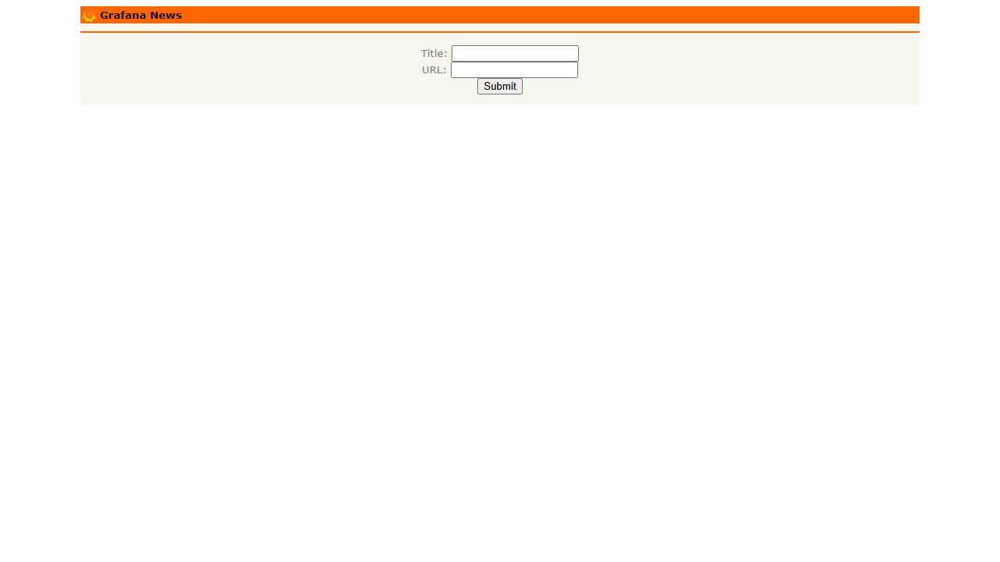
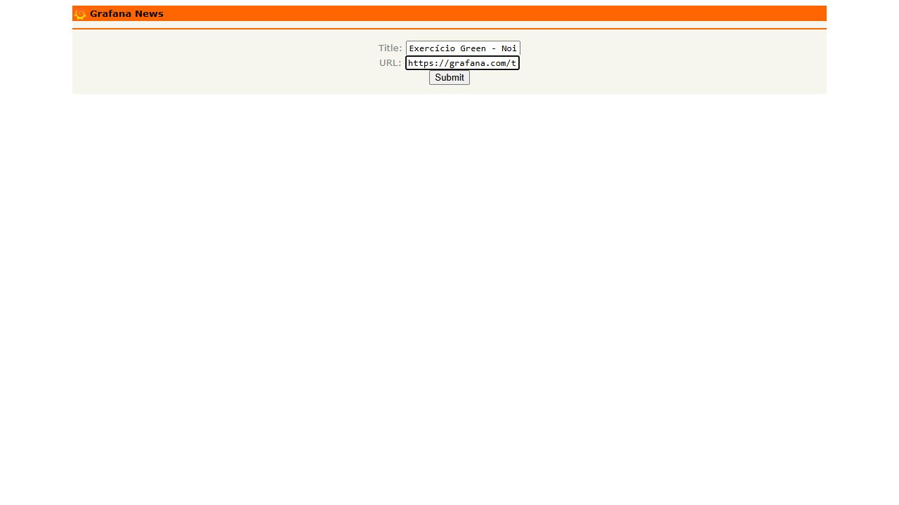
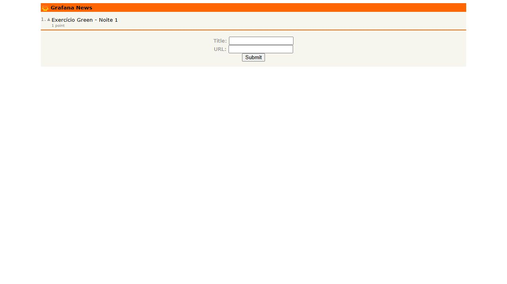
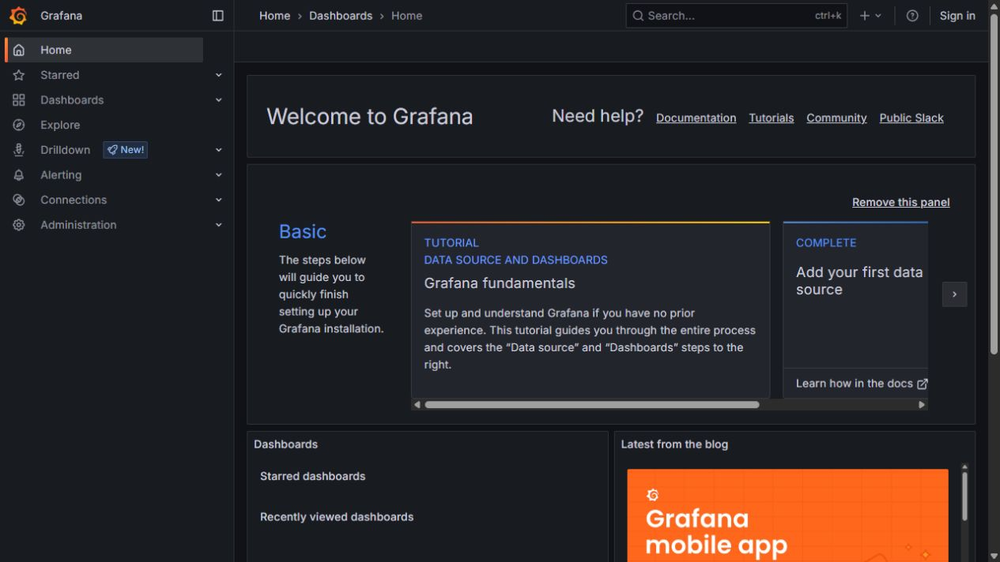
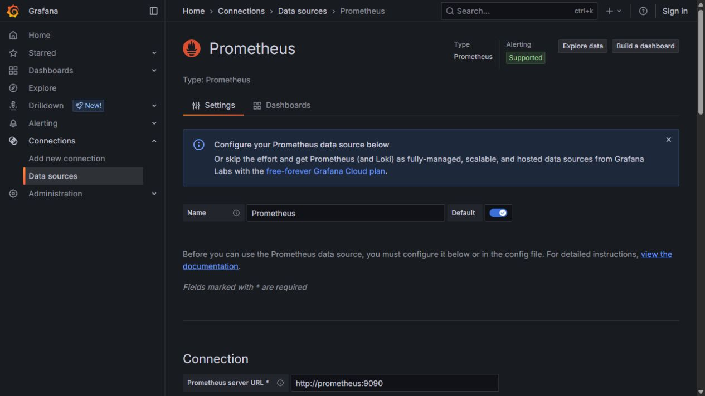
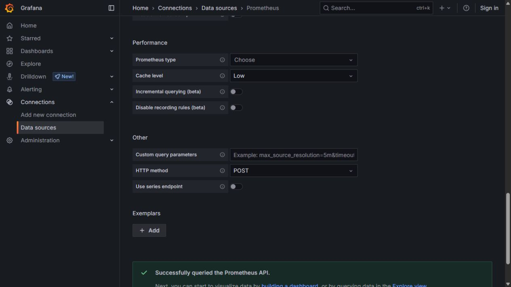

# Noite 1 — Preparação e primeiros passos

Guia visual V8 • Prática 21h00–22h15 • Fábio Silva

Execute na ordem. As telas são do ambiente do aluno, Grafana 12.0.1.

## Exercício 1.1 — Etapa 1: Preparar a pasta e iniciar o laboratório

1. Baixe o ZIP completo da turma e use Extrair tudo. Guarde em uma pasta simples, por exemplo C:/CursoGrafana. Não execute arquivos dentro do ZIP.

2. Abra a pasta que contém iniciar-lab.ps1, iniciar-lab.sh, lab e alunos. Abra o Docker Desktop e aguarde o mecanismo ficar em execução.

3. No Windows, clique com o botão direito dentro dessa pasta e escolha Abrir no Terminal. No PowerShell, execute o comando mostrado abaixo. A pasta atual deve ser a raiz extraída do pacote.

4. Aguarde o término do download e da construção da aplicação. O primeiro início pode levar vários minutos. Só prossiga se o script terminar sem erro e mostrar os três endereços.

5. No Ubuntu com Docker e Compose já instalados, use bash ./iniciar-lab.sh na mesma pasta. Esta é a rota Docker; os scripts de instalação nativa no Ubuntu continuam sendo uma etapa posterior do curso.

6. Mantenha os serviços em execução durante as cinco noites. Os passos seguintes são feitos no navegador, em três abas: Grafana, aplicação e receptor de notificações.

```

# Windows / PowerShell, na raiz extraída do pacote
powershell -NoProfile -ExecutionPolicy Bypass -File .\iniciar-lab.ps1

# Ubuntu com Docker e Compose já instalados
bash ./iniciar-lab.sh

```

**Resultado esperado:** O script mostra Grafana em localhost:3300, aplicação em localhost:38081 e receptor em localhost:38090.

**Se não funcionar:** Se docker não for reconhecido, reabra o terminal após instalar o Docker Desktop. Se houver erro de conexão com o daemon, abra o Docker Desktop. Se uma porta estiver ocupada, não encerre outros projetos: consulte a seção de diagnóstico deste guia.

## Exercício 1.1 — Etapa 2: Abrir a aplicação e o Grafana

1. Abra http://localhost:38081 em uma aba. Você deve ver Grafana News e os campos Title e URL.

2. Abra uma segunda aba e digite http://localhost:3300. O laboratório Docker do pacote usa acesso anônimo; não é necessário digitar usuário ou senha.

3. Abra uma terceira aba em http://localhost:38090. Ela exibirá o receptor local de mensagens, usado na Noite 5.

4. Adicione os três endereços aos favoritos e mantenha as abas abertas. Não use os endereços da VM do professor nos exercícios locais.

5. Anote a data, o horário e o fuso do seu computador. Eles ajudam a localizar suas ações nos gráficos e logs.

**Resultado esperado:** Aplicação, Grafana e receptor abrem no navegador.

**Se não funcionar:** Uma lista vazia no Grafana News é normal. Página de login no Grafana pode indicar outra instalação: confira a porta 3300. localhost refere-se ao computador onde o navegador está aberto.



## Exercício 1.2 — Etapa 3: Preencher o link a publicar

1. Volte à aba Grafana News. Em Title, digite Exercício Green - Noite 1 - seguido do seu nome.

2. Em URL, digite https://grafana.com/tutorials/grafana-fundamentals/. Inclua https://.

3. Confira os dois campos antes de continuar. Faça uma captura da tela preenchida, se desejar registrar o antes.

4. Clique uma vez em Submit. Aguarde a resposta; os campos ficam vazios e seu título aparece na lista.

**Resultado esperado:** O link publicado aparece abaixo do título Grafana News.

**Se não funcionar:** Se aparecer empty url, o campo URL estava vazio. Use Voltar do navegador, preencha-o e envie novamente. Evite clicar várias vezes em Submit.



## Exercício 1.2 — Etapa 4: Votar e gerar atividade conhecida

1. Na linha do seu link, clique no pequeno triângulo à esquerda do título. Não clique no próprio título: ele abre o site publicado.

2. Confira a contagem abaixo do link. Ela deve passar de 0 points para 1 point; o valor pode ser diferente se você já votou antes.

3. Atualize a página pelo botão Recarregar do navegador. Repita a atualização algumas vezes para produzir requisições GET.

4. Registre o horário de publicação e do voto. Na Noite 2 você verá métricas; na Noite 3 verá os registros dessa aplicação.

**Resultado esperado:** O título permanece na lista e a contagem de votos aumenta.

**Se não funcionar:** Se outra página abrir, volte à aplicação e use o triângulo. Um número diferente do print não é falha: compare a mudança após sua ação.



## Exercício 1.3 — Etapa 5: Reconhecer a navegação do Grafana

1. Volte à aba http://localhost:3300. Clique no ícone do Grafana, no canto superior esquerdo, se o menu estiver fechado.

2. Localize Explore: é onde você executará consultas temporárias sem precisar salvar um painel.

3. Localize Dashboards: reúne painéis salvos para acompanhar os dados.

4. Localize Connections. Expanda pela seta e clique em Data sources para ver as fontes conectadas.

5. Se o menu aparecer como uma janela sobre a página, escolha o destino e feche-o depois para ganhar espaço. Em telas menores, botões extras podem estar em Show more items.

**Resultado esperado:** Você consegue encontrar Explore, Dashboards e Connections > Data sources.

**Se não funcionar:** A tela inicial e os avisos de novidades podem variar. Neste guia, use os nomes dos botões, não apenas a posição no print.



## Exercício 1.3 — Etapa 6: Abrir Prometheus e conferir sua URL

1. Em Connections > Data sources, localize a fonte Prometheus. Ela já vem criada no pacote; não adicione outra.

2. Clique no nome Prometheus. Na aba Settings, confirme Name = Prometheus.

3. Na seção Connection, confira Prometheus server URL = http://prometheus:9090.

4. Deixe a URL interna como está. O Grafana faz essa conexão dentro da rede Docker; localhost:39090 é o endereço externo do Prometheus para o navegador.

5. Role até o fim da página e clique em Save & test. Aguarde a mensagem de confirmação.

**Resultado esperado:** A configuração usa http://prometheus:9090 e a fonte está marcada como padrão.

**Se não funcionar:** Se não existir Prometheus, confira se iniciou o pacote completo e a porta correta do Grafana. Não substitua a URL por localhost:9090: no container, localhost aponta para o próprio Grafana.



## Exercício 1.3 — Etapa 7: Validar a fonte e registrar a entrega

1. Leia a mensagem Successfully queried the Prometheus API. Ela confirma a comunicação do Grafana com a API da fonte.

2. Faça uma captura com a confirmação e registre a URL interna da fonte.

3. Escreva uma frase sobre cada recurso: Explore consulta; Dashboard apresenta painéis salvos; Data source configura a conexão.

4. Entregue as evidências da noite: aplicação acessível, link com voto e teste da fonte.

5. Mantenha o ambiente iniciado para continuar na Noite 2. Não remova containers nem volumes.

**Resultado esperado:** Você tem três evidências e sabe explicar o papel dos recursos.

**Se não funcionar:** Save & test bem-sucedido não garante que qualquer métrica exista. A consulta à aplicação será validada na próxima noite.


