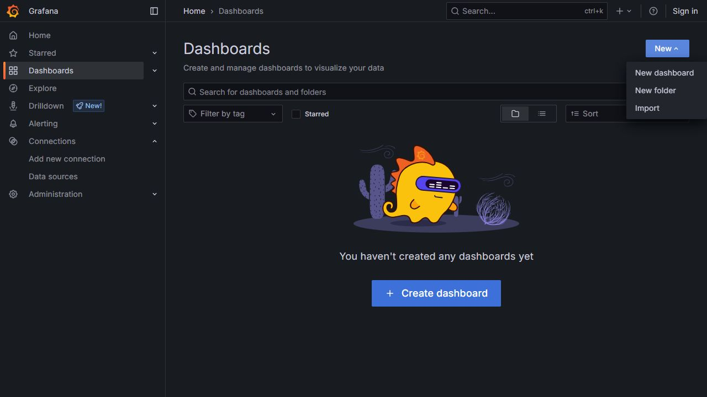
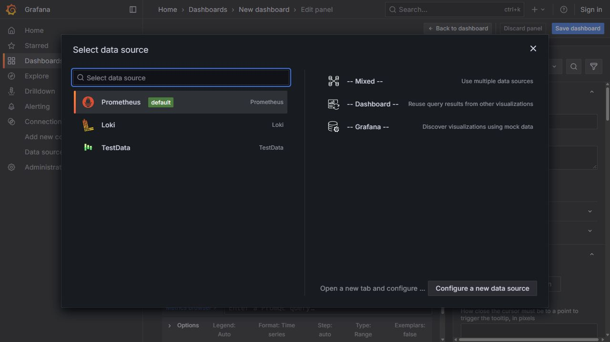
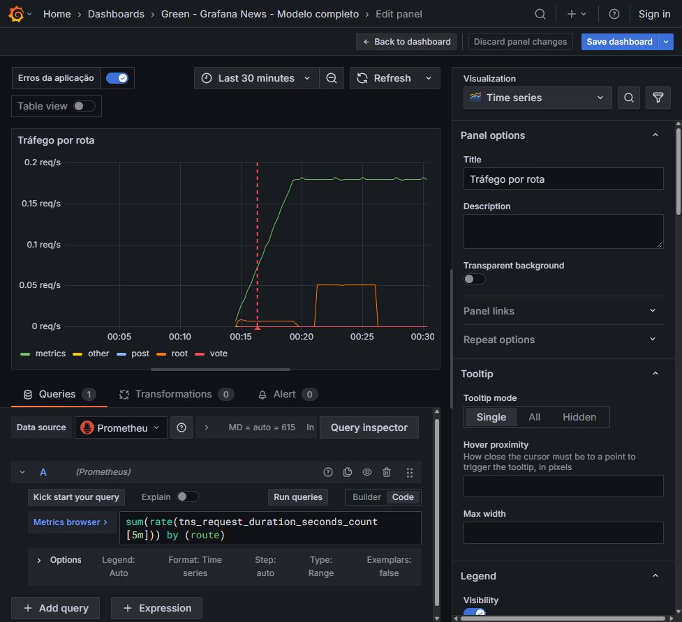
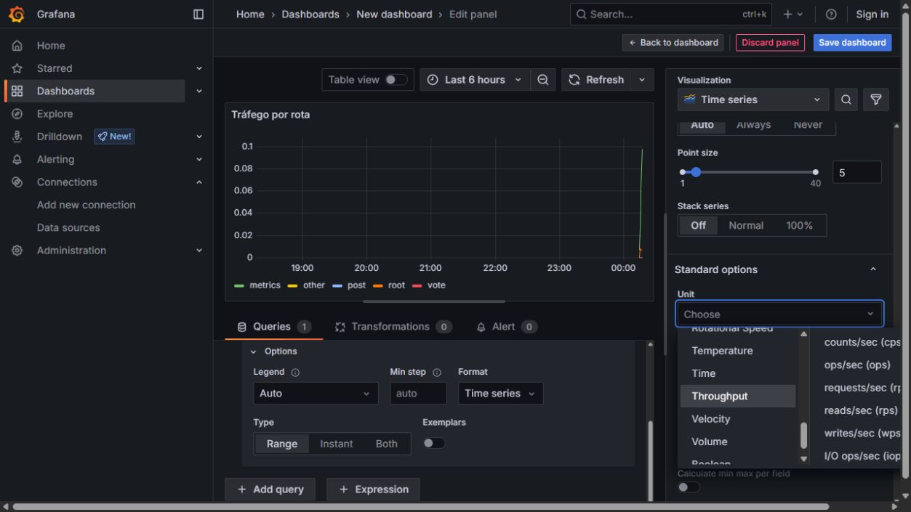
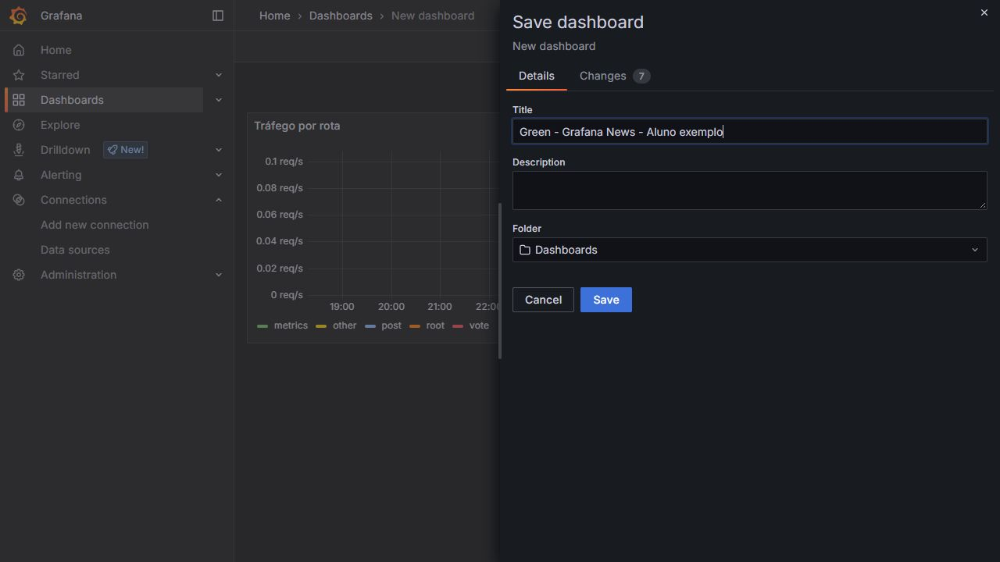
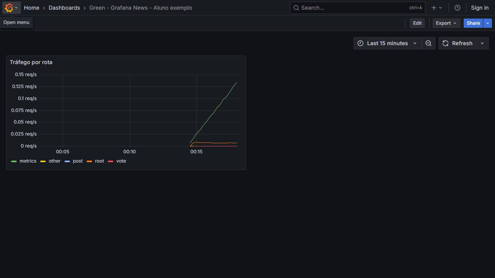
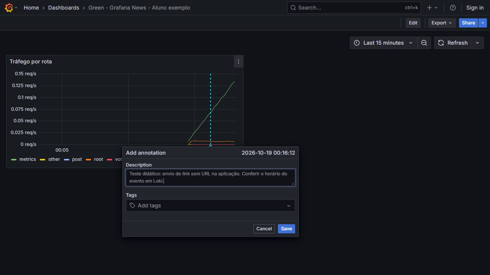
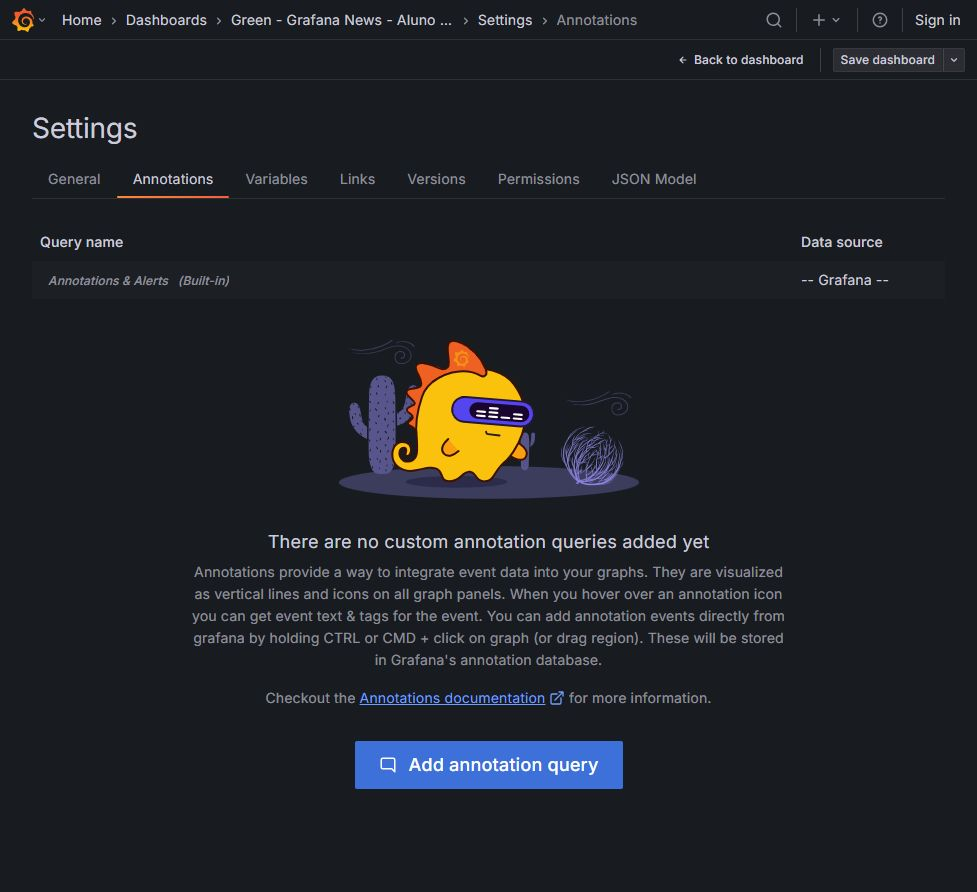
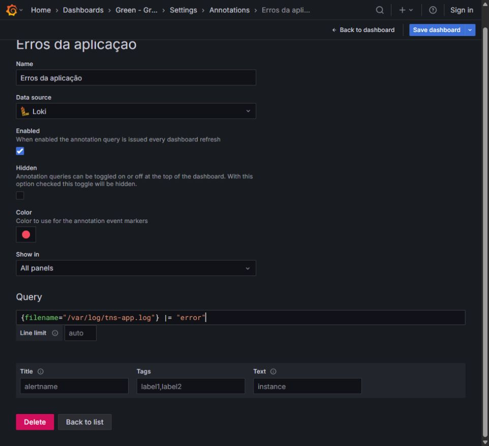
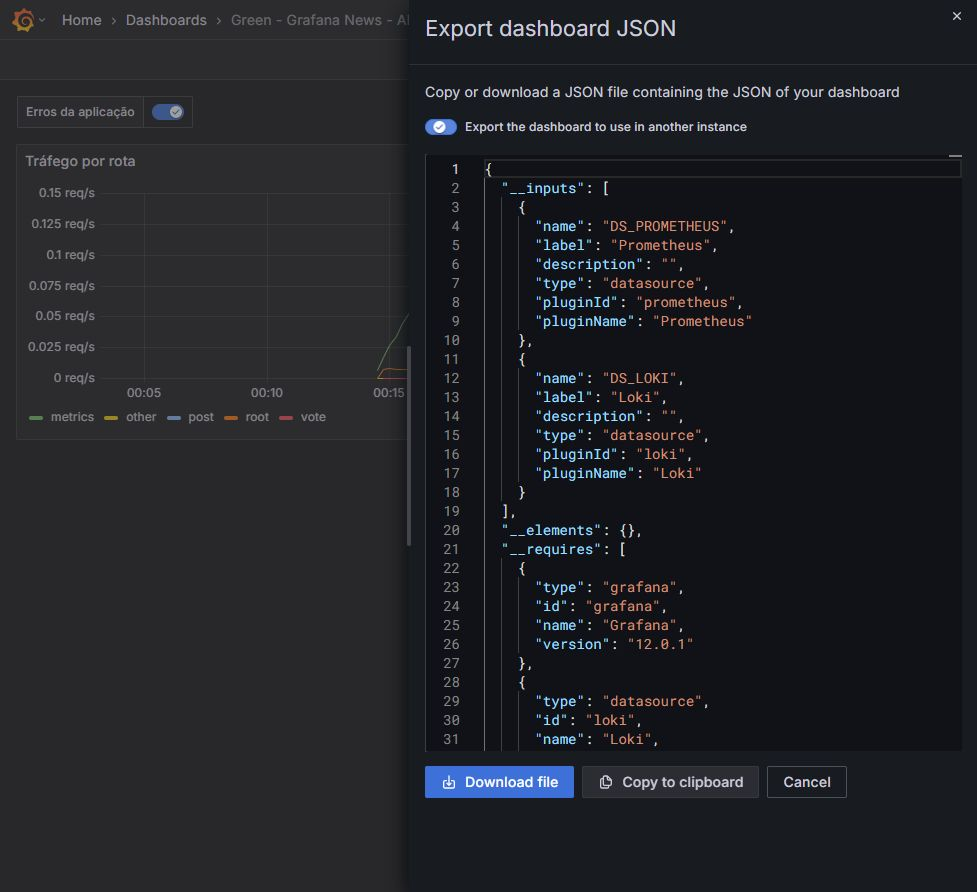

# Noite 4 — Dashboards e anotações

Guia visual V8 • Prática 21h00–22h15 • Fábio Silva

Execute na ordem. As telas são do ambiente do aluno, Grafana 12.0.1.

## Exercício 4.1 — Etapa 1: Iniciar a criação manual do dashboard

1. No menu principal do Grafana, clique em Dashboards.

2. Na página Dashboards, abra o botão New e escolha New dashboard.

3. O exercício será feito manualmente para compreender consulta, visualização e salvamento.

4. Também há arquivos prontos em exemplos-importaveis, como material de apoio opcional.

5. Continue em Add visualization na próxima página e execute as etapas na ordem.

**Resultado esperado:** O dashboard vazio está aberto e pronto para receber seu primeiro painel.

**Se não funcionar:** O botão New da página de Dashboards é diferente do botão global + do cabeçalho. O menu da página mostra New dashboard e Import.



## Exercício 4.1 — Etapa 2: Adicionar visualização Prometheus

1. No dashboard vazio, clique em Add visualization.

2. Na janela Select data source, escolha Prometheus.

3. Aguarde abrir o editor do painel. Na parte inferior, na aba Queries, confirme Data source = Prometheus.

4. Selecione Code no editor A, se ele estiver em Builder.

5. A visualização inicial deve ser Time series. Se houver outro tipo, clique no seletor Visualization e escolha Time series.

**Resultado esperado:** O editor mostra um painel Time series ligado a Prometheus.

**Se não funcionar:** Se a janela de fontes não abrir imediatamente, aguarde o carregamento. Escolher Loki aqui muda o editor para LogQL e não executa a consulta de métricas.



## Exercício 4.1 — Etapa 3: Preencher a consulta e o título

1. Na consulta A, cole a expressão abaixo e clique em Run queries.

2. À direita, em Panel options > Title, substitua New panel por Tráfego por rota.

3. Em Options, abaixo da consulta, confirme Type = Range e Format = Time series. Mantenha Legend = Auto; as rotas já identificam as séries.

4. Abra o seletor de período e escolha Last 15 minutes para concentrar o gráfico no laboratório recém-iniciado.

5. Se a consulta estiver escondida porque rolou a área inferior, role essa área para cima. O editor tem rolagem independente da coluna de opções.

6. Confira que o gráfico e a legenda apresentam as rotas. Os valores variam com o seu tráfego.

```

sum(rate(tns_request_duration_seconds_count[5m])) by (route)

```

**Resultado esperado:** Título, consulta, visualização e legenda correspondem ao exercício.

**Se não funcionar:** No Grafana 12, o retorno é Back to dashboard. Em algumas versões anteriores o botão equivalente é Apply. Não feche a aba do navegador.



## Exercício 4.1 — Etapa 4: Configurar a unidade correta

1. Na coluna de opções à direita, role até Standard options.

2. Clique no campo Unit, que inicialmente mostra Choose.

3. No menu de categorias, escolha Throughput. No submenu, clique em requests/sec (rps).

4. A unidade do eixo deve passar a req/s. Não escolha percentuais, bytes ou segundos.

5. Clique em Back to dashboard, no topo. Isso devolve o painel ao dashboard, mas você ainda precisa salvar o dashboard.

**Resultado esperado:** A curva é exibida em requisições por segundo.

**Se não funcionar:** Se o seletor não pesquisar ao digitar, use o caminho Throughput > requests/sec (rps). Não altere o nome da métrica para corrigir a unidade.



## Exercício 4.1 — Etapa 5: Salvar com identificação do aluno

1. Clique em Save dashboard, no topo.

2. Em Title, digite Green - Grafana News - seguido do seu nome. Use um nome próprio para evitar conflitos.

3. Mantenha Folder = Dashboards, ou escolha a pasta pessoal da turma se ela já existir.

4. Clique em Save no rodapé da janela. Aguarde Dashboard saved.

5. Volte à página Dashboards e reabra pelo nome, ou recarregue a página atual, para conferir que o painel foi salvo.

6. Guarde o endereço do dashboard nos favoritos. Ele será usado na Noite 5.

**Resultado esperado:** O dashboard abre novamente e mantém o painel.

**Se não funcionar:** Back to dashboard aplica o painel; Save dashboard persiste a alteração. Se você só voltar e fechar sem salvar, poderá perder o trabalho.



## Exercício 4.1 — Etapa 6: Conferir o dashboard salvo

1. No dashboard salvo, confirme o título do painel Tráfego por rota e a unidade req/s.

2. No seletor de período, use Last 15 minutes. Clique em Refresh para atualizar.

3. Leia a legenda sem ocultar séries acidentalmente. Se clicar em uma série e as demais sumirem, clique novamente para restaurar.

4. Registre uma captura e o link do dashboard. Esta é a entrega do exercício 4.1.

5. Continue em 4.2. Os exemplos importáveis ficam em pasta separada e não são obrigatórios para concluir este exercício.

**Resultado esperado:** Você tem um painel salvo e sabe reabri-lo.

**Se não funcionar:** Um gráfico sem pontos antes da inicialização do lab é esperado. Ajuste o período para perto do horário em que começou a gerar atividade.



## Exercício 4.2 — Etapa 7: Criar a anotação manual

1. Na aplicação, faça uma ação identificável, como publicar um novo link válido ou provocar empty url. Anote o horário exato.

2. Volte ao dashboard salvo e selecione Last 15 minutes. Localize no eixo do gráfico um ponto próximo ao horário da ação.

3. Segure Ctrl no Windows/Linux ou Command no macOS e clique dentro da área do gráfico. Deve abrir Add annotation.

4. Em Description, descreva a ação realmente feita. Exemplo: Teste didático: envio de link sem URL. Evite registrar um deploy ou uma migração que não ocorreu.

5. Clique em Save. Deve aparecer Annotation added e um marcador vertical no gráfico.

6. Para representar duração, use Ctrl/Command e arraste uma região; para um evento pontual, basta clicar. A anotação manual já é salva no banco do Grafana.

**Resultado esperado:** O gráfico contém um marcador com a descrição e o horário da sua ação.

**Se não funcionar:** Se Add annotation não abrir, confira se o dashboard já foi salvo e tente Ctrl+clique dentro do gráfico, longe da legenda. Passe o mouse sobre o marcador para ler o texto.



## Exercício 4.3 — Etapa 8: Abrir consultas de anotação

1. No dashboard, clique em Edit. No topo, abra Settings. Em telas pequenas, procure em Show more items.

2. Na tela Settings, clique na aba Annotations.

3. Mantenha Annotations & Alerts (Built-in): ela exibe eventos salvos no Grafana.

4. Clique em Add annotation query. Será aberta uma consulta inicialmente ligada à fonte padrão.

5. Em Name, escreva Erros da aplicação. No seletor Data source, escolha Loki.

**Resultado esperado:** O formulário da nova anotação usa a fonte Loki.

**Se não funcionar:** Não remova a anotação integrada. Configurar Loki nesta tela não muda a fonte Prometheus do painel de métricas.



## Exercício 4.3 — Etapa 9: Configurar e salvar os marcadores de erro

1. Mantenha Enabled marcado. Deixe Hidden desmarcado para o controle aparecer no dashboard.

2. Em Query, cole a consulta abaixo. Mantenha Show in = All panels.

3. Deixe os campos opcionais Title, Text e Tags com os padrões. Não copie os valores alertname ou instance como se fossem obrigatórios para este aplicativo.

4. Clique em Back to dashboard e depois em Save dashboard. Confirme Save na janela.

5. Na aplicação, produza mais um erro de URL vazia. Espere 10 a 20 segundos e volte ao dashboard.

6. Clique em Refresh. Confirme que a chave Erros da aplicação está ligada e passe o mouse sobre o marcador do horário correspondente.

```

{filename="/var/log/tns-app.log"} |= "error"

```

**Resultado esperado:** Logs de erro aparecem como marcadores no painel de métricas.

**Se não funcionar:** Se não houver marcadores, execute a mesma consulta no Explore/Loki e confira o período. Primeiro valide o log; só depois investigue a anotação.



## Exercício 4.3 — Etapa 10: Conferir e exportar para guardar o trabalho

1. Confira a anotação manual e a consulta de erros. Elas são mecanismos diferentes: o evento manual fica no banco; a consulta busca eventos no Loki.

2. Saia do modo Edit. No topo, abra Export > Export as JSON. Em versões anteriores o caminho pode estar em Share > Export.

3. Ative Export the dashboard to use in another instance para solicitar o mapeamento de fontes em outra instalação.

4. Clique em Download file e guarde o arquivo na pasta do curso. Você também pode usar Copy to clipboard para salvar o texto JSON.

5. O JSON preserva o painel e a definição da consulta de anotações. Ele não exporta os registros de logs nem os eventos manuais do banco.

6. Entregue captura do dashboard, anotação com texto e consulta de erros. Os exemplos importáveis para consulta opcional estão em exemplos-importaveis.

**Resultado esperado:** Você tem um arquivo JSON portátil e sabe o que ele contém.

**Se não funcionar:** Copiar o link do dashboard não cria um backup. Não remova containers antes de exportar. A existência do arquivo não substitui verificar se a importação abre corretamente.


