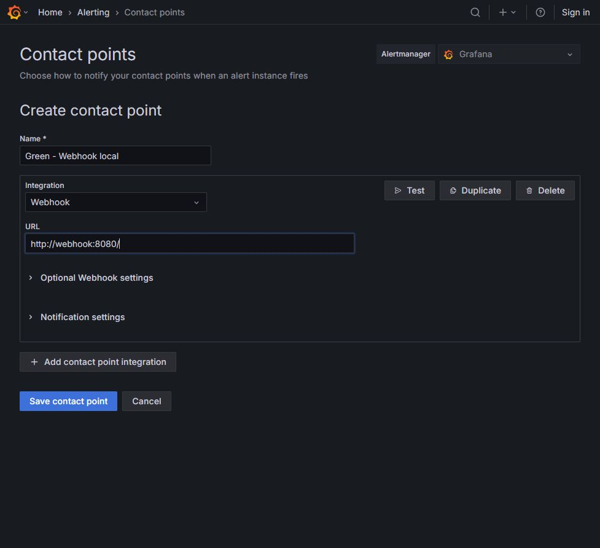
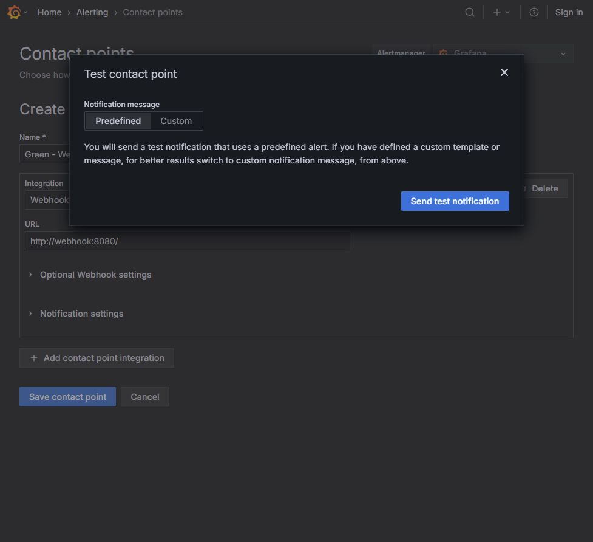
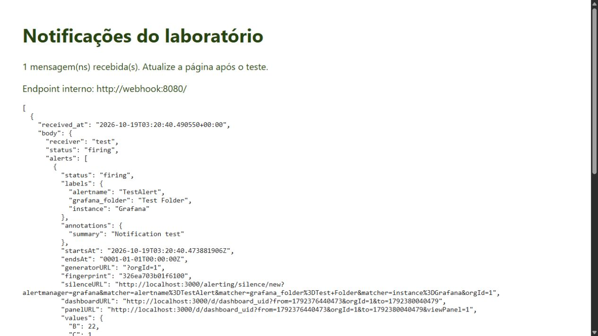
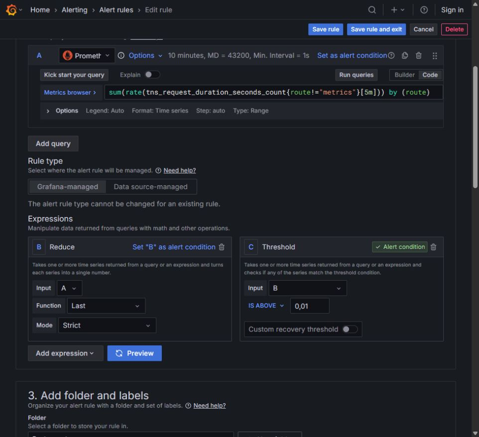
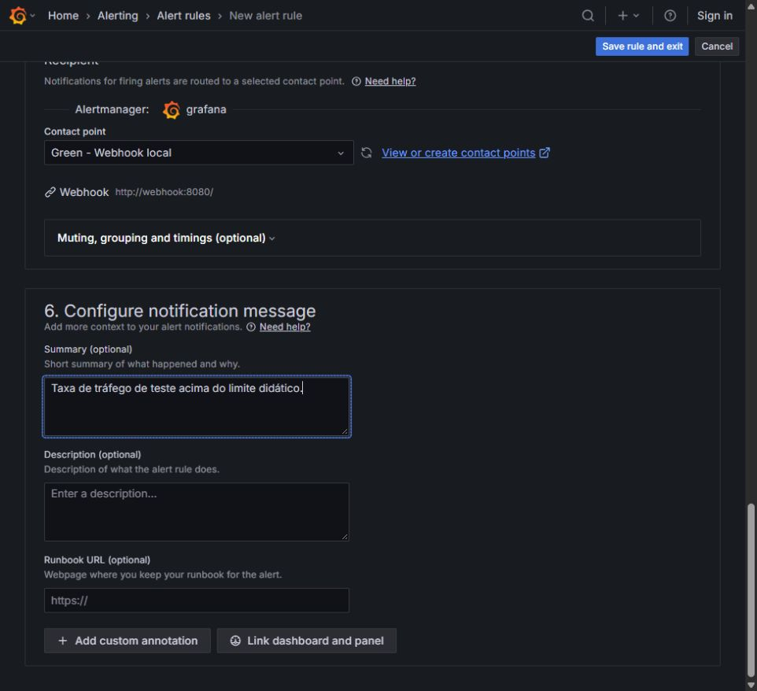
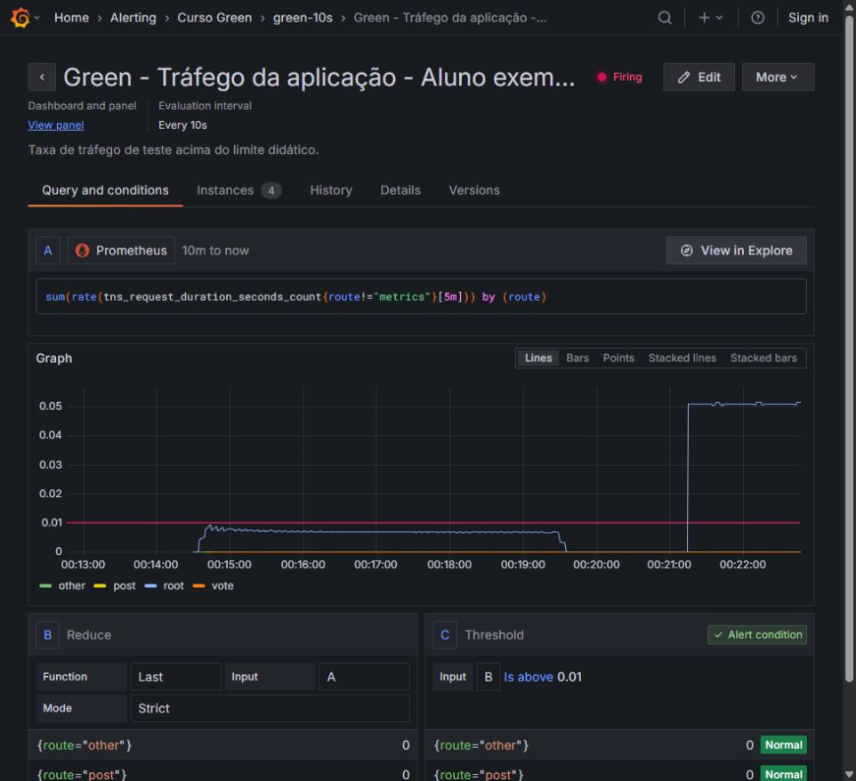
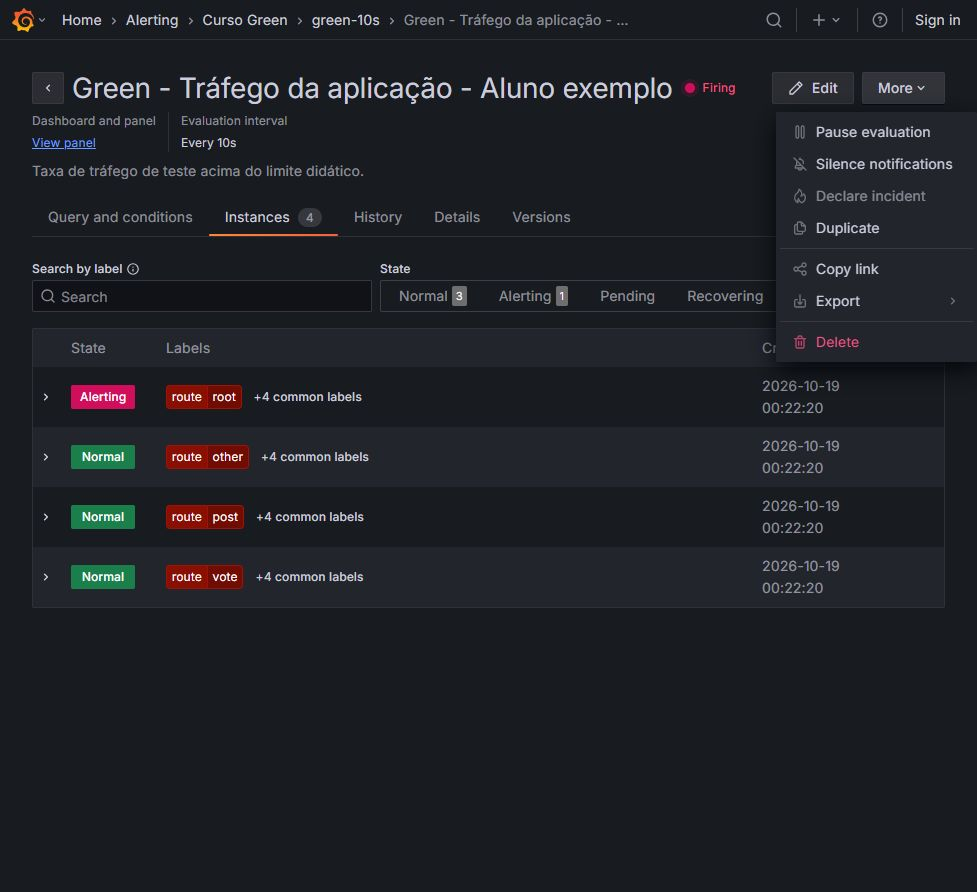

# Noite 5 — Alertas e entrega do projeto

Guia visual V8 • Prática 21h00–22h15 • Fábio Silva

Execute na ordem. As telas são do ambiente do aluno, Grafana 12.0.1.

## Exercício 5.1 — Etapa 1: Criar o contato Webhook local

1. Abra o receptor em http://localhost:38090 para confirmar que está acessível. Mantenha essa aba aberta.

2. No Grafana, abra Alerting > Contact points. Se estiver na página inicial de Alerting, clique em Manage contact points.

3. Clique em Create contact point. Em Name, escreva Green - Webhook local ou um nome que identifique você.

4. No seletor Integration, escolha Webhook. No campo URL, preencha exatamente http://webhook:8080/.

5. Use o endereço interno nessa configuração. localhost:38090 é o endereço externo usado pelo seu navegador.

6. Não configure Email para esta atividade. A localização do SMTP e dos destinatários está na teoria, sem envio de e-mail.

**Resultado esperado:** O formulário mostra Integration = Webhook e URL = http://webhook:8080/.

**Se não funcionar:** Se o receptor não abrir no navegador, confira o serviço webhook do pacote. Webhook.site não é necessário: o teste será todo local.



## Exercício 5.1 — Etapa 2: Enviar o teste de comunicação

1. No formulário do contato, clique em Test.

2. Na janela Test contact point, mantenha Predefined.

3. Confira que a URL do contato é o receptor local e clique em Send test notification.

4. Espere Test alert sent. Feche a janela pelo X ou Close.

5. Clique em Save contact point para salvar o contato, mesmo depois de o teste ter dado certo.

**Resultado esperado:** O Grafana confirma o envio e o contato fica salvo.

**Se não funcionar:** Testar não salva o contato. Se houver erro de DNS ou conexão, confira a grafia webhook, a porta interna 8080 e se o serviço está na mesma rede Docker.



## Exercício 5.1 — Etapa 3: Confirmar a mensagem de teste no receptor

1. Volte à aba http://localhost:38090 e atualize a página pelo navegador.

2. Confira a contagem de mensagens. Ela deve aumentar depois do teste; não precisa ser exatamente 1 se você já testou antes.

3. No JSON, localize receiver = test e labels.alertname = TestAlert.

4. Essa mensagem comprova comunicação com o receptor, mas ainda não comprova que uma regra sua foi avaliada.

5. Guarde uma captura e anote TestAlert como origem do teste. O alerta real terá o nome da regra criada a seguir.

**Resultado esperado:** O receptor apresenta o JSON do TestAlert.

**Se não funcionar:** O receptor guarda as últimas 100 mensagens em memória. Reiniciar esse serviço apaga o histórico. Preserve suas evidências antes de reiniciá-lo.



## Exercício 5.2 — Etapa 4: Criar a consulta A em modo avançado

1. Abra Alerting > Alert rules. Clique em New alert rule.

2. Em Name, escreva Green - Tráfego da aplicação - seguido do seu nome.

3. Na seção 2, ative Advanced options, se estiver usando a tela simplificada. Confirme Grafana-managed.

4. Selecione Prometheus e Code na consulta A. Cole a expressão abaixo.

5. Em Options da própria consulta, defina Type = Range. Mantenha o intervalo de consulta em 10 minutes e clique em Run queries.

6. A consulta exclui route="metrics", para que o scrape não dispare o alerta como se fosse navegação do aluno. Ela mantém uma série por rota.

```

sum(rate(tns_request_duration_seconds_count{route!="metrics"}[5m])) by (route)

```

**Resultado esperado:** A consulta A devolve séries temporais das rotas da aplicação.

**Se não funcionar:** A faixa de consulta 10m e a janela [5m] têm funções distintas. Se a UI criar uma expressão reducer automaticamente, reutilize-a no próximo passo em vez de adicionar outra igual.


## Exercício 5.2 — Etapa 5: Definir B e C sem ligar o limite à série bruta

1. Em Expressions, localize Reduce. Se ela já existir como reducer, clique no nome, troque por B e pressione Enter. Se não existir, use Add expression > Reduce e nomeie B.

2. Em B, configure Input = A, Function = Last e Mode = Strict. Cada série será reduzida a um valor.

3. Localize a expressão Threshold C. Configure Input = B, Is above e limite 0.01. A tela em português pode mostrar 0,01.

4. Depois de renomear reducer, confira novamente Input de C: algumas versões voltam para A. Reescolha B.

5. C deve estar marcada Alert condition. Caso não esteja, use Set as alert condition na expressão C.

6. Clique em Preview. A prévia pode mostrar Normal ou Firing, conforme o valor atual de B. Neste laboratório o limite é didático, não um limite recomendado para produção.

**Resultado esperado:** B tem um número por rota e C compara esse número com 0,01 req/s.

**Se não funcionar:** You cannot use time series data as an alert condition indica que C ainda usa A ou que B não é Reduce/Last. Corrija a referência antes de salvar. Não conclua entrega somente pela prévia.



## Exercício 5.2 — Etapa 6: Criar pasta e grupo de avaliação

1. Na seção Add folder and labels, clique em New folder, digite Curso Green e clique em Create. Se já existir, escolha essa pasta.

2. Na seção Set evaluation behavior, clique em New evaluation group.

3. Em Evaluation group name, digite green-10s. Em Evaluation interval, digite 10s.

4. Clique em Create. Se o grupo já existir na pasta, selecione-o em vez de criar uma duplicata.

5. O grupo define a frequência de avaliação da regra. Não é o intervalo do scrape do Prometheus nem o intervalo de atualização do dashboard.

**Resultado esperado:** A pasta Curso Green e o grupo green-10s estão selecionados.

**Se não funcionar:** New evaluation group só fica disponível depois de escolher uma pasta. Se o intervalo for rejeitado, use um múltiplo do intervalo mínimo aceito pela instalação.


## Exercício 5.2 — Etapa 7: Configurar pendência e recuperação

1. Confira a informação de que as regras do grupo são avaliadas a cada 10s.

2. Em Pending period, escolha None ou digite 0s. Assim o teste dispara na avaliação que encontrar a condição verdadeira.

3. Em Keep firing for, mantenha None ou 0s, para não prolongar artificialmente o estado do exercício.

4. Deixe Configure no data and error handling nos padrões do laboratório. Anote que No Data e Error são diferentes de uma comparação falsa.

5. Continue até Configure notifications. Não salve a regra ainda sem definir o contato local.

**Resultado esperado:** Avaliação = 10s, pendência = 0s e Keep firing for = 0s.

**Se não funcionar:** Um pending de 1m exige a condição verdadeira continuamente durante esse período. O objetivo aqui é observar rapidamente o ciclo; o valor 0s é específico da atividade.


## Exercício 5.2 — Etapa 8: Associar o contato e a mensagem

1. Em Configure notifications, deixe o Alertmanager grafana selecionado.

2. No campo Contact point, escolha o contato Green - Webhook local criado e testado em 5.1.

3. Confirme que o resumo da integração mostra Webhook e http://webhook:8080/.

4. Em Configure notification message > Summary, digite Taxa de tráfego de teste acima do limite didático.

5. Não escolha grafana-default-email. Esse contato padrão não tem SMTP configurado para o exercício.

6. Você fará o vínculo com o painel na próxima etapa. Depois, poderá salvar a regra.

**Resultado esperado:** A regra encaminhará as notificações ao receptor Docker local.

**Se não funcionar:** Se o contato não aparecer, use Refresh contact points list. Se continuar ausente, confira se clicou em Save contact point no exercício 5.1.



## Exercício 5.3 — Etapa 9: Relacionar dashboard e painel antes de salvar

1. Na seção Configure notification message, clique em Link dashboard and panel.

2. Na coluna da esquerda, pesquise e selecione seu dashboard manual ou importado. Use o nome que você salvou, não o do exemplo.

3. Aguarde os painéis carregarem. Na coluna da direita, selecione Tráfego por rota, ou o título personalizado.

4. Clique em Confirm e confira os dois links mostrados na regra.

5. Clique em Save rule and exit, no topo, uma única vez. Aguarde retornar à lista de regras.

6. O vínculo acrescenta contexto e navegação. Ele não altera a consulta do painel nem transforma a prévia em mensagem recebida.

**Resultado esperado:** A regra foi salva, com contato local e referências ao seu dashboard e painel.

**Se não funcionar:** Se Confirm estiver desabilitado, ainda falta selecionar o painel. Se houver erro ao salvar, leia o campo indicado; revise pasta, grupo, condição C e contato.


## Exercício 5.2 / 5.3 — Etapa 10: Verificar a avaliação real

1. Na página Alert rules, abra a pasta Curso Green pela seta ao lado do nome. Clique em View na sua regra.

2. Confira o nome da regra e Every 10s. A aba Query and conditions mostra A, B e C.

3. Se estiver Normal, volte à aplicação, atualize-a 15 a 20 vezes, espere cerca de 10s e volte à regra.

4. Aguarde uma ou duas avaliações. Para a rota root, B deve ultrapassar 0.01; C passa a 1 e o estado fica Firing.

5. Se permanecer Normal, leia o valor de B e compare com o limite. A taxa usa 5 minutos: poucos cliques produzem taxas pequenas.

6. Aguarde também o agrupamento de notificações, normalmente cerca de 30s no lab. Não confunda a avaliação de 10s com o tempo de entrega.

**Resultado esperado:** A regra salva apresenta Firing para uma rota que ultrapassou o limite.

**Se não funcionar:** Se a condição foi ajustada para 0.2 em uma demonstração anterior, volte ao limite didático 0.01 deste roteiro. Evite diminuir para valores negativos apenas para forçar um resultado.



## Exercício 5.2 / 5.3 — Etapa 11: Distinguir as instâncias de cada rota

1. Na regra, abra a aba Instances. O número ao lado do nome indica quantas instâncias existem naquele momento.

2. Localize route=root e leia o estado. Outras rotas podem continuar Normal.

3. Compare com by (route) da consulta A: cada conjunto de labels gera uma instância independente.

4. Registre a rota que disparou, seu valor B e o horário da observação.

5. Esse comportamento explica por que a regra pode mostrar Firing mesmo com outras rotas normais.

**Resultado esperado:** Você identifica qual rota realmente satisfez a condição.

**Se não funcionar:** O número de instâncias pode mudar conforme os labels disponíveis. Não trate o total de 4 do print como obrigatório.


## Exercício 5.2 / 5.3 — Etapa 12: Confirmar a notificação da sua regra

1. Atualize a aba http://localhost:38090 depois de a regra estar Firing e de aguardar o envio.

2. A contagem deve aumentar. Role até a mensagem mais recente; no receptor desta versão as mensagens ficam da mais antiga para a mais nova.

3. Procure receiver = Green - Webhook local e labels.alertname com o nome da SUA regra. TestAlert sozinho não satisfaz esta entrega.

4. Confira status = firing, a label route e values.B / values.C. Na captura real, B ficou aproximadamente 0,0508 e C = 1.

5. Faça uma captura incluindo o nome da regra e o status. Registre também o horário received_at; ele está em UTC, três horas à frente do horário de Brasília nesta data.

6. Os links absolutos do payload podem usar a porta padrão 3000 do servidor. Para navegar no pacote local, mantenha a mesma rota na porta 3300, ou use View panel pela interface do Grafana.

**Resultado esperado:** O receptor tem uma mensagem originada pela regra salva, além do TestAlert.

**Se não funcionar:** Firing sem mensagem: revise o contato, URL interna, serviço webhook, pausa/silêncio e o tempo de agrupamento. Clique Test no contato para isolar comunicação de avaliação; identifique as duas mensagens separadamente.


## Exercício 5.3 — Etapa 13: Encerrar preservando o trabalho

1. Antes de encerrar, entregue: consulta do painel, um erro com horário nos logs, anotação manual, consulta de anotações e evidência de recebimento da regra.

2. Exporte o dashboard por Export > Export as JSON, com Export the dashboard to use in another instance ligado.

3. Na página da regra, abra More > Export e guarde também sua definição, se desejar preservar a regra. Regras não acompanham o JSON do dashboard.

4. Depois das evidências, use More > Pause evaluation na regra criada por você. Confira o texto Paused.

5. Não use Delete para encerrar. Para retomar outra aula, abra More > Resume evaluation.

6. Se for parar o lab, vá à pasta lab/tutorial-environment e use Compose stop com o mesmo projeto green-fundamentals. Preserve a pasta e os arquivos exportados; não use down -v.

**Resultado esperado:** Você concluiu as evidências e pausou somente sua regra didática.

**Se não funcionar:** O dashboard JSON não contém contatos, regras, logs, eventos manuais nem os dados históricos do Prometheus. Antes de remover containers, preserve cada item de que precisa.



## Exercício Consulta opcional — Etapa 14: Parar e retomar o laboratório com os comandos exatos

1. Antes de parar, confira que exportou seu dashboard e guardou as evidências. Os comandos stop preservam os containers; não use down -v.

2. No Windows, abra o PowerShell na raiz extraída do pacote. Execute os três primeiros comandos abaixo. Teste docker compose version: se funcionar, use a linha docker compose; se não existir, use apenas o bloco de alternativa Docker Desktop.

3. No Ubuntu, abra o terminal na raiz do pacote, entre em lab/tutorial-environment e execute a linha stop da rota Compose instalada.

4. Para retomar no Windows, abra um novo terminal na raiz e execute iniciar-lab.ps1 como na Noite 1. No Ubuntu, execute bash ./iniciar-lab.sh na raiz.

5. Depois de retomar, reabra os três endereços. Se precisar continuar a prática de alertas, use More > Resume evaluation somente na regra que criou.

```

# PowerShell: começar na raiz do pacote extraído
Set-Location .\lab\tutorial-environment
docker compose version
docker compose -p green-fundamentals stop

# Alternativa se docker compose não existir no Docker Desktop
$composeCurso = "$env:ProgramFiles/Docker/Docker/resources/cli-plugins/docker-compose.exe"
& $composeCurso -p green-fundamentals stop

# Ubuntu: começar na raiz do pacote extraído
cd lab/tutorial-environment
docker compose -p green-fundamentals stop

```

**Resultado esperado:** O laboratório foi parado sem remoção dos containers e você conhece o caminho de retomada.

**Se não funcionar:** Se estiver usando uma instalação diferente da pasta desta turma, confirme o nome do projeto antes de executar. Não remova volumes de outros projetos para corrigir uma falha de inicialização.
