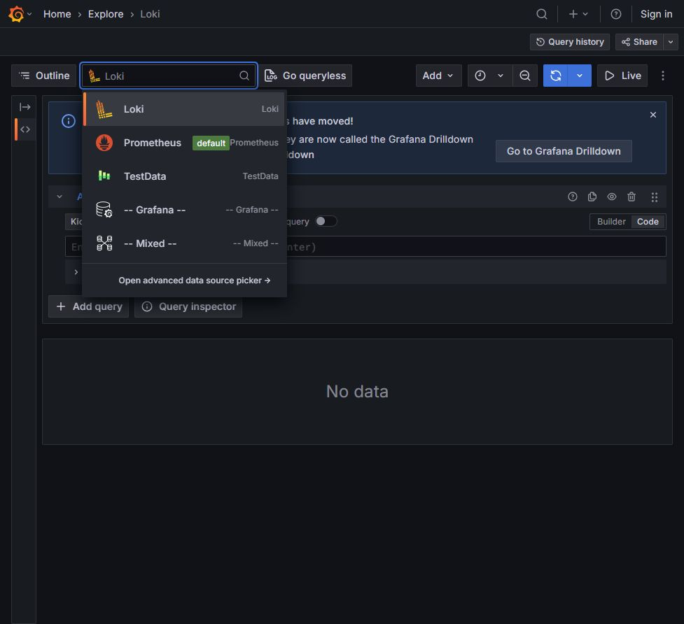
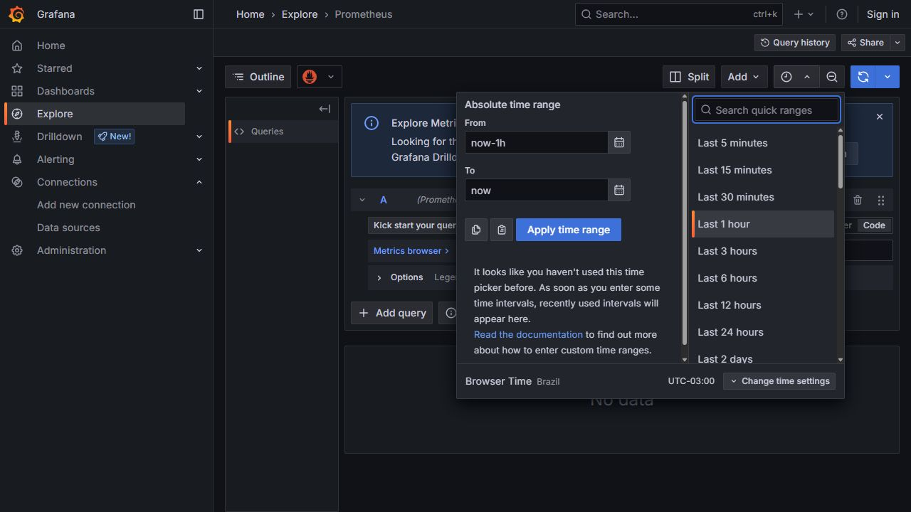
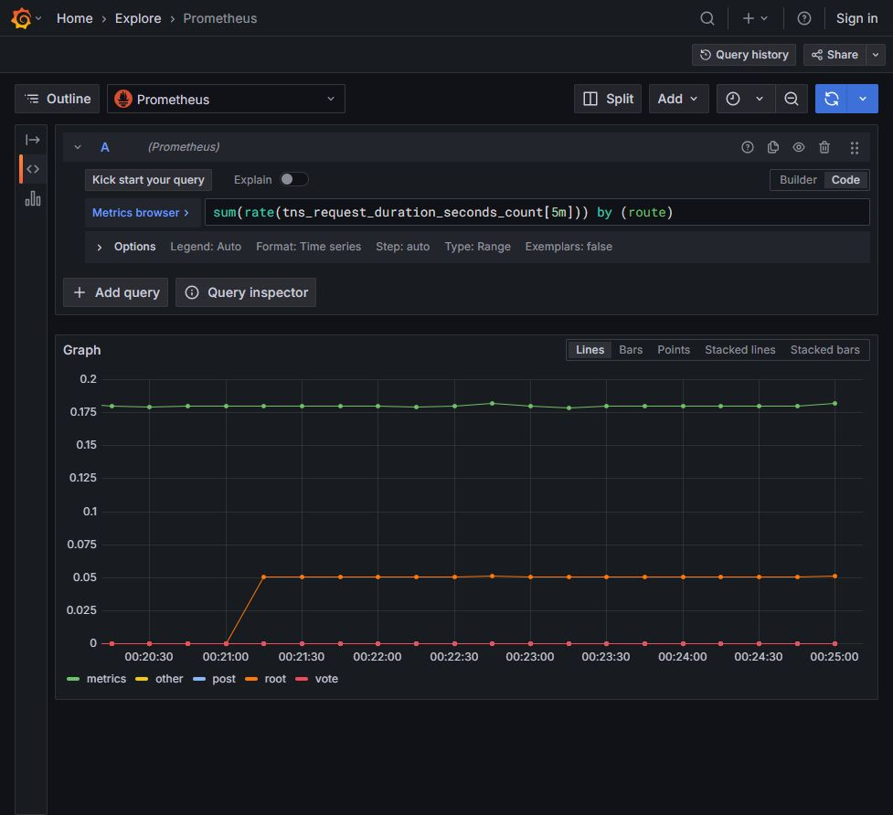

# Noite 2 — Métricas e PromQL

Guia visual V12 • Fábio Silva • Green Tecnologia

Na Noite 2, a teoria ocupa 18h30–20h20 (110 minutos), seguida do intervalo de 20h20–20h45. Às 20h45–21h20, professor e alunos executam juntos os três exercícios de métricas no Grafana. Às 21h20–22h15, retome os mesmos procedimentos no seu ambiente e conclua os registros sem acompanhar cada clique do professor. Correção: 22h15–22h30. A Noite 2 não possui um bloco separado de demonstração antes do intervalo.

## Organização da execução

**Exercício guiado:** 20h45–20h55: exercício 2.1, seleção da fonte e interpretação do contador; 20h55–21h08: exercício 2.2, período e taxa por rota; 21h08–21h14: exercício 2.3, agrupamento por status HTTP; 21h14–21h20: conferência conjunta dos mesmos resultados e passagem à consolidação.

**Consolidação autônoma:** 21h20–21h35: retome 2.1 e finalize a interpretação do contador e dos labels; 21h35–21h55: retome 2.2, gere tráfego e registre rota, unidade e valor; 21h55–22h15: retome 2.3, compare as duas consultas e finalize as capturas e a explicação da janela. São os mesmos três exercícios, sem atividade obrigatória adicional.

As cinco telas de referência foram capturadas em 19/10/2026 no Grafana 12.0.1 do laboratório local. Siga os procedimentos, sem tentar reproduzir os mesmos valores.

## Exercício 2.1 — Etapa 1: Selecionar a fonte no Explore

1. Abra http://localhost:3300 e, no menu principal, clique em Explore.

2. Clique no seletor de fonte no topo da área de consulta. Ele pode mostrar apenas o ícone e uma seta em uma tela estreita.

3. Na lista, clique em Prometheus. Não selecione TestData nem Loki.

4. No editor da consulta A, marque Code à direita de Builder. Se houver uma consulta anterior, clique dentro do editor e use Ctrl+A para substituí-la.

5. Se um aviso azul sobre Drilldown ocupar a tela, feche-o pelo X do próprio aviso. O exercício continua no Explore.

**Resultado esperado:** A consulta A indica Prometheus e o modo Code está ativo.

**Se não funcionar:** Se o editor mencionar Loki query, troque a fonte para Prometheus. PromQL não é executado na fonte Loki.



## Exercício 2.1 — Etapa 2: Executar e interpretar o contador

1. Cole a consulta abaixo no editor A. Use aspas retas e copie somente a consulta, sem as marcas de bloco de código.

2. Clique em Run query, no topo à direita, ou use Shift+Enter. Aguarde o gráfico carregar.

3. Abra o seletor de período e use Last 15 minutes. Isso é suficiente para um laboratório recém-iniciado.

4. Leia a legenda abaixo do gráfico. Identifique route e status_code em pelo menos duas séries.

5. Anote que o valor representa uma contagem de requisições por combinação de labels, não CPU, tempo em segundos ou req/s.

6. Atualize a aplicação em outra aba, aguarde aproximadamente 10 segundos e execute Run query novamente. O contador pode voltar a zero se o processo reiniciar.

```promql

tns_request_duration_seconds_count

```

**Resultado esperado:** O gráfico mostra séries do contador, com labels como route e status_code.

**Se não funcionar:** Em No data, confirme a fonte Prometheus, abra a aplicação, atualize-a, aguarde duas coletas de 5s e execute novamente. Um gráfico vazio à esquerda do horário de início do lab é esperado.


## Exercício 2.2 — Etapa 3: Mudar o período pela tela

1. No Explore, clique no botão de período ao lado de Run query. Ele mostra algo como Last 1 hour ou Last 15 minutes.

2. Na lista de períodos relativos, clique no texto Last 5 minutes. O menu fecha ao aplicar a seleção.

3. Confirme que o botão passou a mostrar Last 5 minutes.

4. Se o período aparecer apenas como um relógio, expanda Show more items ou feche o menu lateral.

5. Não preencha datas absolutas neste exercício. Esse período acompanha o relógio do computador e mostra a janela mais recente.

**Resultado esperado:** O período visível é Last 5 minutes.

**Se não funcionar:** Se você clicou e nada mudou, clique no texto do intervalo, não na borda da caixa. Um período absoluto não avança sozinho.



## Exercício 2.2 — Etapa 4: Calcular a taxa por rota

1. Substitua a consulta A pela expressão abaixo e clique em Run query.

2. Volte à aplicação e atualize a página 10 a 15 vezes. Espere cerca de 10 segundos para que o Prometheus colete novas amostras.

3. Volte ao Explore e clique em Run query novamente. Na legenda, localize root, post e vote, se estiverem presentes.

4. Leia a taxa na curva. A unidade é requisições por segundo. A função rate usa as amostras dos últimos 5 minutos.

5. Observe também a rota metrics: ela recebe as requisições de coleta do próprio Prometheus. Esse tráfego não significa que um aluno visitou a aplicação.

6. Anote uma rota, um valor aproximado e o período. Um valor 0,05 req/s equivale, em média, a uma requisição a cada 20 segundos.

```promql

sum(rate(tns_request_duration_seconds_count[5m])) by (route)

```

**Resultado esperado:** Você identifica taxas por rota e diferencia o scrape das ações do usuário.

**Se não funcionar:** Taxas pequenas são normais quando você clica poucas vezes. Não espere um número igual ao print. Zero com uma série presente é diferente de No data.



## Exercício 2.3 — Etapa 5: Comparar por status HTTP

1. Substitua by (route) por by (status_code), usando a consulta completa abaixo.

2. Execute Run query e leia a legenda: por exemplo 200, 302, 400 ou 404, conforme as ações já feitas.

3. Compare: route agrupa pelo caminho lógico; status_code agrupa pelo código de resposta. A unidade continua req/s.

4. Troque Last 5 minutes por Last 15 minutes e depois volte. A janela interna [5m] continua a mesma.

5. Registre as duas consultas e explique, em suas palavras, a diferença entre janela do rate e período exibido.

6. Entregue uma captura por agrupamento. A ausência de 400 é normal antes do erro que será produzido na Noite 3.

```promql

sum(rate(tns_request_duration_seconds_count[5m])) by (status_code)

```

**Resultado esperado:** Você compara as mesmas requisições usando dimensões diferentes.

**Se não funcionar:** Uma série nova aparece somente depois de a aplicação produzir aquela combinação de labels. Não invente erro para fazer a legenda coincidir com o print.


## Entrega e correção — 22h15–22h30

Entregue os registros previstos nos mesmos exercícios: interpretação do contador e dos labels, taxa por rota com unidade, capturas dos dois agrupamentos e explicação da diferença entre janela [5m] e período exibido. Os exemplos para importar ficam em pasta separada como referência opcional.


## Desafios opcionais (2.4 a 2.6)


Depois de concluir 2.1 a 2.3, quem terminar antes das 22h15 pode continuar. Os desafios são opcionais e usam as mesmas telas. As capturas de referência vieram do ambiente do professor (loja virtual); no seu laboratório use as consultas `tns_`.

### Desafio 2.4 — Filtrar por label: tirar o scrape

**Objetivo:** usar um filtro de label dentro do seletor para responder uma pergunta mais específica.

1. No Explore, com Prometheus e Code ativos, clique no editor da consulta A e use Ctrl+A para substituir o texto.
2. Cole a consulta abaixo e clique em Run query (ou Shift+Enter). Ela é a taxa por rota do exercício 2.2, sem a rota `metrics`.
3. Compare a legenda com a do exercício 2.2: qual série desapareceu? Por que ela existia?
4. Troque o filtro por `{status_code="200"}` e execute de novo. Quais rotas continuam aparecendo?
5. Registre a pergunta que cada consulta responde e a unidade (req/s).

```promql
sum(rate(tns_request_duration_seconds_count{route!="metrics"}[5m])) by (route)
```

**Resultado esperado:** a rota `metrics` (coleta do Prometheus) não aparece. Ficam apenas as rotas geradas por ações na aplicação, como root, post e vote.

**Se não funcionar:** em No data, confirme a fonte Prometheus e gere tráfego na aplicação. Um filtro que não corresponde a nenhuma série devolve No data, e isso é diferente de zero. Use `!=` (diferente de) e aspas retas, sem espaços dentro das chaves.

**Captura de referência (ambiente do professor):** `sum(rate(http_requests_total{status="500"}[5m])) by (endpoint)`. O filtro `{status="500"}` reduz a legenda a poucas séries.


### Desafio 2.5 — Taxa ou total: rate e increase

**Objetivo:** distinguir "quantos por segundo" de "quantos na janela".

1. Execute a consulta abaixo. O resultado é **o aumento estimado de requisições na janela de 5 minutos**, e não req/s.
2. Anote o valor de uma rota na aba Raw.
3. Execute a consulta do exercício 2.2 (`rate`) e anote o valor da mesma rota.
4. Multiplique a taxa por 300 (segundos de 5 minutos). No mesmo instante e com a mesma janela, increase corresponde a rate multiplicado por 300; a comparação manual pode sofrer arredondamento ou diferença de horário.
5. Explique por que a comparação exige o mesmo instante de avaliação, janela e seleção de séries.

```promql
sum(increase(tns_request_duration_seconds_count[5m])) by (route)
```

**Resultado esperado:** o gráfico mostra contagens em vez de frações. No ambiente do professor, uma rota teve `increase` ≈ 82 e `rate` ≈ 0,27 req/s; 0,27 × 300 ≈ 80.

**Se não funcionar:** compare as consultas no mesmo instante e com a mesma janela e filtros. increase é rate multiplicado pela duração da janela; os dois usam a mesma extrapolação. Instantes diferentes ou arredondamentos podem alterar a comparação manual. O resultado pode ser fracionário. Em um laboratório recém-iniciado, com poucas atualizações, os totais serão pequenos.

**Captura de referência (ambiente do professor):** `sum(increase(http_requests_total[5m])) by (endpoint)`.


### Desafio 2.6 — Latência: percentil 95 com histograma

**Objetivo:** ler uma distribuição de duração e entender por que p95 não é média nem máximo.

1. Execute a consulta abaixo. O resultado está em **segundos**.
2. Leia a legenda e identifique qual rota tem o p95 mais alto.
3. Execute a segunda consulta (média de duração por rota) e compare com o p95 da mesma rota.
4. Escreva, em uma ou duas frases, o que significa "95% das requisições foram atendidas em até X segundos".

```promql
histogram_quantile(0.95, sum(rate(tns_request_duration_seconds_bucket[5m])) by (le, route))
```

Média para comparação:

```promql
sum(rate(tns_request_duration_seconds_sum[5m])) by (route)
  / sum(rate(tns_request_duration_seconds_count[5m])) by (route)
```

**Resultado esperado:** compare p95 e média: são resumos diferentes da distribuição. O p95 não é obrigatoriamente maior que a média em toda distribuição. No ambiente do professor, duas rotas tinham p95 próximo de 0,45 s, e as demais ficavam perto de 0,23 s; as médias eram menores (0,09 s a 0,22 s).

**Se não funcionar:** mantenha `le` no `by (...)`. Sem ele, `histogram_quantile` não encontra os buckets. Com poucas requisições, o percentil pode oscilar ou aparecer como NaN: gere mais tráfego e aguarde novas coletas. O percentil é estimado a partir de faixas (buckets); por isso o valor é aproximado.

**Captura de referência (ambiente do professor):** `histogram_quantile(0.95, sum(rate(http_request_duration_seconds_bucket[5m])) by (le, endpoint))`.


