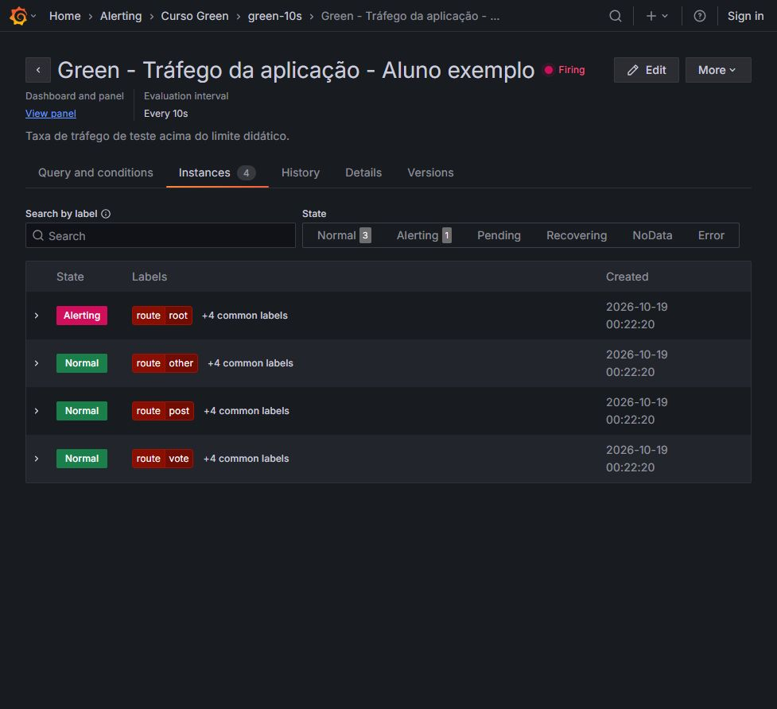
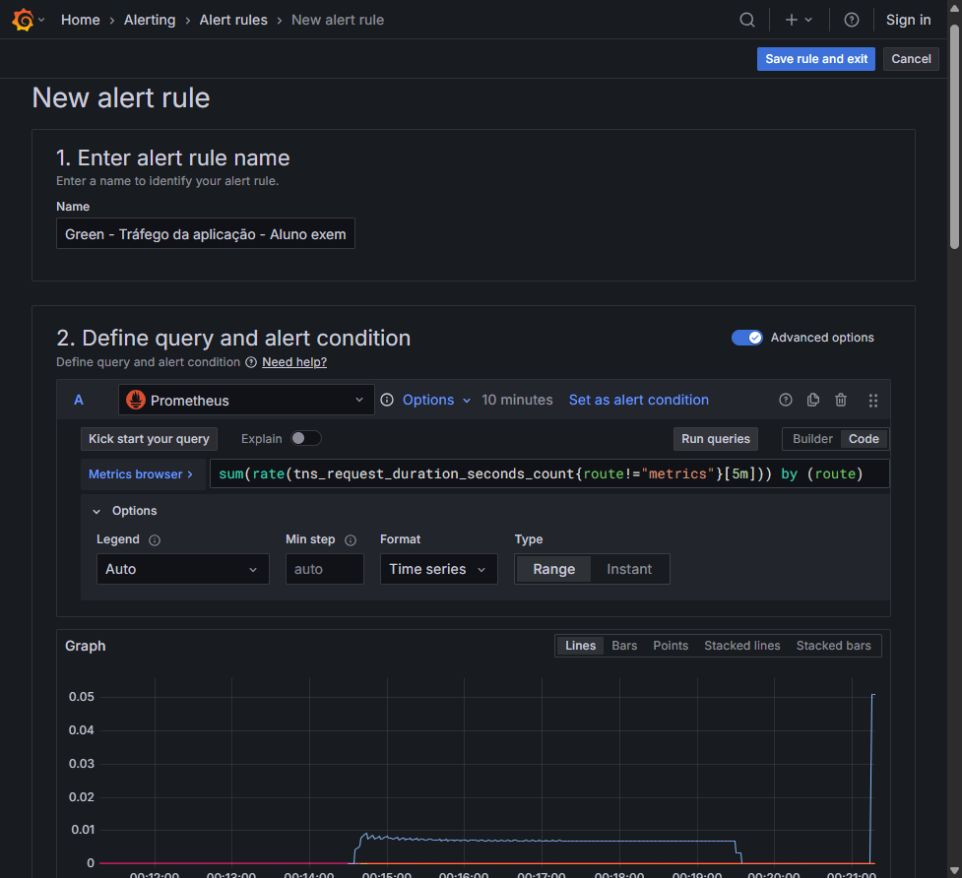
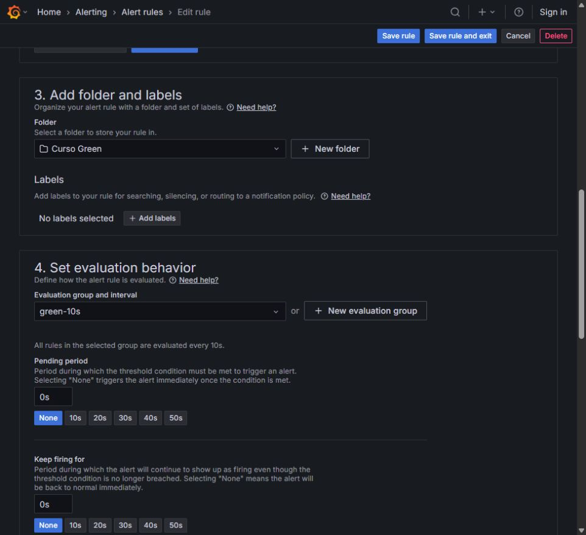
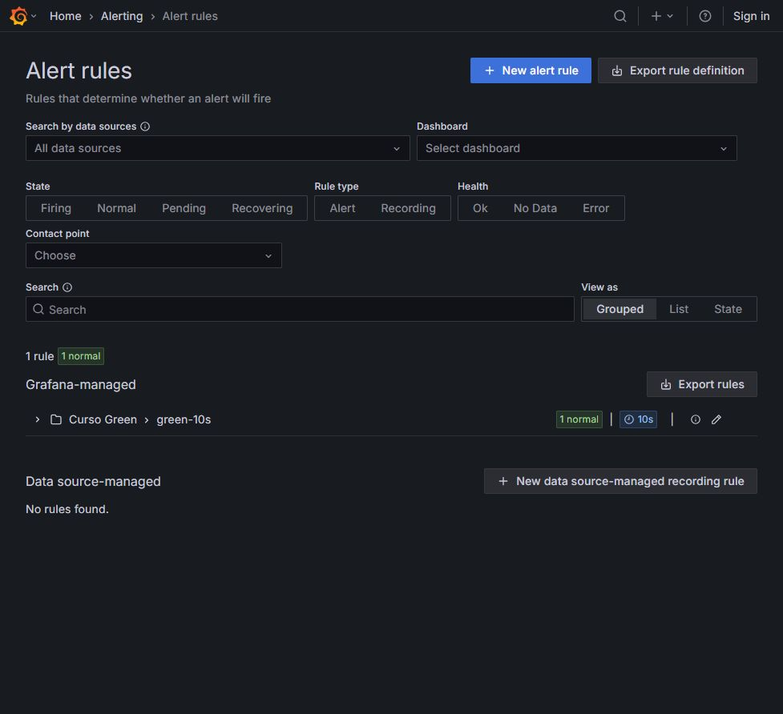
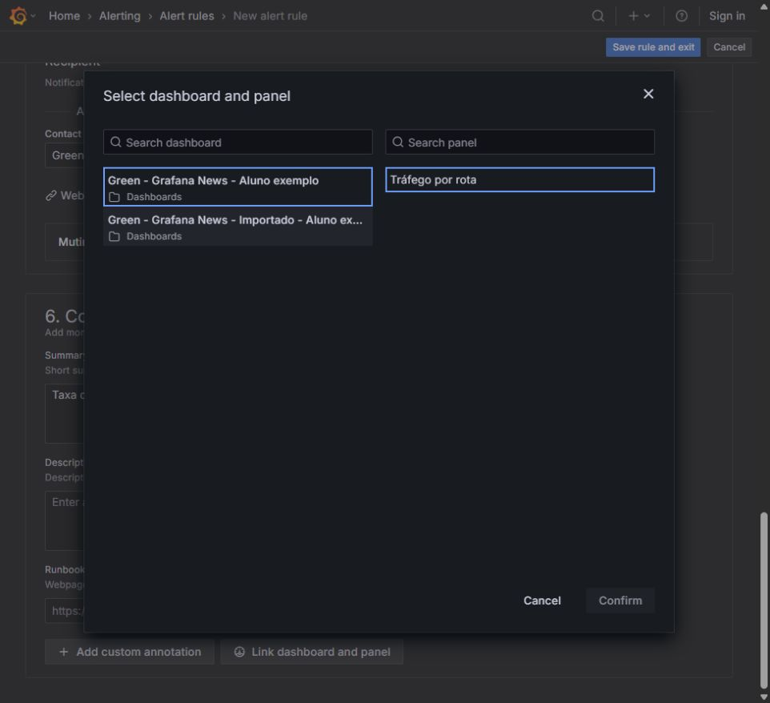
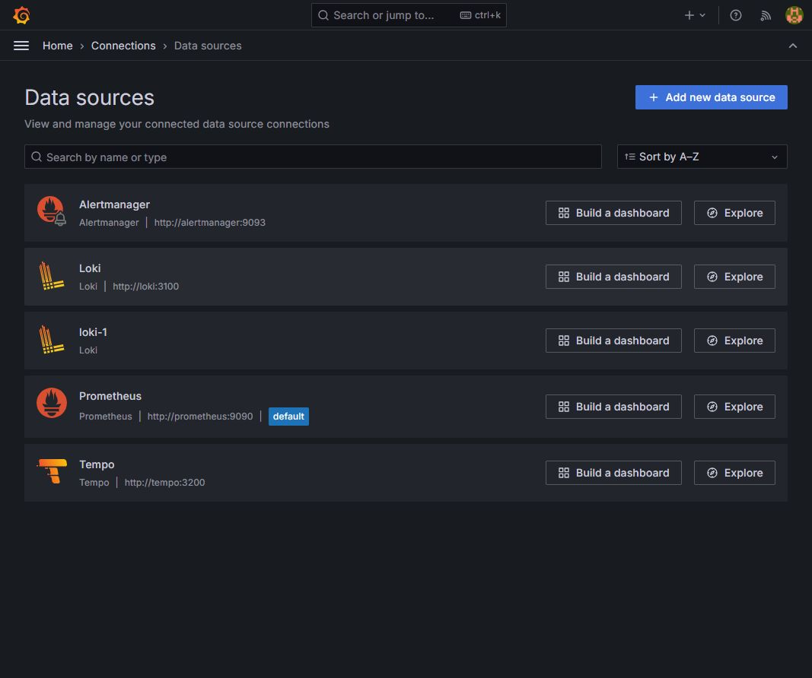
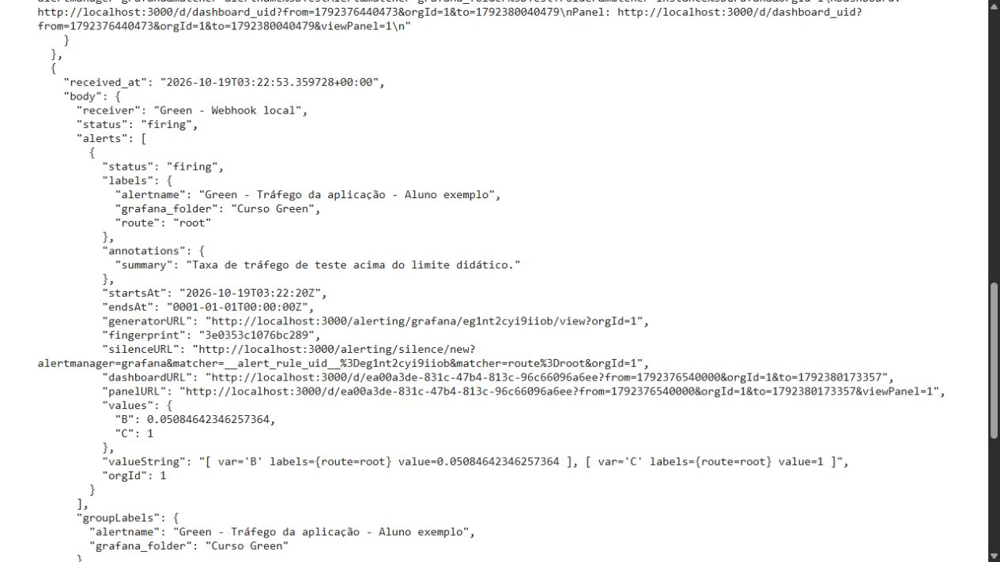
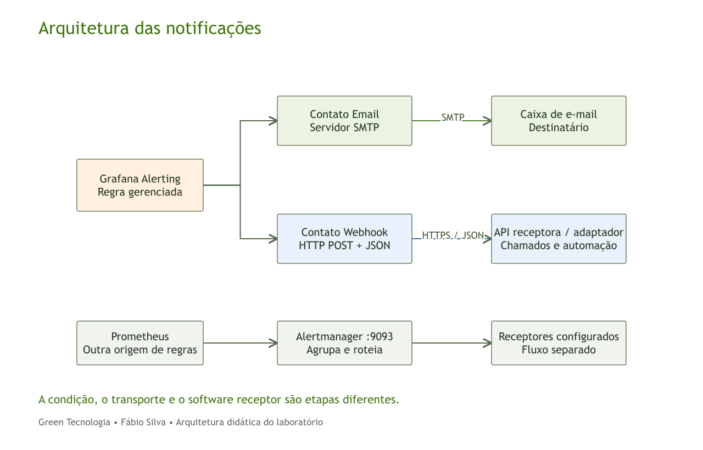
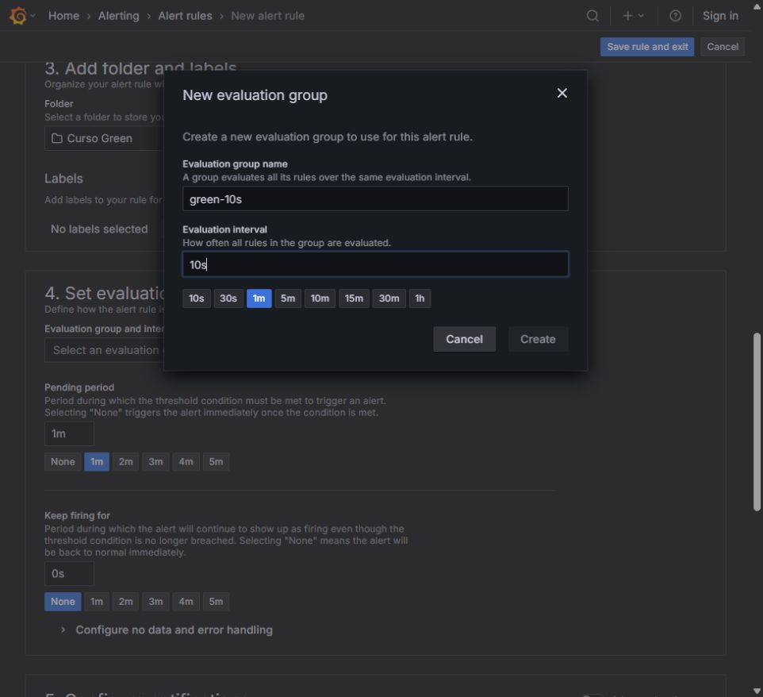
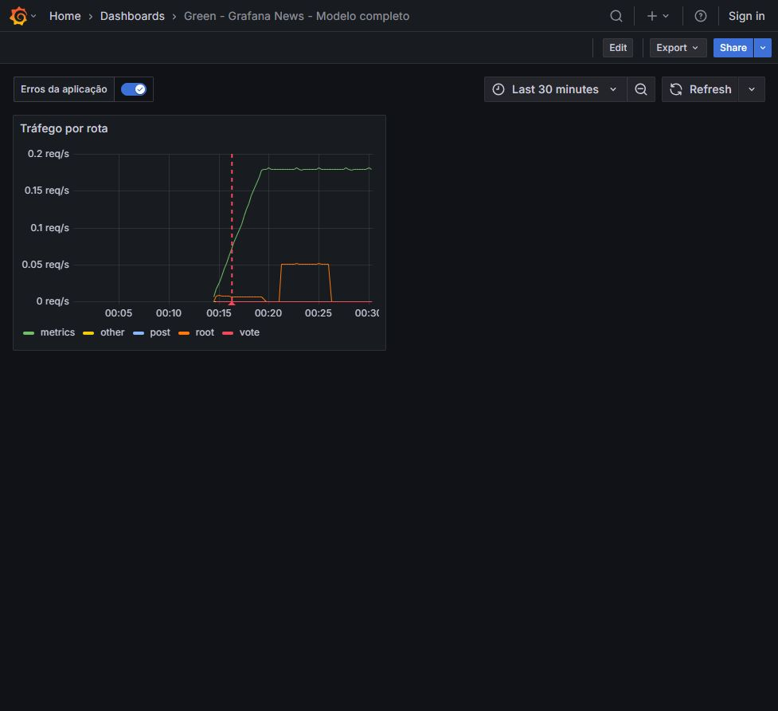

## Noite 5 — Alertas e projeto final

Objetivo: Disparar um alerta e apresentar o dashboard final.

### Fundamentos para acompanhar a teoria

### O que dispara um alerta

Uma regra avalia dados e verifica uma condição.

Um ponto de contato define para onde enviar a notificação.


### Regra, instância e mensagem

A regra define o cálculo e a condição.

A avaliação pode criar instâncias de alerta. A notificação comunica o estado ao contato configurado.



### Consulta da regra

Use Prometheus e a consulta de tráfego por rota.

Confira o resultado antes de definir o limite.



### A, B e C

A consulta produz os dados.

A redução gera o valor avaliado por série. A condição compara esse valor com o limite.


### Escolha de um limite

O limite precisa fazer sentido para a unidade e para o comportamento observado.

Nesta revisão, o exercício local usa 0,01 req/s como limite didático e exclui route="metrics". Esse valor facilita a demonstração com tráfego manual e não é recomendação de produção.


### Avaliação e espera

O intervalo define a frequência de avaliação.

O período pendente define por quanto tempo a condição precisa permanecer verdadeira.



### Estados do alerta

Normal: condição não atendida.

Pending: condição atendida, aguardando o período definido.

Firing: condição atendida após a espera.



### Sem dados e falha de avaliação

No Data indica ausência de dados utilizáveis.

Error indica uma falha ou timeout na avaliação. O comportamento desses casos precisa ser configurado.

### Contato e entrega

O ponto de contato define a integração usada para notificar.

Uma mensagem de teste verifica a comunicação antes de testar o disparo real.


### Duas opções de webhook

O tutorial usa uma URL exclusiva do Webhook.site.

O pacote local inclui um receptor com a mesma finalidade de teste.


### Alerta e painel relacionado

O vínculo informa qual dashboard e painel ajudam na investigação.

O estado do alerta e suas anotações acrescentam contexto visual.



### Referência em vídeo

[How to Display Grafana Alerts to Your Dashboards](https://www.youtube.com/watch?v=ClLp-iSoaSY). Use um trecho na aula conforme a orientação do professor; a referência completa serve ao estudo posterior.

### Diagnóstico de alertas

Sem dados: confira consulta e fonte.

Não dispara: confira valor e condição.

Sem mensagem: confira contato e acesso ao receptor.



### Síntese do ciclo completo

Precisamos confirmar dado, condição, estado e entrega.

O projeto final demonstra o caminho e explica as evidências usadas.

### E-mail e integração com APIs externas

### E-mail: servidor e destinatário

O servidor SMTP permite ao Grafana enviar mensagens.

O ponto de contato Email define quem recebe. São configurações diferentes.

### SMTP: exemplo de configuração

Exemplo ilustrativo no arquivo grafana.ini.

Os valores devem corresponder ao servidor de e-mail disponível. O exemplo não foi aplicado à VM.

```ini
[smtp]
enabled = true
host = smtp.exemplo.invalid:587
from_address = grafana@exemplo.invalid
startTLS_policy = MandatoryStartTLS
```

No Ubuntu, o arquivo costuma ficar em /etc/grafana/grafana.ini. Em Docker, as variáveis GF_SMTP_* ficam no serviço Grafana. SMTP e destinatários não foram configurados nesta VM; são exemplos de localização dos campos.

### Webhook: alerta para uma API externa

O Grafana envia uma requisição HTTP com detalhes do alerta ao endpoint receptor.

O software receptor pode abrir um chamado ou iniciar outro fluxo.

O receptor precisa aceitar a mensagem enviada e sua autenticação. Se o software de chamados exigir outro formato, um adaptador pode transformar a notificação. Uma resposta HTTP 2xx indica aceitação HTTP; confirme o resultado também no software de destino.

### Webhook e API do Grafana

Webhook envia notificações para outro software.

A API do Grafana permite consultar e administrar regras e contatos, conforme permissões e versão.

Exemplos de leitura da API de provisionamento da versão do laboratório: GET /api/v1/provisioning/alert-rules e GET /api/v1/provisioning/contact-points. Exigem autenticação e permissões adequadas. Esses exemplos não foram executados.



### Arquitetura das notificações



O fluxo Grafana-managed utiliza os contatos do Grafana. As regras do Prometheus podem usar o Alertmanager externo em outro caminho. A fonte Alertmanager no Grafana não configura automaticamente o envio de e-mails.

### O que uma integração precisa validar

Confira o evento recebido, o estado, a identificação do alerta e o destino.

Teste também a resolução e evite criar chamados duplicados para a mesma ocorrência.


### Localização dos campos na interface


Alerting > Contact points > Add contact point > Email > Addresses. O formulário foi apenas demonstrado, sem salvar destinatários ou enviar mensagens.


Selecione Webhook, informe a URL do receptor e confira as opções de método e autenticação. O domínio exemplo.invalid é ilustrativo e não deve ser usado como serviço real.

### Exercício 5.1 — Validar o ponto de contato

Tipo: Configuração no navegador. Tempo previsto: 20 minutos.

1. Use o receptor local do pacote: http://localhost:38090 no navegador e http://webhook:8080/ no contato do Grafana.
2. Crie um ponto de contato Webhook no Grafana.
3. Envie uma mensagem de teste e confirme a chegada.
4. Salve o contato.


**Entrega:** Contato salvo e notificação de teste recebida.

**Seu registro:**

- Consulta, comando ou caminho usado: ____________________
- Resultado observado: ____________________
- Interpretação e dúvida: ____________________

### Exercício 5.2 — Criar e disparar a regra

Tipo: Consulta e configuração. Tempo previsto: 30 minutos.

1. Crie uma regra Grafana-managed com identificação do aluno.
2. Use a consulta por rota em A, Reduce / Last em B e Threshold acima de 0.01 em C. Exclua a rota metrics na consulta de A.
3. Use avaliação de 10s, pendente de 0s e o contato testado.
4. Salve, gere tráfego e observe o valor e o estado.
5. Confirme uma notificação da regra no receptor.

Consulta a utilizar:

```
sum(rate(tns_request_duration_seconds_count{route!="metrics"}[5m])) by (route)
```





**Entrega:** Regra avaliada e mensagem de disparo recebida.

**Seu registro:**

- Consulta, comando ou caminho usado: ____________________
- Resultado observado: ____________________
- Interpretação e dúvida: ____________________

### Exercício 5.3 — Vincular e apresentar o projeto

Tipo: Navegação e apresentação. Tempo previsto: 25 minutos.

1. Associe a regra ao seu dashboard e ao painel de tráfego.
2. Mostre a consulta, um erro nos logs e as anotações configuradas.
3. Apresente a evidência de recebimento do alerta.
4. Exporte ou registre seu trabalho antes de encerrar o ambiente.





**Entrega:** Dashboard e regra relacionados, com explicação do fluxo.

**Seu registro:**

- Consulta, comando ou caminho usado: ____________________
- Resultado observado: ____________________
- Interpretação e dúvida: ____________________
