# Noite 3 — Exercícios guiados 3.4 a 3.10 (Loki / LogQL)

Guia V13 • Fábio Silva • Ambiente: **Grafana do professor** (endereço informado em aula), fonte **Loki**, serviço de e-commerce. Grafana 11.3 · Loki 3.3.

Cada exercício tem a **forma certa** e o **erro comum** que vale a pena provocar de propósito. Execute os dois, compare o resultado e registre a explicação. Todas as consultas e mensagens abaixo foram executadas no ambiente do professor em 22/10/2026.

> Dica: no Explore, escolha **Loki**, mude o editor para **Code**, cole a consulta e pressione **Shift+Enter**. Use o período indicado em cada exercício.

| Exercício | Tema | Período |
|---|---|---|
| 3.4 — Selecionar o serviço certo | Seletor de stream | Last 15 minutes |
| 3.5 — Erros pelo label, não pelo texto | Label x filtro de linha | Last 15 minutes |
| 3.6 — Buscar texto ignorando maiúsculas | Filtro de linha com regex | Last 15 minutes |
| 3.7 — Abrir o JSON dentro do JSON | Parser json + line_format | Last 15 minutes |
| 3.8 — Filtrar por status numérico | Filtro de label após parser | Last 15 minutes |
| 3.9 — Contar logs por nível | Consulta de métrica | Last 1 hour |
| 3.10 — Ranking das rotas com falha | Agregação + topk | Last 1 hour |


## Exercício 3.4 — Selecionar o serviço certo

**Tema:** Seletor de stream • **Período:** Last 15 minutes

1. Abra Explore, escolha a fonte Loki e mude o editor para Code.

2. Clique em Label browser, escolha o label service e o valor ecommerce-shop.

3. Confira a consulta montada, execute com Shift+Enter e observe Logs volume.

4. Repita digitando o valor sem aspas e leia a mensagem de erro.

**✔ Forma certa**

```
{service="ecommerce-shop"}
```

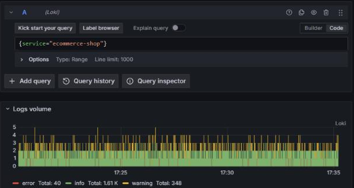

**✘ Erro comum**

```
{service=ecommerce-shop}
```

Sintoma: `parse error at line 1, col 10: syntax error: unexpected IDENTIFIER, expecting STRING`

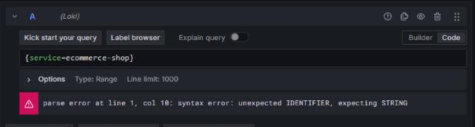

**Por quê:** Valores de label são strings e precisam de aspas duplas. Um seletor vazio ({} ou service=~".*") também é recusado: o Loki exige ao menos um matcher que não aceite vazio.

**Resultado esperado:** Linhas do e-commerce com os níveis INFO, WARNING e ERROR no histograma.

**Registre:** Quantos níveis aparecem no Logs volume? Qual a mensagem de erro do seletor sem aspas?


## Exercício 3.5 — Erros pelo label, não pelo texto

**Tema:** Label x filtro de linha • **Período:** Last 15 minutes

1. Acrescente level="ERROR" ao seletor do exercício anterior.

2. Execute e confirme que o histograma ficou só com a cor de erro.

3. Agora troque por {service="ecommerce-shop"} |= "error" e execute.

4. Compare: por que a segunda consulta não traz nada?

**✔ Forma certa**

```
{service="ecommerce-shop", level="ERROR"}
```

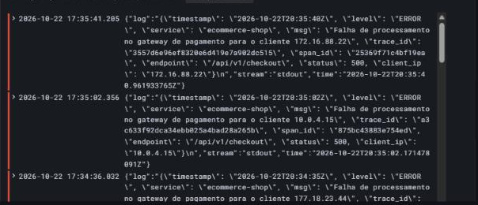

**✘ Erro comum**

```
{service="ecommerce-shop"} |= "error"
```

Sintoma: `No data: 0 linhas (o texto do log usa ERROR em maiúsculas)`

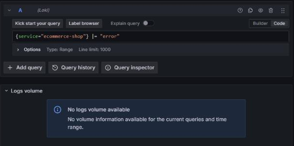

**Por quê:** |= diferencia maiúsculas de minúsculas. Este serviço registra ERROR. Quando o nível já é label, filtrar no seletor é mais rápido e não depende do texto.

**Resultado esperado:** Somente linhas de erro, quase todas de falha no gateway de pagamento.

**Registre:** Anote o horário e a mensagem de duas linhas de erro.


## Exercício 3.6 — Buscar texto ignorando maiúsculas

**Tema:** Filtro de linha com regex • **Período:** Last 15 minutes

1. Volte para {service="ecommerce-shop"}, sem o label level.

2. Acrescente |~ "(?i)gateway de pagamento" e execute.

3. Teste a variação |= "Gateway" e compare a quantidade de linhas.

4. Opcional: exclua um cliente com != "10.0.4.15" depois do filtro.

**✔ Forma certa**

```
{service="ecommerce-shop"} |~ "(?i)gateway de pagamento"
```

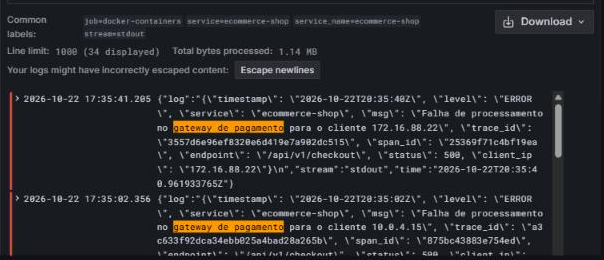

**✘ Erro comum**

```
{service="ecommerce-shop"} |= "Gateway"
```

Sintoma: `No data: 0 linhas (no log a palavra é "gateway", minúscula)`


**Por quê:** (?i) dentro da regex liga a comparação sem diferenciar maiúsculas. |= procura o texto exatamente como foi digitado.

**Resultado esperado:** Linhas ERROR com "Falha de processamento no gateway de pagamento".

**Registre:** Qual dos dois filtros é mais seguro quando você não conhece o texto exato? Por quê?


## Exercício 3.7 — Abrir o JSON dentro do JSON

**Tema:** Parser json + line_format • **Período:** Last 15 minutes

1. Abra uma linha e veja o envelope do Docker: {"log": "{...}", "stream": ..., "time": ...}.

2. Digite a consulta certa: json, line_format "{{.log}}" e json de novo.

3. Execute e confira que cada linha mostra nível, rota e mensagem.

4. Teste a versão com um único | json e veja as linhas quase vazias.

**✔ Forma certa**

```
{service="ecommerce-shop"} | json | line_format "{{.log}}" | json | line_format "{{.level_extracted}} {{.endpoint}} {{.msg}}"
```

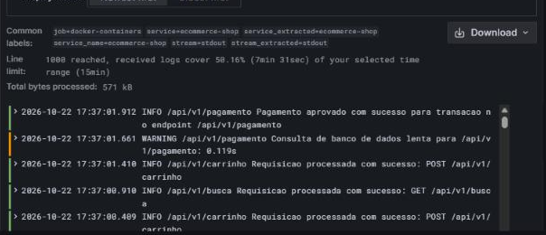

**✘ Erro comum**

```
{service="ecommerce-shop"} | json | line_format "{{.level}} {{.endpoint}} {{.msg}}"
```

Sintoma: `Linhas como "INFO  ": endpoint e msg vazios`

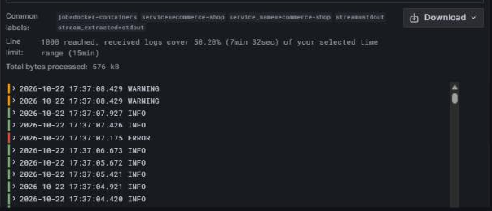

**Por quê:** O primeiro json só enxerga log, stream e time. É preciso trocar a linha pelo conteúdo de log e aplicar json outra vez para chegar em msg, endpoint e status. Como level já é label, o campo extraído vira level_extracted.

**Resultado esperado:** Linhas legíveis: ERROR /api/v1/checkout Falha de processamento no gateway...

**Registre:** Expanda uma linha e liste quatro campos extraídos.


## Exercício 3.8 — Filtrar por status numérico

**Tema:** Filtro de label após parser • **Período:** Last 15 minutes

1. Parta da consulta do 3.7 e troque o último line_format por | status >= 500.

2. Execute e confira que só restam respostas 500.

3. Teste o filtro sem parser: {service="ecommerce-shop"} | status >= 500.

4. Teste também status >= "500" com aspas e leia o erro.

**✔ Forma certa**

```
{service="ecommerce-shop"} | json | line_format "{{.log}}" | json | status >= 500
```

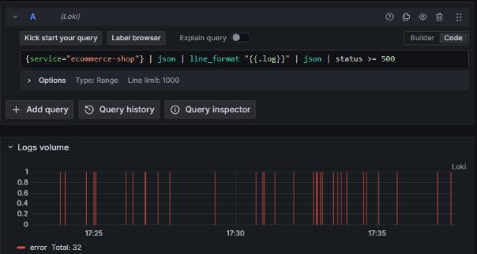

**✘ Erro comum**

```
{service="ecommerce-shop"} | status >= 500
```

Sintoma: `No data: status ainda não existe sem o parser.  Com "500" entre aspas: syntax error: unexpected STRING`

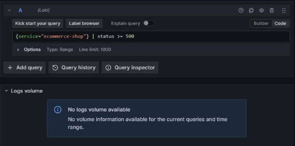

**Por quê:** Filtros de label só enxergam campos que já foram extraídos. Números são comparados sem aspas.

**Resultado esperado:** Somente linhas com status 500 nas rotas de checkout e pagamento.

**Registre:** Quais rotas aparecem com status 500?


## Exercício 3.9 — Contar logs por nível

**Tema:** Consulta de métrica • **Período:** Last 1 hour

1. Escreva sum by (level) (count_over_time({service="ecommerce-shop"}[5m])).

2. Execute com Last 1 hour e observe as três séries no gráfico.

3. Remova [5m] e leia a mensagem de erro.

4. Troque count_over_time por rate e compare a unidade.

**✔ Forma certa**

```
sum by (level) (count_over_time({service="ecommerce-shop"}[5m]))
```

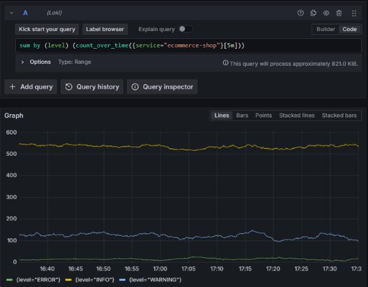

**✘ Erro comum**

```
count_over_time({service="ecommerce-shop"})
```

Sintoma: `parse error: syntax error: unexpected )`

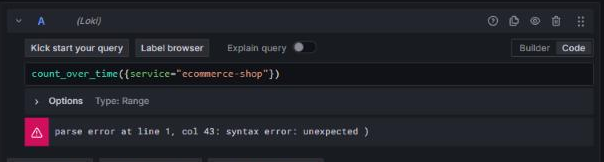

**Por quê:** Funções de range precisam da janela entre colchetes. count_over_time conta linhas na janela; rate divide pelos segundos da janela.

**Resultado esperado:** Três séries: INFO (maior), WARNING e ERROR.

**Registre:** Quantas linhas ERROR em 5 minutos no ponto mais alto?


## Exercício 3.10 — Ranking das rotas com falha

**Tema:** Agregação + topk • **Período:** Last 1 hour

1. Escreva a consulta certa com parser dentro de count_over_time e status >= 400.

2. Execute e identifique as três rotas com mais respostas de falha.

3. Remova o parser e o filtro de status e execute de novo.

4. Compare: por que a versão sem parser devolve uma única série sem nome?

**✔ Forma certa**

```
topk(3, sum by (endpoint) (count_over_time({service="ecommerce-shop"} | json | line_format "{{.log}}" | json | status >= 400 [15m])))
```

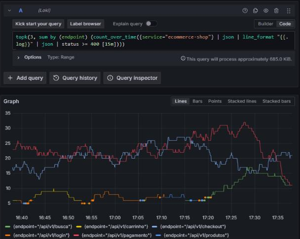

**✘ Erro comum**

```
topk(3, sum by (endpoint) (count_over_time({service="ecommerce-shop"} [15m])))
```

Sintoma: `Uma única série {}: o label endpoint não existe sem o parser`

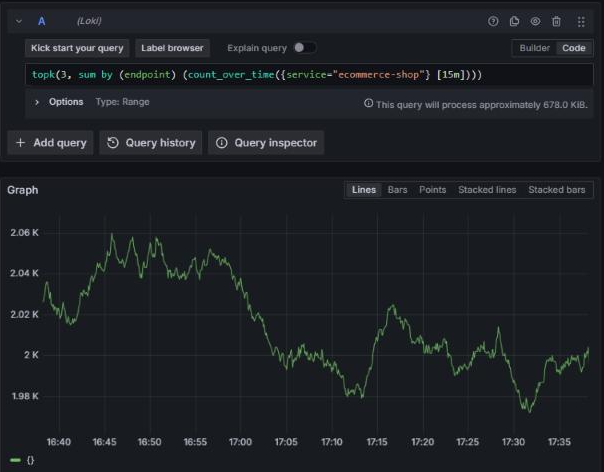

**Por quê:** Para agrupar por um campo de dentro do JSON, o parser precisa estar na consulta interna, antes da janela.

**Resultado esperado:** Séries por rota com status >= 400. topk escolhe as 3 maiores em cada ponto, por isso mais nomes podem aparecer na legenda ao longo de 1 hora.

**Registre:** Qual rota lidera? A falha é 404 (não encontrado) ou 500 (erro do servidor)?


## Cola rápida

```
{service="ecommerce-shop"}                         # seletor
{service="ecommerce-shop", level="ERROR"}          # label de nível
|= "texto"   != "texto"   |~ "(?i)regex"           # filtros de linha
| json | line_format "{{.log}}" | json             # JSON dentro do envelope Docker
| status >= 500                                      # filtro numérico (sem aspas)
sum by (level) (count_over_time({...}[5m]))          # métrica a partir de logs
topk(3, sum by (endpoint) (count_over_time({...} | json ... [15m])))
```
