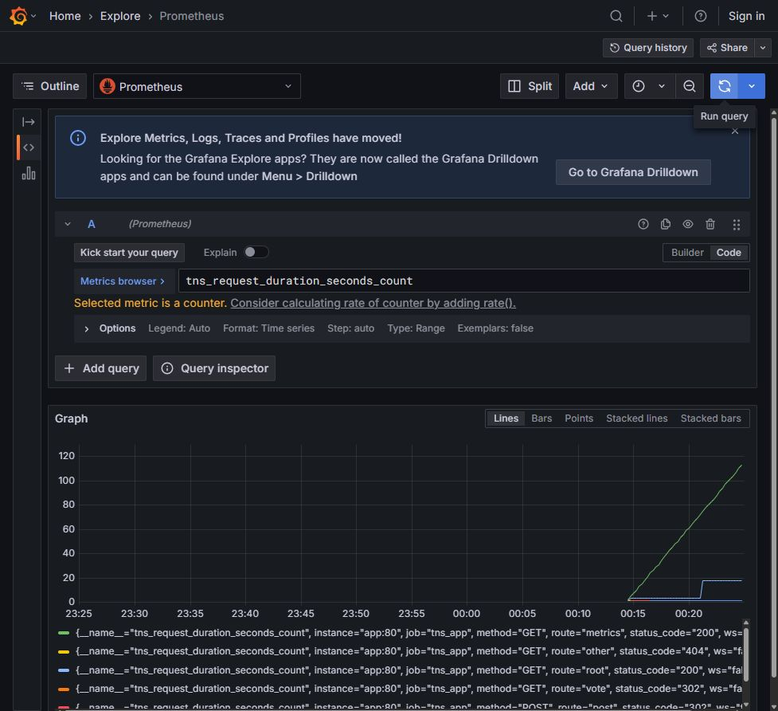
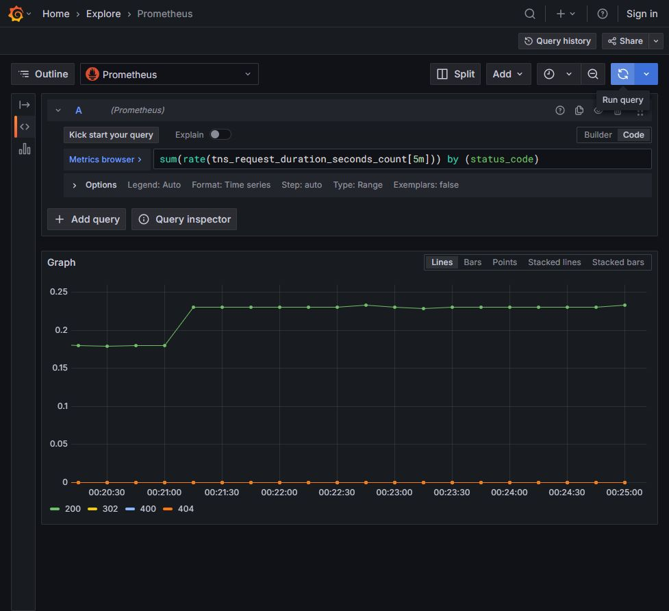

# Noite 2 — Métricas e PromQL

Guia visual V8 • Prática 21h00–22h15 • Fábio Silva

Execute na ordem. As telas são do ambiente do aluno, Grafana 12.0.1.

## Exercício 2.1 — Etapa 1: Selecionar a fonte no Explore

1. Abra http://localhost:3300 e, no menu principal, clique em Explore.

2. Clique no seletor de fonte no topo da área de consulta. Ele pode mostrar apenas o ícone e uma seta em uma tela estreita.

3. Na lista, clique em Prometheus. Não selecione TestData nem Loki.

4. No editor da consulta A, marque Code à direita de Builder. Se houver uma consulta anterior, clique dentro do editor e use Ctrl+A para substituí-la.

5. Se um aviso azul sobre Drilldown ocupar a tela, feche-o pelo X do próprio aviso. O exercício continua no Explore.

**Resultado esperado:** A consulta A indica Prometheus e o modo Code está ativo.

**Se não funcionar:** Se o editor mencionar Loki query, troque a fonte para Prometheus. PromQL não é executado na fonte Loki.


## Exercício 2.1 — Etapa 2: Executar e interpretar o contador

1. Cole a consulta abaixo no editor A. Use aspas retas e copie somente a consulta, sem as marcas de bloco de código.

2. Clique em Run query, no topo à direita, ou use Shift+Enter. Aguarde o gráfico carregar.

3. Abra o seletor de período e use Last 15 minutes. Isso é suficiente para um laboratório recém-iniciado.

4. Leia a legenda abaixo do gráfico. Identifique route e status_code em pelo menos duas séries.

5. Anote que o valor representa uma contagem de requisições por combinação de labels, não CPU, tempo em segundos ou req/s.

6. Atualize a aplicação em outra aba, aguarde aproximadamente 10 segundos e execute Run query novamente. O contador pode voltar a zero se o processo reiniciar.

```

tns_request_duration_seconds_count

```

**Resultado esperado:** O gráfico mostra séries do contador, com labels como route e status_code.

**Se não funcionar:** Em No data, confirme a fonte Prometheus, abra a aplicação, atualize-a, aguarde duas coletas de 5s e execute novamente. Um gráfico vazio à esquerda do horário de início do lab é esperado.



## Exercício 2.2 — Etapa 3: Mudar o período pela tela

1. No Explore, clique no botão de período ao lado de Run query. Ele mostra algo como Last 1 hour ou Last 15 minutes.

2. Na lista de períodos relativos, clique no texto Last 5 minutes. O menu fecha ao aplicar a seleção.

3. Confirme que o botão passou a mostrar Last 5 minutes.

4. Se o período aparecer apenas como um relógio, expanda Show more items ou feche o menu lateral.

5. Não preencha datas absolutas neste exercício. Agora mostraremos o período mais recente, acompanhando o relógio do computador.

**Resultado esperado:** O período visível é Last 5 minutes.

**Se não funcionar:** Se você clicou e nada mudou, clique no texto do intervalo, não na borda da caixa. Um período absoluto não avança sozinho.


## Exercício 2.2 — Etapa 4: Calcular a taxa por rota

1. Substitua a consulta A pela expressão abaixo e clique em Run query.

2. Volte à aplicação e atualize a página 10 a 15 vezes. Espere cerca de 10 segundos para que o Prometheus colete novas amostras.

3. Volte ao Explore e clique em Run query novamente. Na legenda, localize root, post e vote, se estiverem presentes.

4. Leia a taxa na curva. A unidade é requisições por segundo. A função rate usa as amostras dos últimos 5 minutos.

5. Observe também a rota metrics: ela recebe as requisições de coleta do próprio Prometheus. Esse tráfego não significa que um aluno visitou a aplicação.

6. Anote uma rota, um valor aproximado e o período. Um valor 0,05 req/s equivale, em média, a uma requisição a cada 20 segundos.

```

sum(rate(tns_request_duration_seconds_count[5m])) by (route)

```

**Resultado esperado:** Você identifica taxas por rota e diferencia o scrape das ações do usuário.

**Se não funcionar:** Taxas pequenas são normais quando você clica poucas vezes. Não espere um número igual ao print. Zero com uma série presente é diferente de No data.


## Exercício 2.3 — Etapa 5: Comparar por status HTTP

1. Substitua by (route) por by (status_code), usando a consulta completa abaixo.

2. Execute Run query e leia a legenda: por exemplo 200, 302, 400 ou 404, conforme as ações já feitas.

3. Compare: route agrupa pelo caminho lógico; status_code agrupa pelo código de resposta. A unidade continua req/s.

4. Troque Last 5 minutes por Last 15 minutes e depois volte. A janela interna [5m] continua a mesma.

5. Registre as duas consultas e explique, em suas palavras, a diferença entre janela do rate e período exibido.

6. Entregue uma captura por agrupamento. A ausência de 400 é normal antes do erro que será produzido na Noite 3.

```

sum(rate(tns_request_duration_seconds_count[5m])) by (status_code)

```

**Resultado esperado:** Você compara as mesmas requisições usando dimensões diferentes.

**Se não funcionar:** Uma série nova aparece somente depois de a aplicação produzir aquela combinação de labels. Não invente erro para fazer a legenda coincidir com o print.


