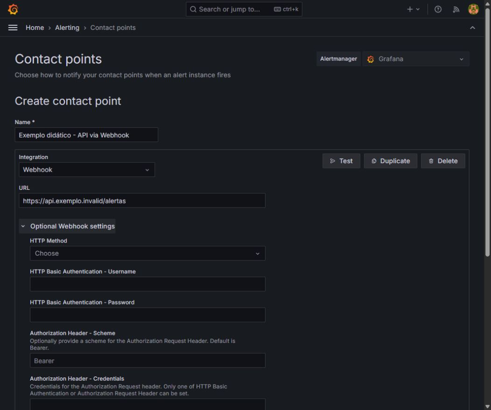

# Grafana Visualizando Dados

Green Tecnologia — Fábio Silva, Arquiteto de Soluções.

## Como usar esta apostila

Revisão V8: os resumos de exercícios deste bloco são acompanhados pelo Guia Visual de 60 páginas, incorporado depois da parte conceitual. Para executar a atividade, siga os passos completos, as capturas e o diagnóstico do guia, também disponível em alunos/Guia_Visual_Exercicios_V8.html.

Na Noite 4, a criação manual e a importação com personalização são trilhas alternativas. Na Noite 5, o limite didático foi ajustado a 0,01 req/s e a consulta exclui a rota interna metrics. As telas locais do aluno são do Grafana 12.0.1; as demonstrações do professor são complementares.

O curso apresenta os fundamentos antes de executar os procedimentos. Durante a teoria, acompanhe os exemplos e registre perguntas. Na demonstração, observe o professor. Depois do intervalo, acompanhe os exercícios comentados e receba a folha da noite para trabalhar no seu ambiente local.

São cinco noites, das 18h30 às 22h30, com 25 minutos de intervalo. Cada noite tem 85 minutos de teoria. O roteiro abaixo reserva o tempo de demonstração e de prática de forma separada.

| Bloco | Horário | Duração |
|---|---|---|
| Teoria | 18h30–19h55 | 85 min |
| Demonstração | 19h55–20h20 | 25 min |
| Intervalo | 20h20–20h45 | 25 min |
| Exercícios comentados | 20h45–21h00 | 15 min |
| Prática do aluno | 21h00–22h15 | 75 min |
| Correção | 22h15–22h30 | 15 min |

## Material e ambiente local

O professor poderá distribuir a versão da turma pelo GitHub ou pelo Google Drive. Os links finais serão informados antes da aula. Nesta entrega não foi criado repositório nem publicado arquivo no Drive.

No GitHub, clone o repositório informado pelo professor ou baixe seu ZIP. No Google Drive, baixe o ZIP completo e extraia antes de executar. Use uma única revisão do pacote para manter slides, folhas e laboratório consistentes.

O caminho Docker é o laboratório executável. O roteiro Ubuntu apresenta a segunda instalação, cujos scripts serão preparados e testados depois pelo professor em VM Azure.

### Iniciar Docker

Entre na pasta lab/tutorial-environment e execute:

```bash
docker ps
docker compose -p green-fundamentals up -d --build
docker compose -p green-fundamentals ps
```

No Windows, pode usar iniciar-lab.ps1; no Linux, bash iniciar-lab.sh. Docker e Compose precisam estar instalados e ativos. O primeiro download pode levar alguns minutos.

| Serviço | Navegador no ambiente local | Endereço entre containers |
|---|---|---|
| Grafana | http://localhost:3300 | http://grafana:3000 |
| Aplicação | http://localhost:38081 | http://app:80 |
| Prometheus | http://localhost:39090 | http://prometheus:9090 |
| Loki | http://localhost:33100 | http://loki:3100 |
| Receptor de notificações | http://localhost:38090 | http://webhook:8080/ |

O pacote usa portas diferentes do repositório original para evitar conflitos conhecidos no ambiente de preparação. Se clonar diretamente https://github.com/grafana/tutorial-environment, confira os endereços: Grafana 3000 e aplicação 8081 no snapshot usado pelo curso.

O Grafana Docker do exemplo usa acesso anônimo administrativo para a demonstração. Os serviços publicados no pacote ficam vinculados a 127.0.0.1. Não transfira essa configuração automaticamente para produção.

## Noite 1 — Fundamentos e arquitetura

Objetivo: compreender os sinais, o papel das ferramentas e os caminhos dos dados antes da prática.

### O que é observabilidade?

É a capacidade de investigar o estado interno de um sistema a partir dos sinais que ele produz.

A investigação começa com uma pergunta e usa evidências para testar explicações.

Uma investigação pode começar pela lentidão do checkout e avançar até a etapa responsável pelo atraso. A capacidade de fazer perguntas úteis depende de coleta, contexto e correlação, além da ferramenta de visualização.

### Monitoramento e investigação

Monitoramento acompanha condições conhecidas e avisa quando uma regra é atendida.

Observabilidade ajuda a investigar perguntas novas sobre o comportamento do sistema.

Um alerta de taxa de erros acompanha uma condição conhecida. Para descobrir em qual rota, versão ou serviço o problema se concentra, precisamos investigar os dados. Os dois usos se complementam.

### Métricas: medidas ao longo do tempo

Métricas são valores numéricos associados a instantes e dimensões.

Permitem acompanhar tendências e comparar grupos com consultas agregadas.

Toda leitura precisa de unidade, período e identificação do que foi medido. Uma taxa de 12 req/s e um total de 12 requisições descrevem quantidades diferentes. As labels separam as séries por dimensões como rota e instância.

### Logs: registros de eventos

Logs registram acontecimentos com horário e contexto.

Uma linha pode conter nível, serviço, mensagem, rota e identificador de trace.

Uma mensagem de erro é evidência registrada pela aplicação, mas pode não conter toda a causa do problema. Logs estruturados facilitam a extração de campos e a busca; volume e retenção também precisam ser planejados.

### Traces: caminho de uma requisição

Um trace reúne o trabalho associado a uma requisição.

Cada span representa uma etapa, com início, duração e atributos.

Spans podem se sobrepor quando o trabalho acontece em paralelo. Por isso, somar as durações de todos eles nem sempre produz a duração total do trace. Instrumentação e propagação do contexto precisam existir na aplicação.

### Métricas, logs e traces juntos

A métrica mostra a mudança.
O log acrescenta contexto.
O trace mostra as etapas.

A conclusão depende da combinação das evidências.

Um aumento de latência, um evento de timeout e um span demorado no pagamento sustentam uma hipótese de investigação. A proximidade de dois eventos no tempo, isoladamente, não prova uma relação de causa.

### O que é o Grafana?

É uma plataforma para consultar, explorar e visualizar dados de diferentes fontes.

Permite criar dashboards e regras de alerta sobre os dados conectados.

Neste laboratório, a telemetria fica nos backends Prometheus, Loki e Tempo. O Grafana guarda configurações e dashboards e consulta as fontes conectadas. Uma fonte de dados define como conectar; a consulta define o que selecionar; o painel define como apresentar.

### Grafana: vantagens e limites

Vantagens
Reúne fontes, visualizações e alertas em uma interface.

Limites
Depende da coleta, das fontes disponíveis e da qualidade das consultas.

A vantagem é reunir diferentes fontes em uma experiência de consulta e acompanhamento. A limitação é que um dashboard depende de coleta e consultas corretas. Recursos de autenticação e governança também variam entre edições e configurações.

### O que é o Prometheus?

É um sistema de monitoramento e alertas que coleta e armazena métricas em séries temporais.

Neste laboratório, consulta endpoints HTTP de métricas periodicamente.

No modelo pull do laboratório, o Prometheus inicia um pedido HTTP a cada endpoint de métricas. A resposta contém amostras que são armazenadas por nome de métrica e combinação de labels. O Grafana consulta essas séries por meio da API do Prometheus.

### Prometheus: vantagens e limites

Vantagens
Modelo por labels, PromQL e ecossistema de exporters.

Limites
Alta cardinalidade e retenção exigem planejamento. Não guarda logs nem traces.

Cada nova combinação de valores de labels cria uma série diferente. IDs de requisições ou usuários podem multiplicar esse número. A coleta periódica é apropriada para acompanhamento operacional, mas não substitui registros exatos de faturamento ou auditoria transacional.

### Counter, gauge e distribuições

Counter acumula ocorrências e pode reiniciar.
Gauge sobe e desce.

Histogram e summary descrevem distribuições de observações.

Um counter pode voltar a zero quando o processo reinicia. A função rate interpreta a evolução do contador e trata seus resets. Histogramas agrupam observações em buckets; summaries podem calcular quantis no cliente. Counter e gauge são o foco dos primeiros exercícios.

### O que é o Loki?

É um backend para armazenar e consultar logs.

Organiza fluxos por labels e usa LogQL para selecionar eventos e obter medidas derivadas.

O modelo de indexação do Loki se apoia em labels e metadados, enquanto o corpo dos logs é compactado em chunks. Uma aplicação ou um agente precisa enviar os eventos; instalar somente o Loki não cria a coleta dos arquivos.

### Loki: vantagens e limites

Vantagens
Integração com o Grafana e correlação por contexto.

Limites
Labels mal escolhidos e buscas amplas podem aumentar o custo das consultas.

Selecionar poucos fluxos e um período adequado reduz a quantidade de dados examinada. Labels de cardinalidade elevada podem fragmentar excessivamente os fluxos. Não existe uma economia percentual de armazenamento garantida para qualquer instalação.

### O que é o Tempo?

É um backend para armazenar e consultar traces distribuídos.

Recebe spans de aplicações instrumentadas e permite investigar a duração das etapas.

A porta 4318 recebe OTLP HTTP no ambiente do professor. A porta 3200 atende a API de consulta do Tempo. Receber spans e consultar traces são funções distintas. A aplicação de demonstração usa o SDK OpenTelemetry para enviar spans diretamente.

### Tempo: vantagens e limites

Vantagens
Expõe etapas e durações da requisição; permite navegar a partir do trace_id.

Limites
Depende de instrumentação, propagação de contexto e retenção.

A árvore de spans ajuda a localizar etapas demoradas. Sua completude depende da instrumentação, da propagação de contexto, da amostragem e da retenção. Um backend de traces instalado não produz automaticamente spans de todas as aplicações.

### PromQL: consulta de métricas

PromQL seleciona, filtra e combina séries temporais.

rate calcula uma taxa a partir de um contador; sum pode agregar as séries.

A janela [5m] fornece as amostras para rate. Já Last 1 hour controla o período exibido na tela. Agregar por route soma as séries de cada rota. Esses passos serão praticados com as métricas tns_ do Grafana News na Noite 2.

```promql
sum(rate(tns_request_duration_seconds_count[5m])) by (route)
```

### LogQL: consulta de logs

O seletor escolhe os fluxos.
Os filtros escolhem linhas.
Parsers extraem campos.

Também é possível calcular contagens e taxas a partir dos eventos.

No laboratório do professor, service identifica a aplicação. No Grafana News, os exercícios usam filename. O filtro |= seleciona texto nas linhas; o parser | json extrai campos de conteúdo JSON. Um envelope Docker pode exigir primeiro expor seu campo log.

```logql
{service="ecommerce-shop"} |= "ERROR"
```

### TraceQL: consulta de traces

TraceQL seleciona traces a partir de condições sobre spans, recursos e duração.

Um TraceID conhecido também permite abrir uma requisição específica.

Uma expressão como { resource.service.name = "ecommerce-shop" } seleciona traces com spans do serviço. Já um TraceID conhecido abre uma requisição específica. Nem todo intervalo terá traces que correspondam à condição escolhida.

```traceql
{ resource.service.name = "ecommerce-shop" }
```

### Promtail: papel no laboratório

Promtail acompanha arquivos e logs de containers, acrescenta labels e envia os eventos ao Loki por HTTP.

Ele aparece aqui por fazer parte do ambiente legado do curso.

Promtail lê logs continuamente, acrescenta labels e envia os eventos para a API HTTP do Loki. Ele não é o responsável pelo envio de spans ao Tempo neste ambiente. Uma linha de log com trace_id e um span são registros diferentes ligados pelo contexto.

### Promtail e a migração para Alloy

Promtail encerrou o suporte em 2 de março de 2026.

Para novas implantações, estude Grafana Alloy ou outro coletor mantido. O laboratório preserva o fluxo legado para comparação.

O suporte ao Promtail terminou em 02/03/2026. O curso mantém o fluxo legado para compreender o laboratório existente e apresenta a migração para Alloy como evolução. A migração exige conversão e validação da configuração; ela não foi executada na VM nesta entrega.

### Arquitetura do ambiente do professor


Grafana consulta Prometheus com PromQL, Loki com LogQL e Tempo com TraceQL. Prometheus inicia o scrape dos exporters. O coletor de logs envia ao Loki e a aplicação instrumentada envia spans ao Tempo.

### Coleta de métricas: modelo pull


As setas representam o pedido HTTP de coleta. As amostras retornam na resposta e ficam na TSDB. O intervalo de 5 segundos é a configuração do arquivo local do professor; ele deve ser escolhido conforme o ambiente.

### Caminhos separados de logs e traces


A aplicação gera eventos em stdout ou arquivos e também spans pelo SDK OpenTelemetry. Promtail coleta os eventos e envia ao Loki. Os spans seguem por OTLP HTTP até o Tempo, sem passar pelo Promtail.

### Tutorial do aluno e demonstração

O aluno usa Grafana News no ambiente local.

O professor também mostra host, containers e e-commerce na VM Azure. Os conceitos são os mesmos; as métricas e labels mudam.

Os coletores de host e containers e a aplicação de e-commerce não fazem parte do pacote básico Grafana News. Antes de executar uma consulta, confirme se está usando a fonte e o ambiente correspondentes.

### Preparação para a demonstração

Vamos observar a instalação Docker, a aplicação, as fontes e a navegação.

O roteiro Ubuntu explica a segunda instalação. Os scripts nativos serão validados antes da distribuição.

Docker e Compose precisam estar ativos. O professor demonstra antes do intervalo; os alunos recebem e executam as folhas a partir das 21h00. A instalação nativa de Grafana no Ubuntu é uma rota separada; ela não instala automaticamente toda a pilha de observabilidade.

### Referência em vídeo

https://www.youtube.com/watch?v=TQur9GJHIIQ

### Exercício 1.1 — Obter e iniciar o laboratório Docker

Tipo: Execução local. Tempo previsto: 25 minutos.

1. Baixe o pacote oficial da turma pelo GitHub ou Google Drive quando o professor disponibilizar o link.
2. Extraia ou clone a pasta completa e abra lab/tutorial-environment.
3. Confirme Docker ativo e inicie com o script de entrada ou Compose.
4. Abra a aplicação e o Grafana nos endereços locais do pacote.

**Entrega:** Ambiente local iniciado e dois endereços acessíveis.

**Seu registro:**

- Consulta, comando ou caminho usado: ____________________
- Resultado observado: ____________________
- Interpretação e dúvida: ____________________

### Exercício 1.2 — Gerar atividade conhecida

Tipo: Navegação no navegador. Tempo previsto: 25 minutos.

1. Na aplicação Grafana News, publique um link com título e URL válidos.
2. Vote no link e atualize a página.
3. Registre o horário e descreva as ações feitas.

**Entrega:** Link publicado, voto registrado e anotação do horário.

**Seu registro:**

- Consulta, comando ou caminho usado: ____________________
- Resultado observado: ____________________
- Interpretação e dúvida: ____________________

### Exercício 1.3 — Reconhecer os recursos do Grafana

Tipo: Navegação no Grafana. Tempo previsto: 25 minutos.

1. Localize Explore, Dashboards e Connections.
2. Abra a fonte Prometheus já existente.
3. Identifique a URL interna e teste a conexão quando disponível.
4. Escreva uma frase sobre o papel de cada recurso.

**Entrega:** Fonte identificada e explicação dos recursos de navegação.

**Seu registro:**

- Consulta, comando ou caminho usado: ____________________
- Resultado observado: ____________________
- Interpretação e dúvida: ____________________

## Noite 2 — Exploração de métricas

Objetivo: Consultar o tráfego da aplicação e explicar o resultado.

### Fundamentos para acompanhar a teoria

### Uma série temporal

Uma série relaciona valores a instantes.

Os labels distinguem séries, como as requisições de uma rota ou de um código de resposta.

### Métrica, valor e unidade

O nome identifica o que se mede. O valor precisa de unidade e contexto.

O sufixo _count indica uma contagem de observações, e não duração em segundos.

### Counter e gauge

Counter acumula ocorrências e pode reiniciar com o processo.

Gauge representa um valor que pode aumentar ou diminuir.

### Contador e taxa

Um contador acumula ocorrências. Pode reiniciar quando o processo reinicia.

Para acompanhar o ritmo das requisições, usamos uma taxa por segundo.

### O significado de uma taxa

Um aumento de 120 ocorrências em 60 segundos sugere uma média de 2 ocorrências por segundo.

rate usa as amostras da janela para estimar essa taxa.

### A função rate

A janela de cinco minutos fornece amostras para calcular a taxa.

O resultado representa requisições por segundo para cada série.

### Labels identificam séries

Cada combinação de labels distingue uma série.

route separa rotas e status_code separa códigos de resposta.

### Agrupamento por rota

sum agrega valores de séries. by(route) preserva uma série para cada rota.

A legenda ajuda a relacionar cada linha à sua origem.

### Agrupamento por status

Troque route por status_code.

A mesma métrica agora responde a uma pergunta diferente sobre as respostas da aplicação.

### Filtro e agrupamento

Um filtro restringe as séries selecionadas.

Uma agregação combina valores; by preserva os grupos escolhidos.

### Intervalo e atualização

O seletor de tempo define o período exibido.

A atualização automática executa novamente a consulta. Ela não muda o intervalo de coleta do Prometheus.

### Sem dados no gráfico

Confira a fonte, o nome da métrica e o período.

A consulta rate precisa de amostras suficientes na janela selecionada.

### Leitura crítica do resultado

Interprete o número com unidade, período e agrupamento.

Compare as séries antes de concluir que uma mudança representa um problema.

### Exercício 2.1 — Explorar a métrica da aplicação

Tipo: Consulta no navegador. Tempo previsto: 25 minutos.

1. Abra Explore e selecione Prometheus.
2. Execute a métrica bruta.
3. Identifique dois labels disponíveis e registre o significado do valor.

Consulta a utilizar:

```
tns_request_duration_seconds_count
```

**Entrega:** Consulta executada e interpretação da contagem.

**Seu registro:**

- Consulta, comando ou caminho usado: ____________________
- Resultado observado: ____________________
- Interpretação e dúvida: ____________________

### Exercício 2.2 — Consultar a taxa por rota

Tipo: Consulta no navegador. Tempo previsto: 25 minutos.

1. Execute a consulta de taxa por rota.
2. Gere atividade na aplicação e aguarde a coleta.
3. Escolha Last 5 minutes e compare as séries.
4. Registre a unidade e a rota identificada.

Consulta a utilizar:

```
sum(rate(tns_request_duration_seconds_count[5m])) by (route)
```

**Entrega:** Taxa interpretada com unidade e agrupamento.

**Seu registro:**

- Consulta, comando ou caminho usado: ____________________
- Resultado observado: ____________________
- Interpretação e dúvida: ____________________

### Exercício 2.3 — Comparar agrupamentos

Tipo: Consulta e navegação. Tempo previsto: 25 minutos.

1. Troque o agrupamento por status_code.
2. Compare o resultado com o agrupamento por rota.
3. Mude o período mostrado e descreva o efeito.
4. Entregue uma frase explicando cada consulta.

Consulta a utilizar:

```
sum(rate(tns_request_duration_seconds_count[5m])) by (status_code)
```

**Entrega:** Duas consultas comparadas e uma conclusão sustentada.

**Seu registro:**

- Consulta, comando ou caminho usado: ____________________
- Resultado observado: ____________________
- Interpretação e dúvida: ____________________

## Noite 3 — Exploração de logs

Objetivo: Conectar o Loki e localizar um erro provocado na aplicação.

### Fundamentos para acompanhar a teoria

### Métricas e eventos

Uma métrica ajuda a perceber uma mudança.

Um log pode trazer o contexto do evento que ocorreu naquele instante.

### Estrutura de um evento de log

Um evento tem horário e conteúdo.

A mensagem e os campos disponíveis ajudam a relacionar o registro ao que a aplicação executou.

### Labels e conteúdo no Loki

Os labels selecionam os fluxos de logs.

Os filtros de linha restringem o conteúdo retornado.

### Leitura do seletor LogQL

As chaves delimitam o seletor.

O label filename identifica o arquivo usado neste ambiente de demonstração.

### Filtro por texto

O operador |= mantém as linhas que contêm o texto indicado.

A seleção do fluxo continua valendo.

### Leitura de uma linha

Observe o horário e o conteúdo do evento.

Expanda uma linha para inspecionar os campos disponíveis e relacioná-los à ação no navegador.

### Erro, evento e diagnóstico

Um erro conhecido ajuda a validar o caminho de observação.

O registro encontrado precisa corresponder à ação e ao período investigados.

### A janela da investigação

Use o horário do evento para reduzir o período.

Compare os logs próximos ao erro com as ações executadas na aplicação.

### Live e histórico

Live acompanha os novos eventos.

Para analisar uma linha com calma, pare o acompanhamento e use uma consulta histórica.

### Volume de logs e detalhes

A contagem por período mostra a concentração de eventos.

A linha expandida fornece o conteúdo necessário para investigar um evento específico.

### Evidência e hipótese

A evidência descreve o que foi observado.

A hipótese propõe uma explicação que ainda precisa ser verificada.

### Roteiro de investigação

Defina a pergunta, selecione a fonte e delimite o período.

Leia os eventos e registre a conclusão com a consulta usada.

### Exercício 3.1 — Conectar e explorar Loki

Tipo: Configuração no navegador. Tempo previsto: 25 minutos.

1. Adicione a fonte Loki se ela ainda não existir no seu ambiente.
2. Use a URL interna http://loki:3100 no laboratório local.
3. Teste a conexão e execute o seletor do arquivo.

Consulta a utilizar:

```
{filename="/var/log/tns-app.log"}
```

**Entrega:** Fonte conectada e linhas da aplicação visíveis.

**Seu registro:**

- Consulta, comando ou caminho usado: ____________________
- Resultado observado: ____________________
- Interpretação e dúvida: ____________________

### Exercício 3.2 — Gerar e localizar um erro

Tipo: Navegação e consulta. Tempo previsto: 25 minutos.

1. Envie um título sem URL na aplicação.
2. Anote o horário da ação.
3. No Explore, filtre as linhas de erro.
4. Abra o evento correspondente e registre a mensagem.

Consulta a utilizar:

```
{filename="/var/log/tns-app.log"} |= "error"
```

**Entrega:** Consulta, horário e mensagem relacionados à ação.

**Seu registro:**

- Consulta, comando ou caminho usado: ____________________
- Resultado observado: ____________________
- Interpretação e dúvida: ____________________

### Exercício 3.3 — Explicar a investigação

Tipo: Navegação e interpretação. Tempo previsto: 25 minutos.

1. Compare a consulta do arquivo com a consulta filtrada.
2. Ajuste o período e observe a mudança no resultado.
3. Explique o que é evidência e o que seria uma hipótese.
4. Entregue os passos para um colega reproduzir a busca.

**Entrega:** Roteiro de investigação com conclusão e evidência.

**Seu registro:**

- Consulta, comando ou caminho usado: ____________________
- Resultado observado: ____________________
- Interpretação e dúvida: ____________________

## Noite 4 — Dashboards e anotações

Objetivo: Construir um dashboard que relacione tráfego e erros.

### Fundamentos para acompanhar a teoria

### Uma pergunta por painel

Defina a pergunta antes de escolher o gráfico.

Nosso painel vai mostrar a taxa de requisições por rota.

### Dashboard e painel

Um dashboard reúne painéis relacionados.

Cada painel combina uma consulta e uma forma de apresentar seu resultado.

### Consulta e apresentação

A consulta determina os dados retornados.

A visualização deve representar esses dados sem alterar seu significado.

### Escolha da visualização

Time series ajuda a observar a evolução no tempo.

Stat destaca um valor resumido. Table permite comparar campos e valores em linhas.

### Título e unidade

Um título útil informa o que se mede.

Configure a unidade e use a legenda para identificar as rotas.

### Eixos, legenda e período

O eixo temporal situa a observação.

A unidade dá significado ao valor, e a legenda identifica as séries.

### Agregação e redução visual

Uma consulta pode retornar uma série temporal.

Uma visualização de valor único precisa escolher como resumir essa série.

### Salvamento e organização

Salve o painel e o dashboard com nomes reconhecíveis.

Ajuste o tamanho para ler a legenda e comparar as séries.

### Evento pontual e intervalo

Uma anotação pontual marca um instante.

Uma anotação de região representa um evento com início e fim.

### Anotações manuais e por consulta

O registro manual descreve um evento informado pelo usuário.

Uma consulta ao Loki pode trazer eventos recorrentes como anotações no gráfico.

### Correlação e causalidade

Eventos próximos no tempo podem orientar a investigação.

A proximidade, sozinha, não demonstra que um evento causou o outro.

### Dashboard compreensível

Confira o que outra pessoa consegue entender sem a sua explicação.

Títulos, unidades e descrições devem permitir uma leitura consistente.

### Revisão antes da demonstração

Um dashboard útil tem pergunta, consulta e apresentação coerentes.

As anotações acrescentam contexto para interpretar o período observado.

### Exercício 4.1 — Criar e salvar um dashboard

Tipo: Configuração no navegador. Tempo previsto: 30 minutos.

1. Crie um dashboard da aplicação.
2. Adicione uma visualização Prometheus com a consulta por rota.
3. Configure Time series, título Tráfego por rota, unidade e legenda.
4. Salve com seu nome ou identificação da turma e reabra para conferir.

Consulta a utilizar:

```
sum(rate(tns_request_duration_seconds_count[5m])) by (route)
```

**Entrega:** Dashboard salvo, legível e com consulta coerente.

**Seu registro:**

- Consulta, comando ou caminho usado: ____________________
- Resultado observado: ____________________
- Interpretação e dúvida: ____________________

### Exercício 4.2 — Registrar um evento manual

Tipo: Navegação e configuração. Tempo previsto: 20 minutos.

1. Execute uma ação conhecida na aplicação.
2. Adicione uma anotação manual com descrição e horário.
3. Se representar um teste com duração, use uma região.
4. Salve o dashboard.

**Entrega:** Anotação que descreve uma ação realmente executada.

**Seu registro:**

- Consulta, comando ou caminho usado: ____________________
- Resultado observado: ____________________
- Interpretação e dúvida: ____________________

### Exercício 4.3 — Exibir erros como anotações

Tipo: Consulta e configuração. Tempo previsto: 25 minutos.

1. Em Settings e Annotations, adicione uma consulta chamada Erros da aplicação.
2. Selecione Loki e use o filtro de erro.
3. Ative a consulta, salve e provoque outro erro na aplicação.
4. Localize a anotação e explique a relação temporal com o gráfico.

Consulta a utilizar:

```
{filename="/var/log/tns-app.log"} |= "error"
```

**Entrega:** Consulta de anotações ativa e evento encontrado.

**Seu registro:**

- Consulta, comando ou caminho usado: ____________________
- Resultado observado: ____________________
- Interpretação e dúvida: ____________________

## Noite 5 — Alertas e projeto final

Objetivo: Disparar um alerta e apresentar o dashboard final.

### Fundamentos para acompanhar a teoria

### O que dispara um alerta

Uma regra avalia dados e verifica uma condição.

Um ponto de contato define para onde enviar a notificação.

### Regra, instância e mensagem

A regra define o cálculo e a condição.

A avaliação pode criar instâncias de alerta. A notificação comunica o estado ao contato configurado.

### Consulta da regra

Use Prometheus e a consulta de tráfego por rota.

Confira o resultado antes de definir o limite.

### A, B e C

A consulta produz os dados.

A redução gera o valor avaliado por série. A condição compara esse valor com o limite.

### Escolha de um limite

O limite precisa fazer sentido para a unidade e para o comportamento observado.

Nesta revisão, o exercício local usa 0,01 req/s como limite didático e exclui route="metrics". Esse valor facilita a demonstração com tráfego manual e não é recomendação de produção.

### Avaliação e espera

O intervalo define a frequência de avaliação.

O período pendente define por quanto tempo a condição precisa permanecer verdadeira.

### Estados do alerta

Normal: condição não atendida.

Pending: condição atendida, aguardando o período definido.

Firing: condição atendida após a espera.

### Sem dados e falha de avaliação

No Data indica ausência de dados utilizáveis.

Error indica uma falha ou timeout na avaliação. O comportamento desses casos precisa ser configurado.

### Contato e entrega

O ponto de contato define a integração usada para notificar.

Uma mensagem de teste verifica a comunicação antes de testar o disparo real.

### Duas opções de webhook

O tutorial usa uma URL exclusiva do Webhook.site.

O pacote local inclui um receptor com a mesma finalidade de teste.

### Alerta e painel relacionado

O vínculo informa qual dashboard e painel ajudam na investigação.

O estado do alerta e suas anotações acrescentam contexto visual.

### Referência em vídeo

[How to Display Grafana Alerts to Your Dashboards](https://www.youtube.com/watch?v=ClLp-iSoaSY). Use um trecho na aula conforme a orientação do professor; a referência completa serve ao estudo posterior.

### Diagnóstico de alertas

Sem dados: confira consulta e fonte.

Não dispara: confira valor e condição.

Sem mensagem: confira contato e acesso ao receptor.

### Síntese do ciclo completo

Precisamos confirmar dado, condição, estado e entrega.

O projeto final demonstra o caminho e explica as evidências usadas.

### E-mail e integração com APIs externas

### E-mail: servidor e destinatário

O servidor SMTP permite ao Grafana enviar mensagens.

O ponto de contato Email define quem recebe. São configurações diferentes.

### SMTP: exemplo de configuração

Exemplo ilustrativo no arquivo grafana.ini.

Os valores devem corresponder ao servidor de e-mail disponível. O exemplo não foi aplicado à VM.

```ini
[smtp]
enabled = true
host = smtp.exemplo.invalid:587
from_address = grafana@exemplo.invalid
startTLS_policy = MandatoryStartTLS
```

No Ubuntu, o arquivo costuma ficar em /etc/grafana/grafana.ini. Em Docker, as variáveis GF_SMTP_* ficam no serviço Grafana. SMTP e destinatários não foram configurados nesta VM; são exemplos de localização dos campos.

### Webhook: alerta para uma API externa

O Grafana envia uma requisição HTTP com detalhes do alerta ao endpoint receptor.

O software receptor pode abrir um chamado ou iniciar outro fluxo.

O receptor precisa aceitar a mensagem enviada e sua autenticação. Se o software de chamados exigir outro formato, um adaptador pode transformar a notificação. Uma resposta HTTP 2xx indica aceitação HTTP; confirme o resultado também no software de destino.

### Webhook e API do Grafana

Webhook envia notificações para outro software.

A API do Grafana permite consultar e administrar regras e contatos, conforme permissões e versão.

Exemplos de leitura da API de provisionamento da versão do laboratório: GET /api/v1/provisioning/alert-rules e GET /api/v1/provisioning/contact-points. Exigem autenticação e permissões adequadas. Esses exemplos não foram executados.

### Arquitetura das notificações


O fluxo Grafana-managed utiliza os contatos do Grafana. As regras do Prometheus podem usar o Alertmanager externo em outro caminho. A fonte Alertmanager no Grafana não configura automaticamente o envio de e-mails.

### O que uma integração precisa validar

Confira o evento recebido, o estado, a identificação do alerta e o destino.

Teste também a resolução e evite criar chamados duplicados para a mesma ocorrência.

### Localização dos campos na interface


Alerting > Contact points > Add contact point > Email > Addresses. O formulário foi apenas demonstrado, sem salvar destinatários ou enviar mensagens.



Selecione Webhook, informe a URL do receptor e confira as opções de método e autenticação. O domínio exemplo.invalid é ilustrativo e não deve ser usado como serviço real.

### Exercício 5.1 — Validar o ponto de contato

Tipo: Configuração no navegador. Tempo previsto: 20 minutos.

1. Use o receptor local do pacote: http://localhost:38090 no navegador e http://webhook:8080/ no contato do Grafana.
2. Crie um ponto de contato Webhook no Grafana.
3. Envie uma mensagem de teste e confirme a chegada.
4. Salve o contato.

**Entrega:** Contato salvo e notificação de teste recebida.

**Seu registro:**

- Consulta, comando ou caminho usado: ____________________
- Resultado observado: ____________________
- Interpretação e dúvida: ____________________

### Exercício 5.2 — Criar e disparar a regra

Tipo: Consulta e configuração. Tempo previsto: 30 minutos.

1. Crie uma regra Grafana-managed com identificação do aluno.
2. Use a consulta por rota em A, Reduce / Last em B e Threshold acima de 0.01 em C. Exclua a rota metrics na consulta de A.
3. Use avaliação de 10s, pendente de 0s e o contato testado.
4. Salve, gere tráfego e observe o valor e o estado.
5. Confirme uma notificação da regra no receptor.

Consulta a utilizar:

```
sum(rate(tns_request_duration_seconds_count{route!="metrics"}[5m])) by (route)
```

**Entrega:** Regra avaliada e mensagem de disparo recebida.

**Seu registro:**

- Consulta, comando ou caminho usado: ____________________
- Resultado observado: ____________________
- Interpretação e dúvida: ____________________

### Exercício 5.3 — Vincular e apresentar o projeto

Tipo: Navegação e apresentação. Tempo previsto: 25 minutos.

1. Associe a regra ao seu dashboard e ao painel de tráfego.
2. Mostre a consulta, um erro nos logs e as anotações configuradas.
3. Apresente a evidência de recebimento do alerta.
4. Exporte ou registre seu trabalho antes de encerrar o ambiente.

**Entrega:** Dashboard e regra relacionados, com explicação do fluxo.

**Seu registro:**

- Consulta, comando ou caminho usado: ____________________
- Resultado observado: ____________________
- Interpretação e dúvida: ____________________

## Complemento de instalação Ubuntu


## Objetivo e situação deste roteiro

A segunda instalação apresenta o Grafana como serviço do Ubuntu. A referência mais recente consultada é Ubuntu 26.10. Ubuntu 26.04.1 LTS é a alternativa de suporte prolongado. O procedimento completo de automação será criado depois e testado por Fábio em uma VM Azure antes da distribuição. Nesta entrega não há scripts de instalação nativa aprovados.

Os comandos abaixo são exemplos comentados do fluxo documentado de instalação do Grafana OSS. Eles não representam um teste executado na VM Azure. O teste do professor deve registrar versão, arquitetura, comandos, resultados e ajustes. A versão de Grafana a fixar nos scripts será definida nessa validação.

## Duas instalações e componentes separados

Docker executa o ambiente do tutorial, com Grafana, Prometheus, Loki e a aplicação. A instalação nativa abaixo instala apenas o Grafana. Ela não instala automaticamente as fontes e a aplicação.

Para comparar os dois Grafanas usando os mesmos dados, uma opção de laboratório é manter a stack de apoio Docker na mesma VM Ubuntu: Grafana Docker em 3300, Grafana nativo em 3000, Prometheus publicado em 39090 e Loki em 33100. No Grafana nativo, as fontes usam http://127.0.0.1:39090 e http://127.0.0.1:33100. Os nomes prometheus:9090 e loki:3100 servem à rede dos containers, não ao processo nativo do host. Esse arranjo também precisa ser validado pelo professor. Uma stack inteiramente nativa exigiria scripts adicionais e não está entregue nesta revisão.

## 1 Conferir o sistema

```bash
cat /etc/os-release
uname -m
```

Registre a versão e a arquitetura. A imagem escolhida na VM Azure deve corresponder ao alvo do roteiro que será liberado aos alunos.

## 2 Preparar APT e adicionar o repositório oficial

```bash
sudo apt-get update
sudo apt-get install -y apt-transport-https wget gnupg
sudo mkdir -p /etc/apt/keyrings
sudo wget -O /etc/apt/keyrings/grafana.asc https://apt.grafana.com/gpg-full.key
sudo chmod 644 /etc/apt/keyrings/grafana.asc
echo "deb [signed-by=/etc/apt/keyrings/grafana.asc] https://apt.grafana.com stable main" | sudo tee /etc/apt/sources.list.d/grafana.list
sudo apt-get update
```

O repositório define a origem dos pacotes e a chave permite verificar sua assinatura. O exemplo usa a linha estável. Não misture esse procedimento com a instalação por pacote avulso na mesma máquina de teste.

## 3 Instalar e iniciar o serviço

```bash
sudo apt-get install grafana
sudo systemctl daemon-reload
sudo systemctl enable --now grafana-server
systemctl status grafana-server --no-pager
```

O pacote é grafana e o serviço é grafana-server. O parâmetro enable configura inicialização com o sistema, enquanto --now também inicia o serviço imediatamente.

## 4 Validar localmente

```bash
wget -qO- http://127.0.0.1:3000/api/health
journalctl -u grafana-server -n 50 --no-pager
```

Na instalação nativa padrão, o primeiro acesso solicita autenticação. O login inicial padrão admin/admin deve ser alterado quando solicitado. Essa experiência é diferente do acesso anônimo do ambiente Docker do tutorial. Se o navegador estiver em outro computador, use o IP da VM e o acesso de rede definido pelo professor; localhost do notebook não acessa o servidor remoto.

## Registro do teste Azure a preencher pelo professor

| Item | Resultado |
|---|---|
| Data do teste | A preencher |
| Imagem Ubuntu e versão | A preencher |
| Arquitetura | A preencher |
| Versão Grafana instalada | A preencher |
| Serviço ativo e reinício validado | A preencher |
| API health e acesso no navegador | A preencher |
| Fontes de dados conectadas | A preencher |
| Resultado após reiniciar a VM | A preencher |
| Ajustes necessários | A preencher |
| Liberação dos scripts para a turma | Pendente |

Referências: https://ubuntu.com/download/desktop e https://grafana.com/docs/grafana/latest/setup-grafana/installation/debian/ .


## Preservar o trabalho entre as noites

O pacote não adiciona volume persistente para a base interna do Grafana. Para manter o container com suas configurações entre encontros, use stop e start. Antes de down, exporte os dashboards. Não use down -v como rotina, pois também remove os volumes.

```bash
docker compose -p green-fundamentals stop
docker compose -p green-fundamentals start
```

## Exercício opcional de alerta de erros

Para quem concluir o fluxo principal: consultar sum(rate(tns_request_duration_seconds_count{status_code=~"4..|5.."}[5m])), verificar que há dados após provocar URL vazia e criar uma condição maior que zero. Este complemento não substitui o projeto principal.

## Referências

- https://grafana.com/tutorials/grafana-fundamentals/
- https://github.com/grafana/tutorial-environment
- https://prometheus.io/docs/concepts/metric_types/
- https://prometheus.io/docs/prometheus/latest/querying/basics/
- https://grafana.com/docs/loki/latest/query/log_queries/
- https://grafana.com/docs/grafana/latest/visualizations/panels-visualizations/
- https://grafana.com/docs/grafana/latest/alerting/fundamentals/alert-rule-evaluation/
- https://ubuntu.com/download/desktop
- https://grafana.com/docs/grafana/latest/setup-grafana/installation/debian/


## Referências dos fundamentos e integrações

https://grafana.com/tutorials/grafana-fundamentals/

https://prometheus.io/docs/introduction/overview/

https://prometheus.io/docs/concepts/metric_types/

https://grafana.com/docs/loki/latest/get-started/overview/

https://grafana.com/docs/loki/latest/query/

https://grafana.com/docs/tempo/latest/traceql/

https://grafana.com/docs/loki/latest/send-data/promtail/

https://grafana.com/docs/alloy/latest/set-up/migrate/from-promtail/

https://grafana.com/docs/grafana/latest/alerting/configure-notifications/manage-contact-points/integrations/configure-email/

https://grafana.com/docs/grafana/latest/alerting/configure-notifications/manage-contact-points/integrations/webhook-notifier/

https://grafana.com/docs/grafana/v11.3/developers/http_api/alerting_provisioning/

## Complemento com telas reais

As páginas seguintes reúnem as capturas do professor e os roteiros de demonstração. As folhas do aluno continuam separadas e usam o ambiente indicado em cada atividade.
